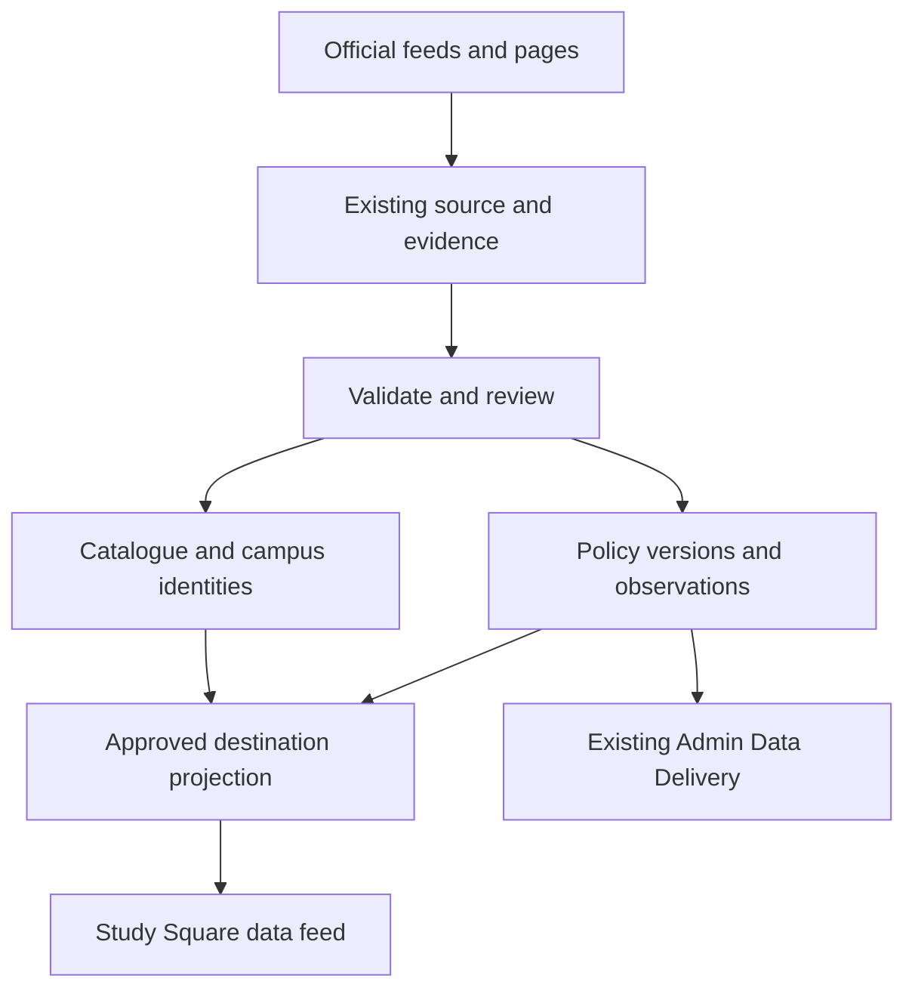

# StudySearch destination data design

**Version 1.0 · 11 November 2026 AEDT · Proposed production design · RM0–RM6**

## Scope and release order

Build **Study rules**, **Cities and costs**, and **Careers and labour market** once and configure them for all six destinations. Add official-source provider, campus and course integrations for the **UK, Ireland and USA**. Australia, Canada and New Zealand reuse their existing catalogue and publication paths. The scope includes data ingestion, verification, Admin operations and a versioned data handoff for Study Square.

| RM | Destination | Catalogue action | Production scope |
|---|---|---|---|
| RM0 | Shared foundation | Reuse L1–L4, identifiers, source/evidence, jobs and Data Delivery | Shared canonical tables, validators, refresh jobs and approved read model |
| RM1 | Australia · AU | Reuse CRICOS and provider facts | All three modules. Australia is the first production release and sets the acceptance fixtures. |
| RM2 | Canada · CA | Reuse Canadian catalogue and reconcile DLI/campus identities | All three modules. Preserve provincial coverage and programme-specific policy conditions. |
| RM3 | UK · GB | New catalogue adapter and first-party enrichment | Catalogue plus all three modules, covering all four nations under their applicable authorities |
| RM4 | New Zealand · NZ | Reuse NZQA and existing lifecycle paths | All three modules. Preserve dated qualification and provider transitions. |
| RM5 | Ireland · IE | New provider and programme adapters | Catalogue plus all three modules. Track Irish recognition and recruitment permissions independently. |
| RM6 | USA · US | New campus, institution and programme adapters | Catalogue plus all three modules. Use an approved set of institutions and campuses, with state/local coverage shown explicitly. |

Read-only production check on 11 November 2026 confirmed lifecycle-active provider/course counts of AU **1,540 / 25,380**, CA **1,130 / 3,814** and NZ **417 / 6,495**. GB, IE and US each returned **0 / 0**, and all six already had country references. These are active catalogue counts before eligibility, publication and country-release filtering. Confirm source-native counts independently for each release.

Study Square receives structured facts and official source links. The website team owns page design and editorial copy. Initial new-catalogue scope is internationally recruitable, full-time, physically attended degree programmes at bachelor level and above. Record explicit local exceptions in the country scope. Preserve catalogue coverage for pre-existing programmes. Full country-wide long-tail acquisition, rankings, outcomes and scholarships are outside this work package. The December handoff for fields already available via Website v2 remains a separate delivery slice of RM1.

## Existing foundations and proposed Supabase model

Reuse `ref.countries`, `ref.subdivisions`, `ref.currencies`, existing study-level references, `catalogue.providers`, `catalogue.provider_identifiers`, `catalogue.provider_registrations`, `catalogue.campuses`, `catalogue.courses`, `catalogue.course_registrations`, `catalogue.course_campuses`, `pipeline.city_regions`, `pipeline.sources`, `pipeline.evidence_artifacts`, `pipeline.evidence_entity_links`, `pipeline.important_dates`, `pipeline.statistics_dataset_registry` and `pipeline.statistics_edition_candidates`. Store only stable source and evidence references in the new fact rows. Leave shared identifiers and regulatory facts at their original canonical grain.

The following are proposed table names and logical keys. Migration work must match existing PK types, schema grants, lifecycle conventions and foreign-key naming in Pilot. Use an internal `destination` schema for cross-destination facts and the approved consumer projection. Keep import staging and operational records in the existing pipeline architecture.

| Proposed table | Grain and key | Essential fields and integrity |
|---|---|---|
| `destination.policy_rule` | One stable rule identity, unique on authority, jurisdiction, route and source-native rule key | Country, optional subdivision/locality, topic, route/scheme and legal authority. One route can have multiple authorities at different scopes. |
| `destination.policy_version` | One immutable rule version and applicability variant | Rule ID, canonical variant hash, typed value, effective date range, lifecycle and review status, legal instrument/locator, source/evidence, observed/reviewed/review-due dates, supersedes link. Preserve source text only where permitted. |
| `destination.locality` | One recognised locality; unique source-native gazetteer scheme + code | Country, subdivision, canonical name, locality type, optional centroid and parent geography, source and status. Use scoped aliases and reject ambiguous name-only joins. |
| `destination.campus_locality` | One dated locality association for an existing campus and mapping type | Campus, locality, mapping basis, validity and evidence. Populate through validated `pipeline.city_regions` and official geography mappings. |
| `destination.city_observation` | One measure per locality, dataset edition, observation grain and applicability scope | Discriminated climate/cost type. Climate carries station ID, measurement period or normal baseline and month/annual indicator. Costs carry basket/category, low/high, currency, billing interval, population and method. Keep provider/campus-specific estimates scoped to their source. |
| `destination.dataset_edition` | One admitted edition/revision of a registered statistical or climate/cost dataset | Registry key, publisher release ID, content hash, release/revision dates, coverage, classification versions, source, evidence and rights. Reuse the existing candidate workflow before admission. Revisions preserve history. |
| `destination.stat_dimension_member` | One native occupation, industry or statistical geography member per publisher classification and edition | Scheme, edition, native code, label, hierarchy, geography scope and source. Add evidence-backed links to country/subdivision/locality where an exact correspondence exists. |
| `destination.stat_crosswalk` | One versioned mapping from a native member to a comparable member | Source and target members, relationship type, optional published weight, applicability, confidence and evidence. Retain one-to-many mappings. |
| `destination.labour_observation` | One dataset edition, metric, statistical geography, occupation/industry, period, population and statistic | Numeric or categorical value, native unit/currency, pay period, base year and price basis where relevant, actual/estimate/forecast classification, forecast origin and horizon, suppression status and evidence. Use edition-scoped natural keys with explicit absent dimensions. |

If existing controlled source-native identifiers already meet a proposed dimension's key and lineage requirements, use that existing representation during migration design. New official register IDs, accreditation references and programme keys for GB/IE/US go into the existing catalogue structures or mappings. Store course study load and attendance mode independently where applicable. If the existing course/campus model lacks one of those semantics, propose the smallest additive canonical extension and verify whether its exposure needs G3 approval.

### Study rules

| Policy type | Required structure |
|---|---|
| Application and offer documents | Route, applicant class, application channel, conditional document requirement, issuer, procedural deadline and applicable date basis. Link procedural reminders to existing important dates. Distinguish programme offer, sponsorship/immigration document and proof of funds. |
| Fees and funds | Charge or requirement type, amount/range, currency, period or once-off basis, unit per person or household, family size, region and application route. Keep visa charges, other fees and minimum funds as separate metrics. |
| Processing | Route, jurisdiction/application location, snapshot date, statistic type, percentile or service standard where declared, window, units, source and expiry. A time estimate expires on its own freshness schedule. |
| Dependants and work | Separate principal/dependant scope, relationship, enrolment, course level, duration, attendance, work type, hours and period, term/break, authorisation requirements and exceptions. Use neutral route labels with evidence. |
| Minimum wage | Authority, geographic coverage, sector/age/worker category where relevant, effective date, currency and pay unit. Scope federal, provincial, state, territorial or municipal rules independently where source coverage supports them. |
| Post-study and residence | Route, transitional cutovers, relevant application/decision/commencement date, qualification, field or local programme code, institution/campus, nationality/residency and other source conditions. Model employer, authorisation and application requirements as conditional attributes. |

Store the condition expression as versioned, schema-validated JSON on the rule version, with typed operators and allowlisted keys. Support AND/OR groupings with bounded nesting, explicit inclusive/exclusive comparisons, ordered threshold cases and typed references to catalogue, geography and classification identities. Include the applicable date field explicitly. Use decimal amounts and interval units rather than parsing display text. Common search keys stay relational. A missing condition input produces `unknown` for that variant. The consumer feed returns sourced conditions and availability, without collecting applicant details or offering personalised eligibility decisions.

Use half-open effective ranges `[start, end)` for date-based rules. Store publication, observed, verification, review due and legal-effective dates separately. Treat a proposal as evidence-only and preserve future confirmed rules with a scheduled activation date. Define `expired`, `superseded` and `withdrawn` independently from an elapsed review date. Serialize activation by rule key and variant. Enforce non-overlap for concurrently publishable versions of the **same exact** authority/jurisdiction/route/variant. Compare cross-variant intersections and jurisdiction-specific precedence against golden scenarios. Where authority or exceptions are ambiguous, hold the conflicting scope and preserve unrelated valid facts. A late correction creates a superseding version plus audit history. Test both sides of each transition using local statutory date semantics. [PostgreSQL range types](https://www.postgresql.org/docs/current/rangetypes.html)

### Cities and costs

Start with the campus localities named in the approved source cohort and work outwards. Match each campus to an official locality or published statistical geography. Review ambiguous city names, campuses spanning regions and station proxies. Carry station ID, period and basis with any climate normal. Pin the station-selection methodology to the dataset edition, and make the station-to-city proxy explicit.

Publish recurring local cost ranges in their original currency and interval with basket categories and source period. Separate student budgets from price indices and an institution's cost-of-attendance estimate. Sum components only when geographic coverage, period, units, basket and population align. UK, NZ and Ireland workbook rows cite visa maintenance/funds pages for living costs. Admit those figures only as Study rules. Acquire distinct first-party student budget or official cost observations for Cities and costs. In the USA split IPEDS cost-of-attendance components before using any permitted student living-cost estimate. A missing Canadian city budget becomes an explicit source gap. Exclude tuition, visa fees and one-off relocation expenses from the recurring city basket.

### Careers and labour market

Load each official dataset at its published occupation/industry/geography grain. Metric vocabulary includes shortage classification, outlook, employment, earnings, vacancies and projections. Store base year, period, projection horizon, units and population exactly as applicable. Preserve source suppression, survey exclusions and published confidence/sampling measures where available. Use source-native codes in imports and output. Cross-destination comparisons require compatible statistical populations, time basis and documented crosswalks. Do not imply individual job prospects or visa eligibility from a series.

Route UK Temporary Shortage List, NZ Green List, Irish employment permit occupation lists and Canadian immigration category lists to Study rules, with native classification links where applicable. Admit JSA occupation shortages and equivalent evidenced statistical assessments to Careers. US O*NET Bright Outlook is an outlook indicator. Missing shortage data remains a coverage gap. Occupation pay observations remain distinct from legal wage floors.

## New catalogue adapters and country sources

| Adapter | Identity and source precedence | Admission proof |
|---|---|---|
| **GB** | Stage Home Office sponsor register independently from the provider identity. Map provider IDs such as UKPRN where the source attests the match. Confirm degree authority under the applicable UK nation. Source UG listings from Discover Uni where usable and PG, attendance and international fees from official provider pages. | Reconcile sponsor, provider, campus, course and international scope. Review name-only joins, partner campuses, expired sponsor records, non-university sponsors, and institutions outside England. [Home Office register](https://www.gov.uk/government/publications/register-of-licensed-sponsors-students) · [Discover Uni](https://discoveruni.gov.uk/information-providers/) |
| **IE** | Link stable provider and qualification/award IDs through QQI/IRQ and provider pages. Stage TrustEd provider authorisation and ILEP programme evidence separately. Associate programme, campus, awarding body, NFQ level and exact dated authorisation. | Test the applicable ILEP/TrustEd transition by effective date and scope. Review franchise arrangements, mergers and unmatched programme IDs. Retain a valid pathway only where the official source supports that programme and cohort. [Irish Register of Qualifications](https://www.qqi.ie/what-we-do/the-qualifications-system/irish-register-of-qualifications) · [TrustEd Ireland](https://www.trustedireland.ie/) · [ISD ILEP](https://www.irishimmigration.ie/coming-to-study-in-ireland/what-are-my-study-options/interim-list-of-eligible-programmes-ilep/) |
| **US** | Join DHS SEVP F-1 campus evidence, appropriate recognised accreditation from DAPIP and institution/credential context from IPEDS. Preserve SEVP campus IDs or stable source keys, IPEDS UNITID and accreditor identifiers where available. Use institution course/catalogue pages for actual current programmes, campuses, tuition and attendance. | Prove campus-level F-1 scope, relevant institutional accreditation and bachelor-or-higher offering separately. Review unmatched campuses and branch relationships. IPEDS CIP completions describe historical output. Require official programme evidence for a current listing and published classification evidence for any field-specific policy connection. [DHS School Search](https://studyinthestates.dhs.gov/school-search) · [DAPIP](https://ope.ed.gov/dapip/) · [NCES IPEDS](https://nces.ed.gov/IPEDS/use-the-data) |

Use the following authorities as the first source candidates. Source owners must confirm exact data grain, applicable authority, access terms and redistribution permission during integration. A listed source is a lead; published claims require dated supporting evidence.

| Country | Study rules | Climate and costs | Careers |
|---|---|---|---|
| AU | Home Affairs, legislation and Fair Work authorities. Verify regional pathways and cohort-specific concessions independently. | BOM normals and scoped official or institutional student budget estimates. | ABS OSCA and JSA occupations, shortages, employment and projections. [Home Affairs](https://immi.homeaffairs.gov.au/visas/getting-a-visa/visa-listing/student-500) · [Fair Work](https://www.fairwork.gov.au/pay-and-wages/minimum-wages) · [BOM](https://www.bom.gov.au/climate/averages/) · [JSA](https://www.jobsandskills.gov.au/data) |
| CA | IRCC DLI and study permit/PGWP sources, with provincial/territorial employment authority for wage facts. | ECCC station normals and dated local student budgets. | NOC, Statistics Canada, Job Bank and COPS. [IRCC DLI](https://www.canada.ca/en/immigration-refugees-citizenship/services/study-canada/study-permit/prepare/designated-learning-institutions-list.html) · [ECCC](https://climate.weather.gc.ca/climate_normals/) · [Job Bank](https://www.jobbank.gc.ca/trend-analysis) |
| GB | Home Office Immigration Rules, application and graduate route pages, plus applicable wage authority. | Met Office station normals and verified provider/local student budgets. | ONS SOC, ASHE and regional employment, plus official projections. [Student visa](https://www.gov.uk/student-visa) · [Met Office](https://www.metoffice.gov.uk/research/climate/maps-and-data/climate-averages) · [ONS labour market](https://www.ons.gov.uk/employmentandlabourmarket) |
| NZ | Immigration NZ, NZQA source links where relevant and Employment NZ wage material. | Cliflo/official climate releases and scoped tertiary budgets. | Stats NZ native classifications, MBIE vacancy and projection data, Tahatū earnings with stated methodology. [Immigration NZ](https://www.immigration.govt.nz/study/after-you-finish-your-study/staying-to-work-after-finishing-your-study/) · [Cliflo](https://cliflo.niwa.co.nz/) · [MBIE](https://www.mbie.govt.nz/business-and-employment/employment-and-skills/labour-market-reports-data-and-analysis/) |
| IE | Irish Immigration Service, employment permit authority and statutory minimum wage sources. | Met Éireann normals and institutional or official student budgets. | SOLAS National Skills Bulletin and CSO occupation, industry, pay and employment data. [Irish Immigration Service](https://www.irishimmigration.ie/coming-to-study-in-ireland/) · [Met Éireann dataset](https://data.gov.ie/dataset/met-eireann-1991-2020-climate-averages) · [CSO data](https://data.cso.ie/) |
| US | State Department, DHS, USCIS and effective legal text. Verify federal and applicable state/local wage scopes. | NOAA normals, IPEDS components and scoped institutional budgets. | BLS SOC/OEWS/projections and O*NET outlook; use state and metro grains as published. [State Department](https://travel.state.gov/content/travel/en/us-visas/study/student-visa.html) · [NOAA normals](https://www.ncei.noaa.gov/products/land-based-station/us-climate-normals) · [BLS OEWS](https://www.bls.gov/oes/) |

## Ingest, review and publish

1. **Register the source.** Record publisher, canonical URL, dataset key and scope, cadence, rights for access/storage/redistribution, extraction method and freshness thresholds using existing source/configuration controls. Use official bulk files and APIs first, then direct HTML/PDF. Meter any approved Firecrawl/Parse fallback and AI extraction in the existing toolset budget. AI may suggest a candidate; publication-sensitive legal interpretation and ambiguous identity require the appropriate human review.
2. **Capture and stage.** Store permitted compressed bytes in the existing private evidence bucket with relative object paths. Retain hash, headers, parser version, source locator, timestamps and edition/import IDs. Reuse unchanged captures. If terms bar capture or redistribution, honour the rights mode and keep only permitted metadata or links. Replays use stable source ID, edition/revision, native row key and input hash. Retry after bounded backoff and retain the last accepted generation.
3. **Validate and admit.** Validate required scopes, units, effective dates, expected source membership, duplicate keys, source coverage and release-to-release count changes. Quarantine parse drift, unresolved joins, overlapping rules and large coverage changes. Review high-impact immigration, wage, funding, citizenship and expiry changes in the authorised existing review flow. Commit one accepted import edition or small resumable batch atomically. A partial fetch never retires missing catalogue rows. Only a complete authorised registry reconciliation can propose a lifecycle change.
4. **Refresh the consumer projection.** Generate indexed, revisioned outputs scoped to country/module with the last authorised generation remaining readable during rebuild. Publish a new generation only after completeness and permission checks. Withdraw a known-invalid fact immediately at the serving layer and purge the matching Worker cache. Keep recoverable prior generations subject to freshness, correctness and expiry checks.
5. **Verify and observe.** Reconcile staged, accepted and published counts to real HTTP read-back and cache across the authorised consumer. Surface denominators, missing/held reasons, changed and withdrawn values, last good source edition, review deadline, refresh health, cost and freshness in existing Data Delivery. Use targeted first-run verification, genuine outage/timeout recovery and two unattended cycles. Prioritise actionable issues using existing fingerprints and queues. [F-OPS acceptance](../../platform/STUDYSEARCH-FEATURE-ACCEPTANCE.md)

Initial cadence targets are daily source-change checks for high-impact policy and registries, weekly or term-aware provider verification, and release-based observation updates. Configure cadence, publication rights, freshness, coverage guardrails and batch/byte limits through existing controls. Keep processing snapshots shorter-lived than static climate normals. Recheck source tiers and performance after RM1/RM2. Use btree indexes for canonical join keys and country/edition reads, partial indexes for current publishable facts where measured, and range indexing for date overlap checks. Validate high-volume query plans and avoid synchronous country-wide scans. Run large transformations in bounded workers or database batches.

### Consumer contract and access

Reuse the existing Cloudflare and Supabase deployment paths. For new facts, propose a separate versioned destination read interface under existing G3 controls, with country/module selectors, cursor paging, generation/revision, source attribution, jurisdiction and measure metadata. A compact destination summary can point to separate policy, city and careers collections. Status values distinguish `available`, `not_available`, `under_review`, `stale` and `not_applicable`. Return a dated last-known observation only if the module's freshness contract permits it and label it. Suppress expired or withdrawn policy from current results. Publish material numbers in their native unit and currency. Preserve existing Website v2 and Zoho API contracts, with ordinary catalogue data published only through the established approved paths.

Private schema access defaults to internal roles. Publish only the approved read projection through the existing server/Worker boundary with least privilege, bounded response sizes and permissions tests. No broad anon/authenticated table grants, raw evidence links, private snapshot payloads or applicant inputs. Separate read and mutation privileges, use existing audit logging, and verify direct Data API denial for internal tables. [Supabase custom schemas](https://supabase.com/docs/guides/api/using-custom-schemas)

## Implementation sequence and acceptance

| Order | Implementation slice | Release evidence |
|---|---|---|
| 1 | RM0 schema/source/review fixtures, then RM1 Australia. First implementation is an official-source AU policy version, an AU campus climate normal and one JSA statistical edition through the existing evidence path. Add the remaining AU feature coverage within RM1. | Replay without duplicates; effective-date cutover, conflicting-source hold and withdrawal; city/station match and native units; shortage/visa-list separation; Admin and authorised consumer read-back. |
| 2 | RM2 Canada on existing catalogue. Implement provincial scope, programme/CIP matching and local budget coverage. | DLI and course match reconciliation; partial programme eligibility and missing CIP cases; provincial wage versus federal rule; date-bound cutover; blank city cost source reported. |
| 3 | RM3 GB adapters and modules; RM4 NZ modules on existing catalogue. | GB sponsor, provider and campus matches across four nations with UG/PG separation; London/non-London fund scope and wage bands. NZ qualification-specific and future/current pathway checks, local cost estimates and provider succession. |
| 4 | RM5 Ireland adapters and modules; RM6 USA adapters and modules. | Ireland programme/provider authorisation transition, NFQ and local costs. USA three-source join, distinct campus/parent identities, F-1 programme evidence, separate fee types, proposal-vs-effective handling, and native regional labour codes. |

For each country, record source-edition and target cohort counts, coverage by feature and geography, identity exceptions, quantitative publication gains, source authority review, golden scenario results, two unattended refreshes, a replay/partial-failure test and authenticated consumer read-back after publish/withdraw. For new catalogues report candidate, matched, rejected, active and published counts by entity grain. Validate that hidden or retired records and unsupported policy values stay out of public results. Verify controller-owned migrations, QA, production readiness and approved release under the existing model. Reuse F-DISC for adapter outcomes and F-OPS.02, .03A and .07 for first-run, observability and release proof. Record linked work and evidence in the existing Execution Register. This is a design record and proposed sequence. [Operating model](../../platform/AGENT-OPERATING-MODEL.md) · [Execution Register](../../platform/STUDYSEARCH-EXECUTION-REGISTER.md)

### Engineering and capacity allowance

| RM | Study rules | Cities and costs | Careers | Catalogue | Shared or release integration | Total eng h | Review/QA h |
|---|---:|---:|---:|---:|---:|---:|---:|
| RM0 | 128 | 70 | 110 | 48 | 64 | 420 | 24 |
| RM1 AU | 38 | 18 | 32 | 0 | 10 | 98 | 24 |
| RM2 CA | 55 | 20 | 40 | 0 | 10 | 125 | 28 |
| RM3 GB | 42 | 18 | 32 | 120 | 10 | 222 | 32 |
| RM4 NZ | 40 | 14 | 22 | 0 | 10 | 86 | 20 |
| RM5 IE | 32 | 14 | 22 | 66 | 10 | 144 | 24 |
| RM6 US | 58 | 28 | 54 | 170 | 10 | 320 | 36 |
| **Total** | **393** | **182** | **312** | **404** | **124** | **1,415** | **188** |

The 887 module hours reuse the roadmap estimates for RM0 and these six countries. The GB/IE/US catalogue estimates carry forward the roadmap lane allowances. Shared catalogue work, integration and review hours are scoped planning assumptions for this package. The estimate is a subset and refinement of the broader roadmap, with overlap reconciled before funding. At A$150/engineering hour and A$95/review hour, plus 25% contingency, allow **A$287,638 excluding GST** for labour. At 56 engineering hours per week, the effort is about **25 engineering weeks** before external lead times. Vendor usage, licensing, any separately procured specialist advice and website development require separate allowance.

Reuse the previous capacity model for the first six roadmap destinations as an initial envelope. The live baseline was **5.42 GB logical Postgres** and **30.69 GB objects**. Its six-destination model adds 90,500 course rows, 311,000 other observations and 129,600 retained captures. At 50 kB indexed per course, 2 kB per observation, 7 kB metadata and 220 kB object data per capture, that gives about **11.47 GB logical Postgres** and **59.20 GB objects**. The 30% headroom envelope is about **15 GB provisioned disk and 77 GB object storage**, subject to physical disk, WAL/temp use, backup/restore and organisation-wide quota checks. The model includes broader catalogue volumes from the roadmap. Measure actual object sizes, index growth, storage by bucket, throughput and database pressure after the first two releases. Use existing Medium compute as the starting point and scale on measured demand. [Roadmap capacity baseline](../../platform/nz-enrichment-brief/2026-11-11-studysearch-destination-roadmap.md) · [Supabase compute and disk](https://supabase.com/docs/guides/platform/compute-and-disk)

## Design references

- [Destination roadmap and source workbook reconciliation](../../platform/nz-enrichment-brief/2026-11-11-studysearch-destination-roadmap.md)
- [Accepted database architecture v2.10.50](../../coursefinder-database-architecture-v2.10.50.md) · [Pipeline lineage](../../platform/PIPELINE-LINEAGE.md)
- [Feature acceptance](../../platform/STUDYSEARCH-FEATURE-ACCEPTANCE.md) · [Website developer requirements](../../integrations/WEBSITE-DEVELOPER-REQUIREMENTS.md)
