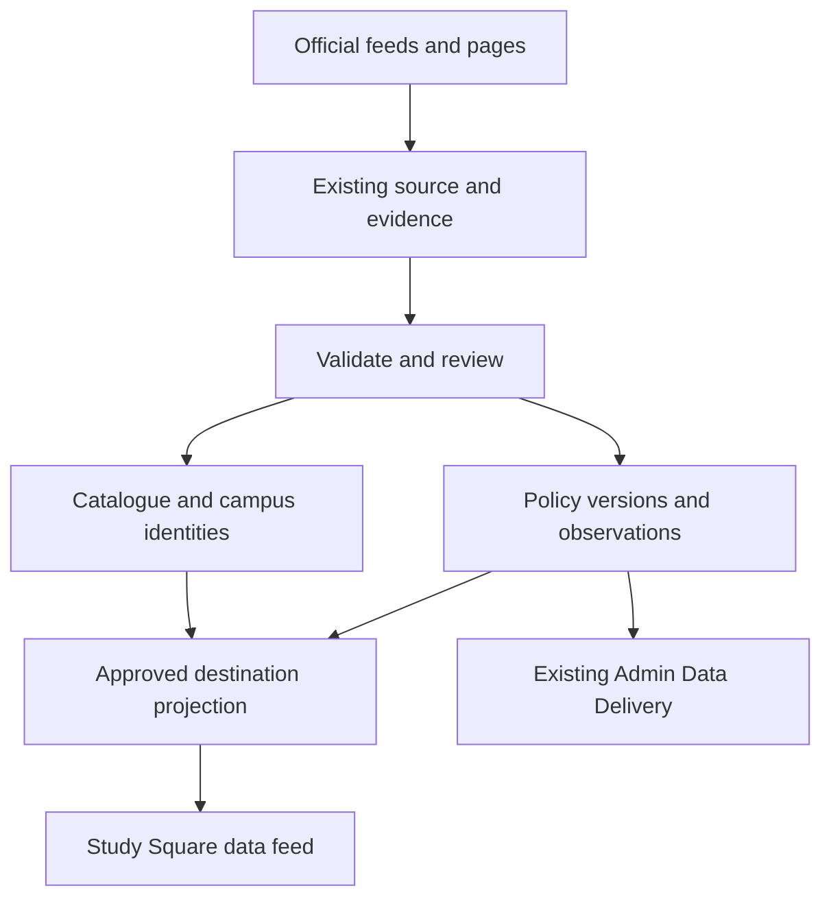
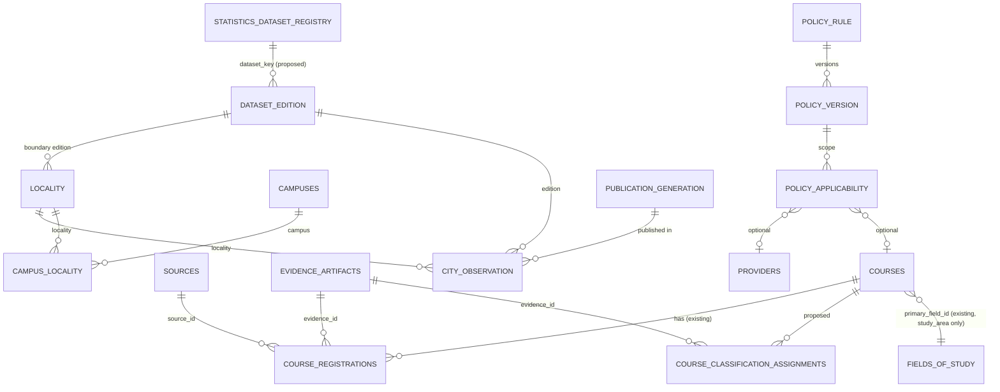

# StudySearch destination data design

**Version 1.1 · 13 November 2026 AEDT · Proposed production design · RM0–RM6** (v1.1 adds the [S1-RM-Design database design and v3 handoffs](#s1-rm-design--database-design-and-v3-delivery-handoffs-13-november-2026); v1.0, 11 November 2026)

## Scope and release order

Build **Study rules**, **Cities and costs**, and **Careers and labour market** once and configure them for all six destinations. Add official-source provider, campus and course integrations for the **UK, Ireland and USA**. Australia, Canada and New Zealand reuse their existing catalogue and publication paths. The scope includes data ingestion, verification, Admin operations and a versioned data handoff for Study Square.

| RM | Destination | Catalogue action | Production scope |
|---|---|---|---|
| RM0 | Shared foundation | Reuse L1–L4, identifiers, source/evidence, jobs and Data Delivery | Shared canonical tables, validators, refresh jobs and approved read model |
| RM1 | Australia · AU | Reuse CRICOS and provider facts | All three modules. Australia is the first production release and sets the acceptance fixtures. |
| RM2 | Canada · CA | Reuse Canadian catalogue and reconcile DLI/campus identities | All three modules. Preserve provincial coverage and programme-specific policy conditions. |
| RM3 | UK · GB | New catalogue adapter and first-party enrichment | Catalogue plus all three modules, covering all four nations under their applicable authorities |
| RM4 | New Zealand · NZ | Reuse NZQA and existing lifecycle paths | All three modules. Preserve dated qualification and provider transitions. |
| RM5 | Ireland · IE | New provider and programme adapters | Catalogue plus all three modules. Track Irish recognition and recruitment permissions independently. |
| RM6 | USA · US | New campus, institution and programme adapters | Catalogue plus all three modules. Use an approved set of institutions and campuses, with state/local coverage shown explicitly. |

Read-only production check on 11 November 2026 confirmed lifecycle-active provider/course counts of AU **1,540 / 25,380**, CA **1,130 / 3,814** and NZ **417 / 6,495**. GB, IE and US each returned **0 / 0**, and all six already had country references. These are active catalogue counts before eligibility, publication and country-release filtering. Confirm source-native counts independently for each release.

Study Square receives structured facts and official source links. The website team owns page design and editorial copy. Initial new-catalogue scope is internationally recruitable, full-time, physically attended degree programmes at bachelor level and above. Record explicit local exceptions in the country scope. Preserve catalogue coverage for pre-existing programmes. Full country-wide long-tail acquisition, rankings, outcomes and scholarships are outside this work package. The December handoff for fields already available via Website v2 remains a separate delivery slice of RM1.

## Existing foundations and proposed Supabase model

Reuse `ref.countries`, `ref.subdivisions`, `ref.currencies`, existing study-level references, `catalogue.providers`, `catalogue.provider_identifiers`, `catalogue.provider_registrations`, `catalogue.campuses`, `catalogue.courses`, `catalogue.course_registrations`, `catalogue.course_campuses`, `pipeline.city_regions`, `pipeline.sources`, `pipeline.evidence_artifacts`, `pipeline.evidence_entity_links`, `pipeline.important_dates`, `pipeline.statistics_dataset_registry` and `pipeline.statistics_edition_candidates`. Store only stable source and evidence references in the new fact rows. Leave shared identifiers and regulatory facts at their original canonical grain.

The following are proposed table names and logical keys. Migration work must match existing PK types, schema grants, lifecycle conventions and foreign-key naming in Pilot. Use an internal `destination` schema for cross-destination facts and the approved consumer projection. Keep import staging and operational records in the existing pipeline architecture.

| Proposed table | Grain and key | Essential fields and integrity |
|---|---|---|
| `destination.policy_rule` | One stable rule identity, unique on authority, jurisdiction, route and source-native rule key | Country, optional subdivision/locality, topic, route/scheme and legal authority. One route can have multiple authorities at different scopes. |
| `destination.policy_version` | One immutable rule version and applicability variant | Rule ID, canonical variant hash, typed value, effective date range, lifecycle and review status, legal instrument/locator, source/evidence, observed/reviewed/review-due dates, supersedes link. Preserve source text only where permitted. |
| `destination.locality` | One recognised locality; unique source-native gazetteer scheme + code | Country, subdivision, canonical name, locality type, optional centroid and parent geography, source and status. Use scoped aliases and reject ambiguous name-only joins. |
| `destination.campus_locality` | One dated locality association for an existing campus and mapping type | Campus, locality, mapping basis, validity and evidence. Populate through validated `pipeline.city_regions` and official geography mappings. |
| `destination.city_observation` | One measure per locality, dataset edition, observation grain and applicability scope | Discriminated climate/cost type. Climate carries station ID, measurement period or normal baseline and month/annual indicator. Costs carry basket/category, low/high, currency, billing interval, population and method. Keep provider/campus-specific estimates scoped to their source. |
| `destination.dataset_edition` | One admitted edition/revision of a registered statistical or climate/cost dataset | Registry key, publisher release ID, content hash, release/revision dates, coverage, classification versions, source, evidence and rights. Reuse the existing candidate workflow before admission. Revisions preserve history. |
| `destination.stat_dimension_member` | One native occupation, industry or statistical geography member per publisher classification and edition | Scheme, edition, native code, label, hierarchy, geography scope and source. Add evidence-backed links to country/subdivision/locality where an exact correspondence exists. |
| `destination.stat_crosswalk` | One versioned mapping from a native member to a comparable member | Source and target members, relationship type, optional published weight, applicability, confidence and evidence. Retain one-to-many mappings. |
| `destination.labour_observation` | One dataset edition, metric, statistical geography, occupation/industry, period, population and statistic | Numeric or categorical value, native unit/currency, pay period, base year and price basis where relevant, actual/estimate/forecast classification, forecast origin and horizon, suppression status and evidence. Use edition-scoped natural keys with explicit absent dimensions. |

If existing controlled source-native identifiers already meet a proposed dimension's key and lineage requirements, use that existing representation during migration design. New official register IDs, accreditation references and programme keys for GB/IE/US go into the existing catalogue structures or mappings. Store course study load and attendance mode independently where applicable. If the existing course/campus model lacks one of those semantics, propose the smallest additive canonical extension and verify whether its exposure needs G3 approval.



### Study rules

| Policy type | Required structure |
|---|---|
| Application and offer documents | Route, applicant class, application channel, conditional document requirement, issuer, procedural deadline and applicable date basis. Link procedural reminders to existing important dates. Distinguish programme offer, sponsorship/immigration document and proof of funds. |
| Fees and funds | Charge or requirement type, amount/range, currency, period or once-off basis, unit per person or household, family size, region and application route. Keep visa charges, other fees and minimum funds as separate metrics. |
| Processing | Route, jurisdiction/application location, snapshot date, statistic type, percentile or service standard where declared, window, units, source and expiry. A time estimate expires on its own freshness schedule. |
| Dependants and work | Separate principal/dependant scope, relationship, enrolment, course level, duration, attendance, work type, hours and period, term/break, authorisation requirements and exceptions. Use neutral route labels with evidence. |
| Minimum wage | Authority, geographic coverage, sector/age/worker category where relevant, effective date, currency and pay unit. Scope federal, provincial, state, territorial or municipal rules independently where source coverage supports them. |
| Post-study and residence | Route, transitional cutovers, relevant application/decision/commencement date, qualification, field or local programme code, institution/campus, nationality/residency and other source conditions. Model employer, authorisation and application requirements as conditional attributes. |

Store the condition expression as versioned, schema-validated JSON on the rule version, with typed operators and allowlisted keys. Support AND/OR groupings with bounded nesting, explicit inclusive/exclusive comparisons, ordered threshold cases and typed references to catalogue, geography and classification identities. Include the applicable date field explicitly. Use decimal amounts and interval units rather than parsing display text. Common search keys stay relational. A missing condition input produces `unknown` for that variant. The consumer feed returns sourced conditions and availability, without collecting applicant details or offering personalised eligibility decisions.

Use half-open effective ranges `[start, end)` for date-based rules. Store publication, observed, verification, review due and legal-effective dates separately. Treat a proposal as evidence-only and preserve future confirmed rules with a scheduled activation date. Define `expired`, `superseded` and `withdrawn` independently from an elapsed review date. Serialize activation by rule key and variant. Enforce non-overlap for concurrently publishable versions of the **same exact** authority/jurisdiction/route/variant. Compare cross-variant intersections and jurisdiction-specific precedence against golden scenarios. Where authority or exceptions are ambiguous, hold the conflicting scope and preserve unrelated valid facts. A late correction creates a superseding version plus audit history. Test both sides of each transition using local statutory date semantics. [PostgreSQL range types](https://www.postgresql.org/docs/current/rangetypes.html)

### Cities and costs

Start with the campus localities named in the approved source cohort and work outwards. Match each campus to an official locality or published statistical geography. Review ambiguous city names, campuses spanning regions and station proxies. Carry station ID, period and basis with any climate normal. Pin the station-selection methodology to the dataset edition, and make the station-to-city proxy explicit.

Publish recurring local cost ranges in their original currency and interval with basket categories and source period. Separate student budgets from price indices and an institution's cost-of-attendance estimate. Sum components only when geographic coverage, period, units, basket and population align. UK, NZ and Ireland workbook rows cite visa maintenance/funds pages for living costs. Admit those figures only as Study rules. Acquire distinct first-party student budget or official cost observations for Cities and costs. In the USA split IPEDS cost-of-attendance components before using any permitted student living-cost estimate. A missing Canadian city budget becomes an explicit source gap. Exclude tuition, visa fees and one-off relocation expenses from the recurring city basket.

### Careers and labour market

Load each official dataset at its published occupation/industry/geography grain. Metric vocabulary includes shortage classification, outlook, employment, earnings, vacancies and projections. Store base year, period, projection horizon, units and population exactly as applicable. Preserve source suppression, survey exclusions and published confidence/sampling measures where available. Use source-native codes in imports and output. Cross-destination comparisons require compatible statistical populations, time basis and documented crosswalks. Do not imply individual job prospects or visa eligibility from a series.

Route UK Temporary Shortage List, NZ Green List, Irish employment permit occupation lists and Canadian immigration category lists to Study rules, with native classification links where applicable. Admit JSA occupation shortages and equivalent evidenced statistical assessments to Careers. US O*NET Bright Outlook is an outlook indicator. Missing shortage data remains a coverage gap. Occupation pay observations remain distinct from legal wage floors.

## New catalogue adapters and country sources

| Adapter | Identity and source precedence | Admission proof |
|---|---|---|
| **GB** | Stage Home Office sponsor register independently from the provider identity. Map provider IDs such as UKPRN where the source attests the match. Confirm degree authority under the applicable UK nation. Source UG listings from Discover Uni where usable and PG, attendance and international fees from official provider pages. | Reconcile sponsor, provider, campus, course and international scope. Review name-only joins, partner campuses, expired sponsor records, non-university sponsors, and institutions outside England. [Home Office register](https://www.gov.uk/government/publications/register-of-licensed-sponsors-students) · [Discover Uni](https://discoveruni.gov.uk/information-providers/) |
| **IE** | Link stable provider and qualification/award IDs through QQI/IRQ and provider pages. Stage TrustEd provider authorisation and ILEP programme evidence separately. Associate programme, campus, awarding body, NFQ level and exact dated authorisation. | Test the applicable ILEP/TrustEd transition by effective date and scope. Review franchise arrangements, mergers and unmatched programme IDs. Retain a valid pathway only where the official source supports that programme and cohort. [Irish Register of Qualifications](https://www.qqi.ie/what-we-do/the-qualifications-system/irish-register-of-qualifications) · [TrustEd Ireland](https://www.trustedireland.ie/) · [ISD ILEP](https://www.irishimmigration.ie/coming-to-study-in-ireland/what-are-my-study-options/interim-list-of-eligible-programmes-ilep/) |
| **US** | Join DHS SEVP F-1 campus evidence, appropriate recognised accreditation from DAPIP and institution/credential context from IPEDS. Preserve SEVP campus IDs or stable source keys, IPEDS UNITID and accreditor identifiers where available. Use institution course/catalogue pages for actual current programmes, campuses, tuition and attendance. | Prove campus-level F-1 scope, relevant institutional accreditation and bachelor-or-higher offering separately. Review unmatched campuses and branch relationships. IPEDS CIP completions describe historical output. Require official programme evidence for a current listing and published classification evidence for any field-specific policy connection. [DHS School Search](https://studyinthestates.dhs.gov/school-search) · [DAPIP](https://ope.ed.gov/dapip/) · [NCES IPEDS](https://nces.ed.gov/IPEDS/use-the-data) |

Use the following authorities as the first source candidates. Source owners must confirm exact data grain, applicable authority, access terms and redistribution permission during integration. A listed source is a lead; published claims require dated supporting evidence.

| Country | Study rules | Climate and costs | Careers |
|---|---|---|---|
| AU | Home Affairs, legislation and Fair Work authorities. Verify regional pathways and cohort-specific concessions independently. | BOM normals and scoped official or institutional student budget estimates. | ABS OSCA and JSA occupations, shortages, employment and projections. [Home Affairs](https://immi.homeaffairs.gov.au/visas/getting-a-visa/visa-listing/student-500) · [Fair Work](https://www.fairwork.gov.au/pay-and-wages/minimum-wages) · [BOM](https://www.bom.gov.au/climate/averages/) · [JSA](https://www.jobsandskills.gov.au/data) |
| CA | IRCC DLI and study permit/PGWP sources, with provincial/territorial employment authority for wage facts. | ECCC station normals and dated local student budgets. | NOC, Statistics Canada, Job Bank and COPS. [IRCC DLI](https://www.canada.ca/en/immigration-refugees-citizenship/services/study-canada/study-permit/prepare/designated-learning-institutions-list.html) · [ECCC](https://climate.weather.gc.ca/climate_normals/) · [Job Bank](https://www.jobbank.gc.ca/trend-analysis) |
| GB | Home Office Immigration Rules, application and graduate route pages, plus applicable wage authority. | Met Office station normals and verified provider/local student budgets. | ONS SOC, ASHE and regional employment, plus official projections. [Student visa](https://www.gov.uk/student-visa) · [Met Office](https://www.metoffice.gov.uk/research/climate/maps-and-data/climate-averages) · [ONS labour market](https://www.ons.gov.uk/employmentandlabourmarket) |
| NZ | Immigration NZ, NZQA source links where relevant and Employment NZ wage material. | Cliflo/official climate releases and scoped tertiary budgets. | Stats NZ native classifications, MBIE vacancy and projection data, Tahatū earnings with stated methodology. [Immigration NZ](https://www.immigration.govt.nz/study/after-you-finish-your-study/staying-to-work-after-finishing-your-study/) · [Cliflo](https://cliflo.niwa.co.nz/) · [MBIE](https://www.mbie.govt.nz/business-and-employment/employment-and-skills/labour-market-reports-data-and-analysis/) |
| IE | Irish Immigration Service, employment permit authority and statutory minimum wage sources. | Met Éireann normals and institutional or official student budgets. | SOLAS National Skills Bulletin and CSO occupation, industry, pay and employment data. [Irish Immigration Service](https://www.irishimmigration.ie/coming-to-study-in-ireland/) · [Met Éireann dataset](https://data.gov.ie/dataset/met-eireann-1991-2020-climate-averages) · [CSO data](https://data.cso.ie/) |
| US | State Department, DHS, USCIS and effective legal text. Verify federal and applicable state/local wage scopes. | NOAA normals, IPEDS components and scoped institutional budgets. | BLS SOC/OEWS/projections and O*NET outlook; use state and metro grains as published. [State Department](https://travel.state.gov/content/travel/en/us-visas/study/student-visa.html) · [NOAA normals](https://www.ncei.noaa.gov/products/land-based-station/us-climate-normals) · [BLS OEWS](https://www.bls.gov/oes/) |

## Ingest, review and publish

1. **Register the source.** Record publisher, canonical URL, dataset key and scope, cadence, rights for access/storage/redistribution, extraction method and freshness thresholds using existing source/configuration controls. Use official bulk files and APIs first, then direct HTML/PDF. Meter any approved Firecrawl/Parse fallback and AI extraction in the existing toolset budget. AI may suggest a candidate; publication-sensitive legal interpretation and ambiguous identity require the appropriate human review.
2. **Capture and stage.** Store permitted compressed bytes in the existing private evidence bucket with relative object paths. Retain hash, headers, parser version, source locator, timestamps and edition/import IDs. Reuse unchanged captures. If terms bar capture or redistribution, honour the rights mode and keep only permitted metadata or links. Replays use stable source ID, edition/revision, native row key and input hash. Retry after bounded backoff and retain the last accepted generation.
3. **Validate and admit.** Validate required scopes, units, effective dates, expected source membership, duplicate keys, source coverage and release-to-release count changes. Quarantine parse drift, unresolved joins, overlapping rules and large coverage changes. Review high-impact immigration, wage, funding, citizenship and expiry changes in the authorised existing review flow. Commit one accepted import edition or small resumable batch atomically. A partial fetch never retires missing catalogue rows. Only a complete authorised registry reconciliation can propose a lifecycle change.
4. **Refresh the consumer projection.** Generate indexed, revisioned outputs scoped to country/module with the last authorised generation remaining readable during rebuild. Publish a new generation only after completeness and permission checks. Withdraw a known-invalid fact immediately at the serving layer and purge the matching Worker cache. Keep recoverable prior generations subject to freshness, correctness and expiry checks.
5. **Verify and observe.** Reconcile staged, accepted and published counts to real HTTP read-back and cache across the authorised consumer. Surface denominators, missing/held reasons, changed and withdrawn values, last good source edition, review deadline, refresh health, cost and freshness in existing Data Delivery. Use targeted first-run verification, genuine outage/timeout recovery and two unattended cycles. Prioritise actionable issues using existing fingerprints and queues. [F-OPS acceptance](../../platform/STUDYSEARCH-FEATURE-ACCEPTANCE.md)

Initial cadence targets are daily source-change checks for high-impact policy and registries, weekly or term-aware provider verification, and release-based observation updates. Configure cadence, publication rights, freshness, coverage guardrails and batch/byte limits through existing controls. Keep processing snapshots shorter-lived than static climate normals. Recheck source tiers and performance after RM1/RM2. Use btree indexes for canonical join keys and country/edition reads, partial indexes for current publishable facts where measured, and range indexing for date overlap checks. Validate high-volume query plans and avoid synchronous country-wide scans. Run large transformations in bounded workers or database batches.

### Consumer contract and access

Reuse the existing Cloudflare and Supabase deployment paths. For new facts, propose a separate versioned destination read interface under existing G3 controls, with country/module selectors, cursor paging, generation/revision, source attribution, jurisdiction and measure metadata. A compact destination summary can point to separate policy, city and careers collections. Status values distinguish `available`, `not_available`, `under_review`, `stale` and `not_applicable`. Return a dated last-known observation only if the module's freshness contract permits it and label it. Suppress expired or withdrawn policy from current results. Publish material numbers in their native unit and currency. Preserve existing Website v2 and Zoho API contracts, with ordinary catalogue data published only through the established approved paths.

Private schema access defaults to internal roles. Publish only the approved read projection through the existing server/Worker boundary with least privilege, bounded response sizes and permissions tests. No broad anon/authenticated table grants, raw evidence links, private snapshot payloads or applicant inputs. Separate read and mutation privileges, use existing audit logging, and verify direct Data API denial for internal tables. [Supabase custom schemas](https://supabase.com/docs/guides/api/using-custom-schemas)

## Implementation sequence and acceptance

| Order | Implementation slice | Release evidence |
|---|---|---|
| 1 | RM0 schema/source/review fixtures, then RM1 Australia. First implementation is an official-source AU policy version, an AU campus climate normal and one JSA statistical edition through the existing evidence path. Add the remaining AU feature coverage within RM1. | Replay without duplicates; effective-date cutover, conflicting-source hold and withdrawal; city/station match and native units; shortage/visa-list separation; Admin and authorised consumer read-back. |
| 2 | RM2 Canada on existing catalogue. Implement provincial scope, programme/CIP matching and local budget coverage. | DLI and course match reconciliation; partial programme eligibility and missing CIP cases; provincial wage versus federal rule; date-bound cutover; blank city cost source reported. |
| 3 | RM3 GB adapters and modules; RM4 NZ modules on existing catalogue. | GB sponsor, provider and campus matches across four nations with UG/PG separation; London/non-London fund scope and wage bands. NZ qualification-specific and future/current pathway checks, local cost estimates and provider succession. |
| 4 | RM5 Ireland adapters and modules; RM6 USA adapters and modules. | Ireland programme/provider authorisation transition, NFQ and local costs. USA three-source join, distinct campus/parent identities, F-1 programme evidence, separate fee types, proposal-vs-effective handling, and native regional labour codes. |

For each country, record source-edition and target cohort counts, coverage by feature and geography, identity exceptions, quantitative publication gains, source authority review, golden scenario results, two unattended refreshes, a replay/partial-failure test and authenticated consumer read-back after publish/withdraw. For new catalogues report candidate, matched, rejected, active and published counts by entity grain. Validate that hidden or retired records and unsupported policy values stay out of public results. Verify controller-owned migrations, QA, production readiness and approved release under the existing model. Reuse F-DISC for adapter outcomes and F-OPS.02, .03A and .07 for first-run, observability and release proof. Record linked work and evidence in the existing Execution Register. This is a design record and proposed sequence. [Operating model](../../platform/AGENT-OPERATING-MODEL.md) · [Execution Register](../../platform/STUDYSEARCH-EXECUTION-REGISTER.md)

### Engineering and capacity allowance

| RM | Study rules | Cities and costs | Careers | Catalogue | Shared or release integration | Total eng h | Review/QA h |
|---|---:|---:|---:|---:|---:|---:|---:|
| RM0 | 128 | 70 | 110 | 48 | 64 | 420 | 24 |
| RM1 AU | 38 | 18 | 32 | 0 | 10 | 98 | 24 |
| RM2 CA | 55 | 20 | 40 | 0 | 10 | 125 | 28 |
| RM3 GB | 42 | 18 | 32 | 120 | 10 | 222 | 32 |
| RM4 NZ | 40 | 14 | 22 | 0 | 10 | 86 | 20 |
| RM5 IE | 32 | 14 | 22 | 66 | 10 | 144 | 24 |
| RM6 US | 58 | 28 | 54 | 170 | 10 | 320 | 36 |
| **Total** | **393** | **182** | **312** | **404** | **124** | **1,415** | **188** |

The 887 module hours reuse the roadmap estimates for RM0 and these six countries. The GB/IE/US catalogue estimates carry forward the roadmap lane allowances. Shared catalogue work, integration and review hours are scoped planning assumptions for this package. The estimate is a subset and refinement of the broader roadmap, with overlap reconciled before funding. At A$150/engineering hour and A$95/review hour, plus 25% contingency, allow **A$287,638 excluding GST** for labour. At 56 engineering hours per week, the effort is about **25 engineering weeks** before external lead times. Vendor usage, licensing, any separately procured specialist advice and website development require separate allowance.

Reuse the previous capacity model for the first six roadmap destinations as an initial envelope. The live baseline was **5.42 GB logical Postgres** and **30.69 GB objects**. Its six-destination model adds 90,500 course rows, 311,000 other observations and 129,600 retained captures. At 50 kB indexed per course, 2 kB per observation, 7 kB metadata and 220 kB object data per capture, that gives about **11.47 GB logical Postgres** and **59.20 GB objects**. The 30% headroom envelope is about **15 GB provisioned disk and 77 GB object storage**, subject to physical disk, WAL/temp use, backup/restore and organisation-wide quota checks. The model includes broader catalogue volumes from the roadmap. Measure actual object sizes, index growth, storage by bucket, throughput and database pressure after the first two releases. Use existing Medium compute as the starting point and scale on measured demand. [Roadmap capacity baseline](../../platform/nz-enrichment-brief/2026-11-11-studysearch-destination-roadmap.md) · [Supabase compute and disk](https://supabase.com/docs/guides/platform/compute-and-disk)

## S1-RM-Design — database design and v3 delivery handoffs (13 November 2026)

**Status:** design and handoff record for RM0 (chat S1-RM-Design). Slice RM1A-1 was delivered on 13 November 2026 (see §7); everything else in this section is proposed. Proposed objects are marked *proposed*; every other object named here was confirmed in live read-only metadata on 13 November 2026 at about 15:20 AEDT. Prompt: [S1-RM-DESIGN-PROMPT.md](S1-RM-DESIGN-PROMPT.md). Related items: RM1A, RM4A, RM1B, RM1C, RM0B; O29, O28, O38, O23, O27, R30, R32, R33; REQ-52, REQ-57, REQ-58, REQ-67, REQ-68, REQ-75, REQ-76, REQ-81.

### 1. Verified starting point

| Surface | Deployed | Authenticated read-back | Consumer cutover | Planned here |
|---|---|---|---|---|
| Website v3 | Edge function `website-api-v3` **v2 ACTIVE**; actions `reference, search, course, providers, provider, rankings, scholarships, scholarship, sync`. Course items pass through `public.website_v3_course_item_r28` (both `website_v3_course` overloads, `website_v3_course_search`, `website_v3_sync`). | Recorded in the field definition's dated notes for R23/R24/R28/R29/R31/O20/O22/O26. Not repeated in this chat (design only). | **None.** `pipeline.api_requests` shows 1,919 Website calls in the last 7 days, all `website_developer_v2`, **0 v3-labelled**. Decision 277 keeps v3 open to additions. | `recognition[]`, `field_of_study_codes[]` on `course`; new `destination` action |
| Zoho v3 | Edge function `zoho-api-v3` **v1 ACTIVE** (Pilot #1107). `course` and `courses` reuse `website_v3_course_item_r28`; `scholarships/scholarship/rankings` are the Website v3 answers; `sync` = `zoho_v2_sync`, `export` = `zoho_v2_export_page` (**v2 shape, v2 CSV**); other actions v2 unchanged. | Not performed in this chat. | **None.** 8 Zoho calls in 7 days, all `zoho_creator_v2`. | `recognition[]`, `field_of_study_codes[]` on `course` only, after Zoho comms |
| v2 | `website-api-v2` v3 and `zoho-api-v2` v5 ACTIVE, frozen under G3 | — | Live consumers | **No change** |
| `destination`, `api_v3` schemas | **Absent** | — | — | `destination` proposed below |

Live facts that shape the design:

| Fact (13 Nov 2026) | Consequence |
|---|---|
| `catalogue.course_registrations` (uuid PK; unique `course_id, scheme, registration_code`; FKs to course and country; no status CHECK, no `created_at/updated_at`). Active rows: AU `cricos` **25,543**, NZ `nzqa` **6,495**, CA `mtcu` 766 plus two first-party programme-code schemes (220). Every row has `source_id` and `evidence_id`; `valid_from` is never populated. | Reuse as-is for O29. No table change for the first slice. |
| **2,297 AU `cricos` rows are `status='active'` with `valid_to = 2026-10-01`** (all one date, one source; 2,099 of them are on API-searchable courses). | Contradictory lifecycle. The projection holds them (`registration_dates_inconsistent`) and F-DISC reconciles them; it never asserts recognition from a past `valid_to`. |
| AU evidence is the stored `cricos-courses.csv` from data.gov.au (source `dataset`, "CRICOS Providers, Courses and Locations", captures 26 Sep–3 Nov). NZ evidence is one stored **provider-list** snapshot (`nz_nzqa v1`, `typeCode=UNI`, 30 Oct); NZ codes mix 4-digit numbers (3,894), provider-style codes such as `AC1062` (2,559) and other forms (42). | AU is course-grain register evidence. NZ is **not yet course-grain evidence**; RM4A needs a course-level NZQF/NZQA listing before any NZ assertion. |
| `ref.fields_of_study`: 102 rows; courses point only at depth-1 `asced-dddd` codes (ASCED narrow field). AU values come from the CRICOS "Field of Education 1 Narrow Field" column (`_shared/cf247-register-zip.ts`); **no AU course has an `enrich_fields` field-of-study item**. NZ 6,301 and CA 4,921 values were filled by `enrich_fields` (`ai_title`). `primary_field_id` has no per-row source or evidence. | CA/NZ codes are inferred and must never be published as ASCED, CIP or NZSCED. AU is source-native in practice, but row-level provenance is not stored; see the O28 gap below. |
| API-searchable courses (`search.course_documents`): AU **23,732** (21,633 with a current-dated active CRICOS row), NZ **6,495**, CA **3,814** (0 CRICOS/NZQA). Only 5 AU and 5 NZ courses are `publication_status='published'` (formal publication intentionally inactive, 7 Nov). | Visible denominator = what the v2 course detail already returns. The new fields only decorate items v2 returned, so hidden, archived and unpublished-provider rules are inherited unchanged. |
| `catalogue.provider_registrations`: `ircc_dli` 1,130 active (provider grain), `cricos` 1,493 active / 63 ended, `nzqa` 417. | Provider DLI never becomes course recognition or PGWP. |
| `pipeline.city_regions`: 51 rows, one country, `source='ai'`. AU campuses: 3,990 active, 3,987 with postcode and evidence, **0 with latitude/longitude**. | `city_regions` cannot prove a locality. RM1B maps campus postcodes through an official ABS correspondence. |
| `pipeline.statistics_dataset_registry` holds QILT, PRISMS and rankings; `statistics_edition_candidates` exists. Extensions: no `btree_gist`. | Reuse the registry and candidate workflow for ABS editions. Enforce policy non-overlap by trigger, not an exclusion constraint. |
| Open PRs: Pilot #1118–#1120 (F-CDESC, F-SCH, F-INT); Admin #401. None touch recognition, classification or destination objects. | No conflict for the first slice. |

### 2. Field matrix

Null meaning: a scalar is `null` when nothing is admitted for the returned scope. An array is `[]` when no assertion is admitted. **Neither `null` nor `[]` asserts absence** (not recognised, not listed, no route). Operator views carry the held or unknown reason.

| RM / request ID | Meaning and entity grain | Verified source and canonical column, or proposed field | Type / enum and null meaning | Evidence / rights | Website v3 action | Zoho v3 action | Owner |
|---|---|---|---|---|---|---|---|
| RM1A / O29 (AU) | Course is registered on CRICOS. Grain: course × CRICOS course code | `catalogue.course_registrations` (`scheme='cricos'`, `registration_code`, `status`, `valid_to`, `source_id → pipeline.sources.url`, `evidence_id`) | `recognition[]` item `{scheme:"CRICOS", code, status:"registered", authority, source_url, checked_at}`; `[]` = none admitted | Stored data.gov.au CSV; public dataset link only (no evidence path). Confirm the dataset licence at source registration | `course` (both forms) — **slice RM1A-1** | `course` after Zoho comms; `courses` second | RM-Recognition; F-DISC owns lifecycle |
| RM4A / O29 (NZ) | Qualification listed on the NZQF. Grain: course × NZQA qualification number | Same table, `scheme='nzqa'` — **held**: evidence is provider-grain and codes mix schemes | `{scheme:"NZQF", code, status:"listed", authority:"NZQA", …}`; `[]` until course-grain evidence | Needs a course-level NZQA qualification listing captured through L1 | `course` (RM4A-2) | `course` | RM-Recognition with L1 NZ adapter owner |
| O29 (CA) | Programme authorisation (MTCU/APS etc.) — **not DLI, not PGWP** | `course_registrations` `mtcu` 766 / first-party codes 220; provider `ircc_dli` stays provider grain | Not emitted in RM1A/RM4A; later `{scheme:"ON_MTCU"…}` only with authority review | Ontario open data / first-party pages | Later (RM2) | Later | RM-Recognition (RM2) |
| RM1A / O28 (AU) | ASCED field of education. Grain: course × scheme edition × rank (CRICOS Field 1 and Field 2) | **Proposed** `catalogue.course_classification_assignments`, backfilled from stored CRICOS evidence. `courses.primary_field_id` keeps its `study_area` role | `field_of_study_codes[]` item `{scheme:"ASCED", edition:"2001", level:"narrow", code:"0803", rank:1}`; code is a 4-digit string with leading zero; `[]` = none admitted | CRICOS CSV row (course code + input hash) | `course` — **slice RM1A-2** | `course` | RM-Recognition |
| O28 (CA/NZ, US) | CIP / NZSCED native assignment | Same proposed table with `basis='register_native'` or `'provider_native'` only; AI-inferred `primary_field_id` excluded | `[]` until native; crosswalk rows never emitted | Native register or programme page | Later | Later | RM-Recognition (RM2/RM4/RM6) |
| RM1B / O38, REQ-67 | Resident population of the official urban area serving a campus city. Grain: locality × dataset edition × reference date × measure | **Proposed** `destination.locality` (ABS ASGS Significant Urban Area, boundary vintage), `destination.campus_locality`, `destination.city_observation` (`measure='erp_persons'`), `destination.dataset_edition` | `{locality_id, name, geography:"SUA", boundary_vintage:"ASGS 2021", value:int, unit:"persons", reference_date, edition}`; locality without observation → `value:null, status:"not_available"` | ABS Regional population (ERP) + ABS postcode→SUA correspondence. ABS publishes under CC BY 4.0 generally; confirm per table at registration (REQ-68 covers JSA/QILT/Home Affairs separately) | New `destination` action, `module=cities` | Not offered until a confirmed Zoho use | RM-Cities |
| RM1C / O23 | Application route. Grain: rule version × applicability (country, subdivision, provider, course, study level, applicant class) | **Proposed** `destination.policy_rule`, `destination.policy_version`, `destination.policy_applicability` (`topic='application_route'`) | Destination item `{route_code, route_label, url, applicant_class, limited_places: true/false/null, effective_from, effective_to}`; course `application_route` stays `null` unless the course is explicitly bound | Official portal/provider page, stored evidence, last checked | `destination` `module=study_rules` first; course `application_route` only for proven course bindings | Not offered initially | RM-Study-Rules |
| O27 | Post-study work right | Same policy tables, `topic='post_study_work'`, condition JSON on version | Course `post_study_work` stays `null`; destination returns sourced conditional rules only | Home Affairs / INZ / IRCC legal text | Later | Later | RM-Study-Rules |
| Extensions (climate, living costs, careers, wages, visa funds) | Climate normal; student budget; labour series; legal wage floor; visa funds | `city_observation` (`observation_type` climate/cost), `labour_observation` (as §Existing foundations), policy tables for wages and funds | Native unit/currency/interval; separate measures, never summed across types | BOM, institutional budgets, JSA, Fair Work, Home Affairs | `destination` modules `cities`, `careers`, `study_rules` | Later | RM-Cities / RM-Careers / RM-Study-Rules |
| RM1F / R30, REQ-57 | Business-school accreditation | Assertion table after **D-3** | provider `accreditations[]` | Accreditor list rights | `provider` | `provider` | RM-Accreditations |
| RM1E / R32, REQ-75 | Provider primary campus | Assertion after **D-4** | `campuses[].is_primary` boolean/null, `primary_basis` | Registered address evidence | `provider` | `provider` | RM-Campuses |
| RM1G / O25, O17, REQ-52 | Study load; teaching language | S2-CF (course/offering facts) | `study_load` `full_time·part_time·both·null`; `teaching_language` ISO 639-1/null | Course page | `course`, `search` | `course` | S2-CF |
| O18/O19/O21 | Admission tests, entry conditions | AER | as field definition §3 | — | `course` | `course` | AER |
| Deadlines / R28 | Application deadlines, start-date status | S2-Intakes | as deployed | — | as deployed | as deployed | S2-Intakes |
| Awards | Scholarship fields | S2-Scholarship | as deployed | — | as deployed | as deployed | S2-Scholarship |
| RM0B / R33, REQ-76 | Field dictionary | Developer pack; this matrix supplies the new rows | — | — | v3 guide | Zoho pack | RM-v3-Dictionary |

### 3. Relationships



### 4. Proposed DDL and migration sequence

Migration timestamps are allocated by the Integration Controller. Names below are working labels. Each slice is one migration with its own forward-recovery file and guard header (G1–G4, Replaces, Retires, Reversal). All new functions are `security definer`, `set search_path = ''`, with execute revoked from `public, anon, authenticated` and granted to `service_role`, matching `20261113290000_cf247_zoho_api_v3.sql`. All new tables enable RLS with no policies (internal only). Before replacing any existing v3 function, record `md5(pg_get_functiondef(oid))` and stop if it differs from the value below.

| Function replaced | Live md5 (13 Nov) |
|---|---|
| `website_v3_course` (2 overloads) | `0d3ea4ec…`, `b8d1b699…` (match by `pg_get_function_identity_arguments`) |
| `zoho_v3_course(text,text)` | `f3e97603…` |
| `zoho_v3_courses(text[])` | `e7b05f53…` |

**M1 · RM1A-1 · O29 AU recognition projection (no table change)**

```sql
-- security.course_recognition_v1: set-based, one row per course id passed in; only CRICOS in this slice
create or replace function security.course_recognition_v1(p_course_ids uuid[])
returns table (course_id uuid, recognition jsonb, held_reason text)
language sql stable security definer set search_path = '' as $$
  select c.id,
         coalesce(jsonb_agg(jsonb_build_object(
             'scheme', 'CRICOS', 'code', r.registration_code, 'status', 'registered',
             'authority', 'Australian Government — CRICOS', 'source_url', s.url,
             'checked_at', to_char(e.captured_at at time zone 'UTC', 'YYYY-MM-DD'))
           order by r.registration_code) filter (where r.id is not null and (r.valid_to is null or r.valid_to > current_date)), '[]'::jsonb),
         case when bool_or(r.id is not null and r.valid_to <= current_date) then 'registration_dates_inconsistent' end
  from unnest(p_course_ids) u(id)
  join catalogue.courses c on c.id = u.id
  left join catalogue.course_registrations r
         on r.course_id = c.id and r.scheme = 'cricos' and r.status = 'active'
  left join pipeline.sources s on s.id = r.source_id and s.status = 'active'
  left join pipeline.evidence_artifacts e on e.id = r.evidence_id
  where s.id is not null or r.id is null
  group by c.id
$$;
-- public.website_v3_course_item_detail_v1(item jsonb): resolves the course id from search.course_documents (as _r28 does),
-- adds recognition (and in M2 field_of_study_codes). Called only by website_v3_course (both forms) and zoho_v3_course.
```

Rules: a registration with `status <> 'active'` produces no item (withdrawal removes the assertion at the next read; no cache beyond the existing Worker). A row with `valid_to` in the past is held, not shown. A course with no source URL produces no item. No new index is needed: the composite unique index leads with `course_id`. Rollback: restore the three wrappers from the recorded definitions; drop the two new functions. v2 untouched.

**M2 · RM1A-2 · O28 AU ASCED — verified schema gap**

The gap: `primary_field_id` has no per-row source, evidence or scheme edition. It is also written by an AI classifier for other countries and only holds the first CRICOS field. A projection could only infer provenance from country. The smallest additive fix is an assignment table filled from stored register evidence.

```sql
create table catalogue.course_classification_assignments (            -- proposed
  id                uuid primary key default gen_random_uuid(),
  course_id         uuid not null references catalogue.courses(id) on delete cascade,
  scheme            text not null check (scheme in ('ASCED','CIP','NZSCED')),
  scheme_edition    text not null,                                      -- 'ASCED 2001'
  level             text not null check (level in ('broad','narrow','detailed')),
  code              text not null check (code ~ '^[0-9]{2,6}$'),          -- digits as published, leading zeros kept
  rank              smallint not null check (rank between 1 and 9),      -- CRICOS Field of Education 1 = 1, 2 = 2
  basis             text not null check (basis in ('register_native','provider_native','crosswalk','manual')),
  status            text not null default 'active' check (status in ('active','superseded','withdrawn','held')),
  source_id         uuid not null references pipeline.sources(id),
  evidence_id       uuid not null references pipeline.evidence_artifacts(id),
  source_row_key    text not null,                                       -- CRICOS course code
  input_hash        text not null,                                       -- sha256 of the source row fields read
  observed_at       timestamptz not null,
  withdrawn_at      timestamptz, withdrawn_reason text,
  created_at        timestamptz not null default now(),
  updated_at        timestamptz not null default now(),
  check ((status = 'withdrawn') = (withdrawn_at is not null)),
  check (scheme <> 'ASCED' or level <> 'narrow' or code ~ '^[0-9]{4}$')
);
create unique index cca_current_uq on catalogue.course_classification_assignments (course_id, scheme, scheme_edition, rank) where status = 'active';
create unique index cca_replay_uq  on catalogue.course_classification_assignments (course_id, scheme, scheme_edition, rank, input_hash);
create index cca_code_idx          on catalogue.course_classification_assignments (scheme, code) where status = 'active';
create index cca_evidence_idx      on catalogue.course_classification_assignments (evidence_id);
alter table catalogue.course_classification_assignments enable row level security;
```

Backfill and refresh: an L1 apply step re-reads the **stored** CRICOS CSV (no new fetch), keyed on `(course_id, scheme, edition, rank, input_hash)` with `on conflict do nothing`. A changed hash supersedes the previous row in the same transaction. A course missing from a **complete** accepted edition is withdrawn. A partial read never withdraws. Batches are bounded (existing `batch.*` size; no change to `batch.admin_jobs`). Reconciliation before release: rank-1 code equals `primary_field_id` for every AU course, or the mismatch is listed in Data Delivery. Consumer projection emits only `basis in ('register_native','provider_native')`. Corrections: a manual row (`basis='manual'`, with evidence) supersedes and is protected by `pipeline.manual_locks`. Rollback: drop the projection change first, then the table (no other object depends on it).

**M3 · RM1B · destination core and AU city population**

```sql
create schema destination;                                                         -- proposed
revoke all on schema destination from public, anon, authenticated;
grant usage on schema destination to service_role;

create table destination.dataset_edition (
  id uuid primary key default gen_random_uuid(),
  dataset_key text not null references pipeline.statistics_dataset_registry(dataset_key),
  publisher_release_id text not null,                  -- e.g. ABS 'Regional population 2024-25'
  revision smallint not null default 0,
  reference_period daterange, released_on date not null, revised_on date,
  classification text,                                 -- 'ASGS Edition 3 (2021)'
  content_hash text not null, source_id uuid not null references pipeline.sources(id),
  evidence_id uuid not null references pipeline.evidence_artifacts(id),
  candidate_id bigint references pipeline.statistics_edition_candidates(id),
  rights_mode text not null check (rights_mode in ('publish','publish_attributed','internal_only','link_only')),
  attribution text,
  status text not null check (status in ('staged','accepted','published','superseded','withdrawn')),
  created_at timestamptz not null default now(),
  unique (dataset_key, publisher_release_id, revision));

create table destination.locality (
  id uuid primary key default gen_random_uuid(),
  country_id uuid not null references ref.countries(id),
  subdivision_id uuid references ref.subdivisions(id),
  scheme text not null,                                -- 'ABS_SUA'
  native_code text not null,                           -- kept as text
  boundary_edition_id uuid not null references destination.dataset_edition(id),
  name text not null, locality_type text not null,     -- 'significant_urban_area'
  status text not null default 'active' check (status in ('active','retired')),
  unique (scheme, native_code, boundary_edition_id));

create table destination.campus_locality (
  campus_id uuid not null references catalogue.campuses(id) on delete cascade,
  locality_id uuid not null references destination.locality(id),
  mapping_basis text not null check (mapping_basis in ('postcode_correspondence','official_address','manual')),
  allocation_ratio numeric(5,4) check (allocation_ratio between 0 and 1),
  status text not null check (status in ('accepted','held','withdrawn')),
  held_reason text, evidence_id uuid references pipeline.evidence_artifacts(id),
  valid_during daterange not null default daterange(current_date, null),
  decided_by uuid, decided_at timestamptz not null default now(),
  primary key (campus_id, locality_id, valid_during));
create unique index campus_locality_current_uq on destination.campus_locality (campus_id) where status = 'accepted' and upper_inf(valid_during);

create table destination.city_observation (
  id uuid primary key default gen_random_uuid(),
  locality_id uuid not null references destination.locality(id),
  edition_id uuid not null references destination.dataset_edition(id),
  observation_type text not null check (observation_type in ('population','climate','cost')),
  measure text not null,                               -- 'erp_persons'
  reference_date date not null, value numeric not null, unit text not null,
  scope jsonb not null default '{}'::jsonb,            -- climate: station/baseline; cost: basket/interval/currency
  native_row_key text not null, input_hash text not null,
  status text not null check (status in ('staged','accepted','withdrawn')),
  unique (edition_id, locality_id, measure, reference_date, scope));
create index city_obs_read_idx on destination.city_observation (locality_id, observation_type) where status = 'accepted';

create table destination.publication_generation (
  id bigint generated always as identity primary key,
  module text not null check (module in ('cities','study_rules','careers')),
  country_id uuid not null references ref.countries(id),
  status text not null check (status in ('building','published','superseded','withdrawn')),
  published_at timestamptz, item_count int, checks jsonb);
create unique index pubgen_current_uq on destination.publication_generation (module, country_id) where status = 'published';
```

Mapping rule: a campus maps to an SUA only when one SUA holds at least the configured share of its postcode (setting `destination.locality_min_share`, start 0.90). Lower shares, a missing postcode or multiple SUAs go to Layer 4 as `locality_ambiguous` with the correspondence row as evidence. Name-only joins and `pipeline.city_regions` (source `ai`) are never used as proof. Publishing writes a new `publication_generation`. The previous generation stays readable until the new one passes its checks. Withdrawing an edition sets it and its observations to `withdrawn` and publishes a generation without them. Rollback: drop the `destination` schema (no existing object references it).

**M4 · RM1C · policy rules for application routes**

```sql
create table destination.policy_rule (
  id uuid primary key default gen_random_uuid(),
  country_id uuid not null references ref.countries(id),
  topic text not null check (topic in ('application_route','post_study_work','visa_funds','work_rights','minimum_wage','dependants','processing')),
  authority text not null, jurisdiction text not null, rule_key text not null,
  unique (authority, jurisdiction, topic, rule_key));

create table destination.policy_version (
  id uuid primary key default gen_random_uuid(),
  rule_id uuid not null references destination.policy_rule(id),
  variant_hash text not null,                          -- hash of the canonical applicability set
  effective daterange not null check (not isempty(effective)),   -- half-open [start, end)
  value jsonb not null,                                -- schema-validated per topic: route_code, url, limited_places
  conditions jsonb,                                    -- typed condition JSON (O27); null for unconditional
  lifecycle text not null check (lifecycle in ('draft','scheduled','current','expired','superseded','withdrawn')),
  review_state text not null check (review_state in ('pending','approved','rejected')),
  source_id uuid not null references pipeline.sources(id),
  evidence_id uuid not null references pipeline.evidence_artifacts(id),
  legal_locator text, observed_at timestamptz not null, reviewed_at timestamptz, review_due date not null,
  supersedes_id uuid references destination.policy_version(id),
  created_at timestamptz not null default now());
create index policy_version_rule_idx on destination.policy_version (rule_id, variant_hash) where lifecycle in ('scheduled','current');

create table destination.policy_applicability (
  version_id uuid not null references destination.policy_version(id) on delete cascade,
  scope_type text not null check (scope_type in ('country','subdivision','provider','course','study_level','applicant_class')),
  country_id uuid references ref.countries(id), subdivision_id uuid references ref.subdivisions(id),
  provider_id uuid references catalogue.providers(id), course_id uuid references catalogue.courses(id),
  study_level_id uuid references ref.study_levels(id), applicant_class text,
  check (num_nonnulls(country_id, subdivision_id, provider_id, course_id, study_level_id, applicant_class) = 1));
create index policy_app_course_idx on destination.policy_applicability (course_id) where course_id is not null;
create index policy_app_provider_idx on destination.policy_applicability (provider_id) where provider_id is not null;
```

Non-overlap: a constraint trigger on `policy_version` takes `pg_advisory_xact_lock(hashtext(rule_id::text || variant_hash))` and rejects a second `scheduled/current` approved version whose `effective` overlaps (`&&`). This avoids adding `btree_gist`. Activation and expiry run in a bounded scheduled job registered in Task manager. `review_due` passing marks the item stale in Admin; it does not expire a legal rule. A correction inserts a superseding version and never edits the old one. AU first content: country-level international route `direct_to_institution` (AU international applicants apply to the provider or through its representatives), and subdivision-scoped tertiary admissions centre routes (UAC, VTAC, QTAC, SATAC, TISC) with `applicant_class='completing_australian_year12_or_ib_in_au'`. Each needs its own captured official page before admission. Course `application_route` is filled only from a `course` applicability row. Rollback: drop the three tables; M3 is unaffected.

**M5 · destination action (Website v3 only)**

New `public.website_v3_destination(p_country text, p_module text, p_cursor text, p_page_size int)` plus one action entry in `website-api-v3`. Owned by the Integration Controller. Zoho gains the action only for a confirmed use, under its own comms.

### 5. Contracts and fixtures

**Course detail — Website v3 `course` (RM1A-1/-2, additive):**

```json
{"action":"course","course_id":"course:cricos:03443d:104270b"}
→ {"item":{"course_id":"course:cricos:03443d:104270b","course_code":"104270B","study_area":{"code":"asced-0803","…":"…"}, "...":"v2 fields unchanged",
   "recognition":[{"scheme":"CRICOS","code":"104270B","status":"registered","authority":"Australian Government — CRICOS",
                   "source_url":"https://data.gov.au/data/dataset/cricos","checked_at":"2026-11-03"}],
   "field_of_study_codes":[{"scheme":"ASCED","edition":"2001","level":"narrow","code":"0803","rank":1}]},
   "api_version":"website-v3","request_id":"…"}
```

The course and CRICOS code are a real searchable AU course (13 Nov). Other values are illustrative.

| Fixture | Input state | Expected `recognition` | Expected `field_of_study_codes` |
|---|---|---|---|
| F1 positive AU | active CRICOS, `valid_to` null, source active | one CRICOS item | rank-1 ASCED narrow from assignment |
| F2 unknown | course without registration (e.g. CA) | `[]` | `[]` (AI-inferred `primary_field_id` not emitted) |
| F3 hidden | course not in `search.course_documents` or provider unpublished | `404 NOT_FOUND` as v2 | — |
| F4 expired / inconsistent | `status='active'`, `valid_to` ≤ today | `[]`, held reason in Admin | unchanged |
| F5 withdrawn | registration `status='inactive'` after an accepted edition | `[]` at next read | assignment `withdrawn` → `[]` |
| F6 NZ before RM4A-2 | active `nzqa`, provider-grain evidence | `[]` | `[]` |
| F7 parity | same course on Zoho v3 `course` | identical arrays | identical arrays |
| F8 v2 regression | same course on Website v2 and Zoho v2 | keys absent; body byte-equal to baseline | — |

Zoho v3 `course` uses the same helper. `courses` follows once batch timing is measured (≤ 50 ids). **Zoho `search`, `sync` and `export` stay v2-shaped**. This is documented as detail-only in the Zoho pack. Delta-sync child changes and withdrawals are out of scope. They need `updated_at` and change events on `course_registrations`, which the table does not have.

**Destination action — option comparison**

| Option | Fit | Risk | Verdict |
|---|---|---|---|
| A. New versioned `destination` action (`country_code`, `module`, `page_size` 1–200, `cursor`) | Fits paged observations and rule versions; explicit generation and revision | One new action to document | **Recommended** |
| B. Extend `reference` | Reuses an action | `reference` is unpaged closed lists; mixing editions breaks its caching and size | Rejected |
| C. Add locality/population to provider `campuses[]` | Convenient for one field | Duplicates per provider, no editions/paging; can't carry routes | Later, as a `locality_id` link only |

```json
{"action":"destination","country_code":"AU","module":"cities","page_size":100}
→ {"module":"cities","country_code":"AU","generation":17,"as_of":"2026-11-20T02:00:00Z","coverage":{"campus_cities":1165,"mapped":0,"held":0},
   "items":[{"locality_id":"…","name":"<SUA name>","geography":"ABS_SUA","native_code":"<SUA code>","boundary_vintage":"ASGS 2021",
             "population":{"value":null,"unit":"persons","reference_date":null,"edition":null,"status":"not_available"},
             "source":{"publisher":"ABS","url":"https://www.abs.gov.au/statistics/people/population/regional-population","attribution":"…"}}],
   "next_cursor":"g17:…","api_version":"website-v3"}
```

The cursor is pinned to `generation`. A cursor from a superseded generation returns `409 GENERATION_CHANGED` with the current generation. Statuses are `available`, `not_available`, `under_review`, `stale` and `not_applicable`. Withdrawn and non-redistributable rows are excluded. `study_rules` items carry `effective_from`/`effective_to` and conditions, and expired, withdrawn or draft versions are never returned. Values in the example are illustrative and are not admitted data.

### 6. Source registration, operations and acceptance

| Step | Existing control used |
|---|---|
| Register source | `pipeline.sources` (+ `statistics_dataset_registry` row `abs_erp_sua`, `abs_poa_sua_correspondence`) with rights mode and cadence; Platform Admin approval in Settings |
| Edition | `statistics-edition-discovery` → `statistics_edition_candidates` → accept to `destination.dataset_edition` |
| Refresh | CRICOS: existing L1 schedule; ABS: release-based check; routes: weekly page check with `review_due` |
| Operator view | Course Detail: registration and classification rows with source, evidence, status and held reason. Data Delivery: eligible / returned / held counts by reason for `recognition` and `field_of_study_codes`. Reference data: editions, localities, held mappings. Layer 4: `locality_ambiguous`, `registration_dates_inconsistent` |

| ID | Acceptance (measurable) | Links |
|---|---|---|
| AC-RM1A-01 | AU recognition returned on v3 `course` for all searchable courses with a current active CRICOS row (expected about 21,633). 2,099 searchable courses are held and shown in Data Delivery until F-DISC reconciles them | O29, F-DISC.01/.04 |
| AC-RM1A-02 | F1–F8 pass on Website v3 and Zoho v3 independently; `s57` consumer baseline shows no v2 change; `website_v2_*`/`zoho_v2_*` md5 unchanged | G3, Decision 277 |
| AC-RM1A-03 | Added `course` latency ≤ 10 ms p95 over 200 sampled calls; `EXPLAIN` shows index scans only; `search`/`sync` timings unchanged | Operating model v1.10 |
| AC-RM1A-04 | ASCED assignments: 100% of AU searchable courses have a rank-1 row from stored evidence, or each mismatch is listed; replay of the same edition inserts 0 rows | O28 |
| AC-RM4A-01 | NZ items appear only after a course-grain NZQF listing is captured; F6 passes until then | O29 |
| AC-RM1B-01 | One ABS ERP edition accepted; mapped/held counts for the AU campus cities in the approved cohort; no population shown for a different geography; withdraw and republish a generation proven | O38, REQ-67/68, F-OPS.02/.07 |
| AC-RM1C-01 | Overlap trigger rejects a conflicting version; a scheduled version activates at its date; an expired version disappears from current results; course `application_route` stays null without a course scope row | O23 |

### 7. First slice, dependencies and owners

| Order | Slice | Depends on | Owner |
|---|---|---|---|
| 1 | **RM1A-1** — M1 projection on Website v3 `course` (merge on green under Decision 277); Zoho v3 `course` held until Divya is notified. **Delivered 13 Nov 2026** (Pilot #1124, migration `20261113333000`): Website v3 only; live read-back 21,633 served / 2,099 held / NZ 6,495 held; Admin Recognition card and Data Delivery panel. Payload uses `evidence_date` and `checked_on` in place of `checked_at` | Recorded md5 of the three wrappers; developer register entry | RM-Recognition builds; Integration Controller composes wrappers and releases |
| 2 | F-DISC fix for the 2,297 `active`/past-`valid_to` CRICOS rows (clear on reappearance, or end the registration) | L1 CRICOS apply path | F-DISC / L1 owner |
| 3 | **RM1A-2** — M2 assignments + backfill + projection | Slice 1 released | RM-Recognition; L1 for the apply step |
| 4 | **RM4A-1** — capture course-grain NZQA/NZQF listing; classify `nzqa` codes by sub-scheme | L1 NZ adapter | RM-Recognition with L1 NZ owner |
| 5 | **RM1B** — M3 + ABS registration + postcode correspondence | Rights confirmation (REQ-68 route); Platform Admin source approval | RM-Cities |
| 6 | **RM1C** — M4 + AU route pages | M3 schema present | RM-Study-Rules |
| 7 | M5 destination action and developer pack rows | First published generation | Integration Controller; RM-v3-Dictionary for R33 |

Out of scope here: R30/R32 remain behind D-3/D-4. Study load and teaching language stay with S2-CF, admissions with AER, deadlines with S2-Intakes and awards with S2-Scholarship. UK, Ireland and USA catalogue identities follow their RM3/RM5/RM6 adapter milestones. Their recognition schemes reuse the same projection once the adapter proves course grain.

## Design references

- [Destination roadmap and source workbook reconciliation](../../platform/nz-enrichment-brief/2026-11-11-studysearch-destination-roadmap.md)
- [Accepted database architecture v2.10.50](../../coursefinder-database-architecture-v2.10.50.md) · [Pipeline lineage](../../platform/PIPELINE-LINEAGE.md)
- [Feature acceptance](../../platform/STUDYSEARCH-FEATURE-ACCEPTANCE.md) · [Website developer requirements](../../integrations/WEBSITE-DEVELOPER-REQUIREMENTS.md)
