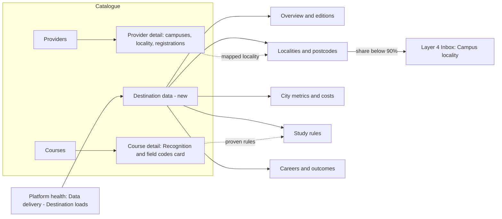
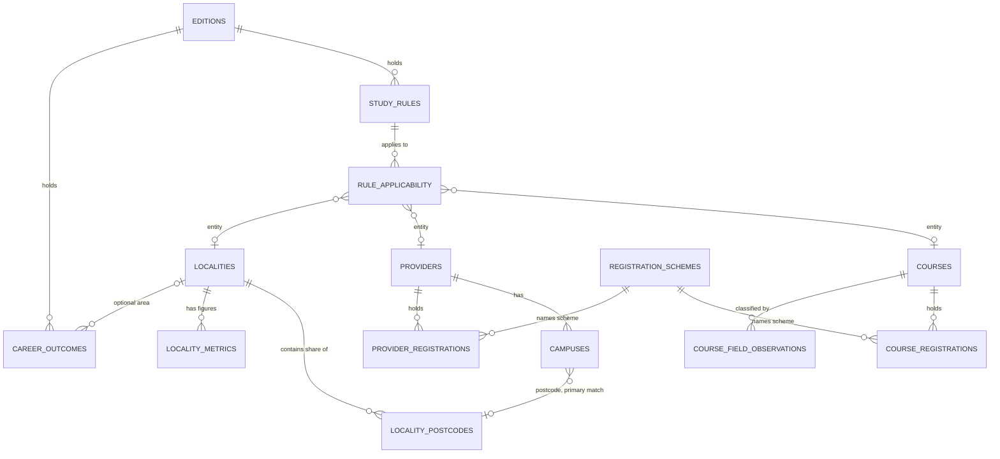
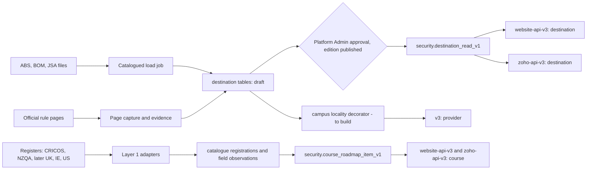

# Destination data: Admin UI fitout, API v3 blueprint and bulk ingestion plan

**Version 1.2 · 17 November 2026 AEDT · RM0C to RM6** (v1.2: the Admin UI fitout is built and live as v2.16.19, see [section 6](#6-build-record-v21619-17-november-2026); the 19 November hold is cancelled and the sessions run in parallel lanes. v1.1: decisions G-1 to G-5 approved by the Platform Admin, 17 November 2026 11:52 AEDT; tabs 1 and 2 move into step 1)

Chat reference: S1-RM-Design (UI fitout and bulk ingestion plan). Platform Admin, 17 November 2026 11:39 AEDT.

Companion to [`DESTINATION-DATA-DESIGN.md`](DESTINATION-DATA-DESIGN.md) v1.8. Wireframe: [`mockups/destination-data-admin-fitout-mockup.html`](mockups/destination-data-admin-fitout-mockup.html).

**Status.** Sections 1 and 2.4 are built and live from v2.16.19 (section 6 says exactly what). The ingestion plan in section 3 is S2-Build's lane. The text below was first written when nothing was built. It is written against the live system as read on 17 November 2026 at 11:45 AEDT (read only): release v2.16.18, newest migration `20261117040000`, 2,054 migrations applied, G3 guard 75 functions and 48 tables with no drift, all `destination` tables empty, 4,906 Layer 4 items pending.

`docs/UI-MAP.md` is generated from the code and is not edited by hand. It will show the new page in the release that builds it. Until then this document is the record of the planned placement.

---

## 1. UI architecture

**Hybrid.** One new top-level page for country and city datasets, and in-place additions to three existing screens for course and provider attributes. No second module for anything a course or provider screen already owns.

### 1.1 Navigation placement

| Item | Value |
|---|---|
| Menu section | Catalogue, after Rankings & statistics and before Reference data |
| Page key and address | `destination` · `#destination-data` |
| Label and subtitle | Destination data · "Country and city datasets the website and Zoho read: localities, city figures, study rules and career outcomes, with their sources and approval." |
| Opens for | Curator and above (rank 3), the rank the live review functions require |
| Files | `src/nav-map.js` (page and `SECTIONS`), `pageBody` in `src/mature-main.jsx`, new `src/DestinationData.jsx` |

### 1.2 Role gates (as the live functions enforce them)

| Action | Minimum role | Live function | Reason required |
|---|---|---|---|
| Open the page, read overview and review lists | Curator (3) | `admin_destination_overview`, `admin_destination_review` | No |
| Resolve a postcode below 90% | Curator (3) | To build (section 1.5) | Yes |
| Run a load now | Pipeline Operator (5) | Scheduled jobs "Run now" | No |
| Approve, publish, supersede or withdraw a row | Platform Admin (6) | `admin_destination_set_status` | Yes |
| Record an edition's terms; publish an edition | Platform Admin (6) | To build as Admin wrappers (section 1.5) | Yes |

The screen hides nothing by role inside the page: a button a role cannot use is shown disabled with the role it needs. The server check is the control; the disabled state is a courtesy.

### 1.3 The five tabs

| # | Tab | Shows | Reads | Actions |
|---|---|---|---|---|
| 1 | Overview & editions | Counts by status for every table; each edition with source owner, terms status, attribution present or missing, publish state; publish health | `admin_destination_overview` | Record terms; publish edition |
| 2 | Localities & postcodes | Localities by country, geography type, boundary vintage and edition; postcode shares; a "Primary" badge at 90% or more and a "Layer 4" badge below | `admin_destination_review('locality')`, `('locality_postcode')` | Approve or withdraw a locality; choose the locality for a postcode below 90% |
| 3 | City metrics & costs | Population at 30 June 2025, climate and living-cost figures, each with value, unit, period, source link and an attribution preview | `admin_destination_review('locality_metric')` | Approve, publish or withdraw a figure |
| 4 | Study rules | Rules by category and effective dates; the stored quote beside the stored source page with the quote highlighted; the rule's applicability rows | `admin_destination_review('study_rule')` | Approve, supersede or withdraw a rule |
| 5 | Careers & outcomes | Occupation by scheme and code, area, median annual earnings, demand rating, period | `admin_destination_review('career_outcome')` | Approve or withdraw an outcome |

Rules every tab follows:

- **Attribution is checked, not assumed.** A row with no attribution text shows "Missing" and cannot be approved from the screen.
- **Published editions are fixed.** A study rule or career row in a published edition cannot be changed (guard of `20261115230000`). The screen offers "Start a new edition" instead of Withdraw for those rows. Localities and locality figures have no edition and can be withdrawn directly.
- **Earnings are not visa funds.** Tab 5 never shows a visa financial threshold; that is a study rule of category `visa_funds` on tab 4. The tab says so on screen.
- **Empty state.** Before any load each tab says what loads it and where that load is run.

### 1.4 Adapted existing screens

| Screen | Addition | Source |
|---|---|---|
| Courses › Course detail › Recognition card (`CourseRecognition.jsx`) | One row per registration scheme the course holds (`cricos`, `nzqa`, later `uk_qaa`, `ie_qqi`, `us_opeid`), never merged. Field-of-study codes by scheme (`asced`, later `nzsced`, `cip`, `hecos`). A new block "Study rules proven for this course" from `rule_applicability`, linking to tab 4 | `admin_course_recognition_read`, extended |
| Providers › Provider detail › Campuses | "Primary campus" badge from `campuses.is_primary`. Mapped locality and match share per campus, or "In Layer 4" below 90% | Provider detail read, extended |
| Providers › Provider detail › Registrations | Provider registrations by scheme. `ircc_dli` is listed as a provider registration; `pgwp` is shown per programme in its own block and never as a DLI | Provider detail read, extended |
| Platform health › Data delivery | New panel "Destination loads" beside Recognition delivery: each load, last run, rows, what it waits on, Run now | `admin_destination_overview`, job catalogue |
| Layer 4 Review › Inbox | New kind "Campus locality": one item per campus whose postcode share is below 90%, beside the 4,906 items pending today | Layer 4 inbox |

### 1.5 What the screens need that is not live

| Gap | Needed for | Proposed |
|---|---|---|
| Admin wrappers for edition terms and publish | Tab 1 | `public.admin_destination_edition_set_terms`, `public.admin_destination_edition_publish` over the existing `security.destination_edition_*` functions; Platform Admin, reason required |
| Edition list with terms and attribution health | Tab 1 | Extend `admin_destination_overview` (it returns counts only) |
| Postcode resolution | Tab 2, Layer 4 kind | `public.admin_destination_postcode_resolve(postcode, locality_id or null, reason)`; Curator and above |
| Applicability rows in the rule review | Tab 4 | Extend `admin_destination_review('study_rule')` |
| Stored page text for the quote verifier | Tab 4 | `destination.study_rules` gains `evidence_id` to the stored page (same pattern as the catalogue), so the quote is checked against stored evidence, not a live fetch |
| Layer 4 kind `campus_locality` | Layer 4, Data delivery | New Inbox kind; decisions write `locality_postcodes` through the resolve function |
| Campus locality on the provider read | Provider detail | Extend the provider detail read |

### 1.6 Wireframes

The interactive wireframe (linked above) shows the menu placement, all five tabs, the four adapted screens, a role switch (Viewer, Curator, Platform Admin) and the reason dialog. Every figure in it is a marked example.

---

## 2. Entity relationships and API v3 blueprint

### 2.1 Entities

`destination.city_profiles` (Pilot #1155) is not in the picture: `locality_metrics` is the home for city figures. It is marked retiring once nothing reads it.

### 2.2 Flow from source to API

### 2.3 Action `destination` (live in v2.16.18)

| Part | Detail |
|---|---|
| Request | `{"action":"destination","filters":{...},"page":1,"page_size":50}` |
| Filters | `country_code` (two letters), `section` (`localities`, `study_rules` or `career_outcomes`), `postcode` (returns the primary-match locality), `locality_id` (uuid), `rule_category` |
| Paging | `page` from 1. `page_size` applies to each list; when omitted it is the platform maximum. Maximum is the setting `destination.page_size_max` (100 today; range 10 to 500) |
| What is returned | Localities and locality figures with status `approved` or `published`. Study rules that are `approved`, in a `published` edition, and in effect today. Career outcomes `approved` or `published` in a `published` edition |
| Response | `localities[]` (each with `metrics[]`), `study_rules[]` (each with `visa` or null, and `applicability[]`), `career_outcomes[]`, `totals{}`, `page`, `page_size`, `filters{}` |
| Errors | `INVALID_INPUT` for a filter that is not an object, a country code that is not two letters, an unknown section or a locality id that is not a uuid |
| Identical on both APIs | Yes: both wrappers call `security.destination_read_v1` |

Field lists per item are in `docs/integrations/api-v3/API-V3-FIELD-DEFINITION.md` and, field by field, under `pending_fields` in Pilot `docs/api/v3/field-dictionary.json` (72 per API).

**Loading the 144 pending fields into `ref.api_field_dictionary` (1,923 rows today).** The existing guard requires migration `20261116110000` to embed exactly the reviewed list, so the list cannot simply grow. The change is one pull request: move the destination entries from `pending_fields` to `fields`; add a new sync migration that embeds the new full list and calls `security.api_field_dictionary_sync_v1`; point `cf-247-api-v3-field-dictionary-contract` and its fixture at the newest sync migration. Owner: RM-v3-Dictionary (RM0B). It can ship before v3 release; the handover documents still wait for release.

### 2.4 Additive fields on `course` and `provider`

| Field | Action | State | Website v3 | Zoho v3 | Source |
|---|---|---|---|---|---|
| `recognition[]` | `course` | Live (CRICOS) | Yes, both forms | Yes | `catalogue.course_registrations` through `security.course_roadmap_item_v1` |
| `field_of_study_codes[]` | `course` | Live (ASCED) | Yes, both forms | Yes | `catalogue.course_field_observations` through the same function |
| `campuses[].locality` | `provider` | To build | Planned | Planned | Campus postcode → `locality_postcodes` primary match → `localities` |
| `study_rules[]` on a course | `course` | Not planned for the course payload | | | Read through `destination` with the course's country; applicability gives the link |

Proposed `campuses[].locality`: `{locality_id, name, geography_type, geography_code, boundary_vintage, match_share}` or `null` when the campus has no primary match. One decorator function serves both APIs, as `course_roadmap_item_v1` does for courses, so the two answers cannot drift.

**G3.** Every one of these is a v3 wrapper or a new function beside v2. No v2 function, table or column is altered, so the guard stays at 75 functions and 48 tables. Each change re-runs `security.consumer_api_check_v1()` after deploy.

### 2.5 Career outcomes grain: decision

**Problem.** `destination.career_outcomes` is unique on (edition, country, occupation code). A state or locality figure for the same occupation cannot sit beside the national one, and the importer's upsert uses that same key.

**Decision G-1 (approved 17 November 2026 11:52 AEDT).** One row per edition, country, occupation scheme, occupation code and area, where area is national, a state, or a locality.

| Change | Detail |
|---|---|
| New columns | `geography_level` (`national`, `state`, `locality`; default `national`), `state_code` |
| Rule | `national`: no state, no locality. `state`: state code set. `locality`: `locality_id` set |
| New key | Unique on edition, country, occupation scheme, occupation code, geography level, state code, locality |
| Old key | `career_outcomes_edition_id_country_id_occupation_code_key` is replaced |
| Importer | `security.destination_import_v1` upserts on the new key in the same migration |
| API | Each outcome gains `geography_level` and `state_code`; `locality_id` is already returned |

The table is empty, so nothing is migrated. Replacing the old key is a constraint replacement. As approved, it goes inside the constraint block of the migration (as `20261117040000` did for the access-history check); no paste file.

---

## 3. Bulk ingestion plan after the squash

Starts when the Platform Admin confirms the squash of Thursday 19 November 2026 (01:30–03:30 AEDT) is complete. Every step ships by pull request, green CI and the deploy workflow; verification is read only. Each load is a catalogued job (G1) whose batch size and limits are settings (G2). Loads write drafts; nothing reaches the API until approved.

| # | Step | Builds | Loads | Needs first | Done when |
|---|---|---|---|---|---|
| 0 | Baseline check | Nothing | Nothing | Squash confirmed | Migration head, G3 guard (75 and 48) and an empty `destination` read all read back clean on the squashed baseline |
| 1 | ABS population and ASGS postcode loader (RM1B), with Destination data tabs 1 and 2 (G-4) | The page `#destination-data` with Overview & editions and Localities & postcodes, and the wrappers they need (section 1.5); job `destination-abs-load`; `evidence_id` on localities and figures; Layer 4 kind `campus_locality`; `admin_destination_postcode_resolve` | SUA localities (about 100, estimate), one population figure each (30 June 2025), postcode shares for the 805 distinct AU campus postcodes | Sources approved (A-1 to A-4, done) | Every AU campus postcode is either a primary match or a Layer 4 item; attribution on every figure; Platform Admin approves; `destination` returns localities |
| 2 | Study rules importer extension (RM0D, RM1C, RM1H, RM2C) | Importer accepts the general rule fields, quote, evidence and applicability; career grain change G-1 rides here if approved | AU rules first (about 15 to 25, estimate): routes, funds, fee, work rights, post-study work, processing times | Page capture of each official page; edition terms recorded | Every rule has a quote found on its stored page and effective dates; edition published; `destination` returns rules |
| 3 | NZQA qualifications capture (RM4A) | NZQCF capture in the Layer 1 NZ adapter; match by qualification number | 3,894 four-digit candidates matched; 2,559 provider-style codes classified | NZQA commercial-use terms settled by management | NZ `recognition[]` served from course-level evidence; unmatched codes held with a reason |
| 4 | BOM climate, living costs and JSA careers (RM1I, RM1D, RM2B, RM4C) | Jobs for each dataset; grain change G-1 if not already shipped | Climate normals and living costs per locality; occupation outcomes | Step 1 (localities). Source and reuse approvals for BOM, the living-cost source and JSA (REQ-68) | Figures and outcomes approved and returned with attribution |
| 5 | UK, Ireland and USA register adapters (RM3, RM5, RM6) | Three Layer 1 adapters and their provider identity rules | Provider and course registrations under `uk_qaa`, `uk_ofs`, `ie_qqi`, `us_opeid`, `us_ipeds`; field codes under `hecos`, `cip` | Source registration and terms per country; country enabled for ingestion | Registrations land with evidence; schemes move from `planned` to `active` in `ref.registration_schemes` |
| 6 | Destination data tabs 3 to 5, the adapted screens (RM0F) and the password-reset audit line | `src/DestinationData.jsx`, the adapted screens, the wrappers of section 1.5; `admin-user-management` writes `password_reset_sent` | Nothing | Steps 1 and 2 give the screens real rows | UI map regenerated, screen help and SOPs updated, version pill bumped, spec `s557` green |

### 3.1 Sequencing notes

- **Tabs 1 and 2 ship with step 1 (G-4, approved).** The Platform Admin has a live approval screen for the first load. Tabs 3 to 5 and the adapted screens stay at step 6, though each tab may ship with the step that gives it rows.
- **Step 4 is two approvals away.** BOM and living-cost sources have no approval yet, and JSA and QILT terms (REQ-68) are open. The build can proceed; the load cannot.
- **Step 5 is the largest piece.** Three new countries, each with its own identity rules. It is listed fifth but is a programme of its own.
- **Dictionary sync** (section 2.3) is independent and can ship at any point.
- **CRICOS 11 November edition** (1,953 waiting rows) and the 701 register departures are Layer 1 actions outside this plan and are still open.

### 3.2 Indicative effort (estimates for planning, not quotes)

| Step | Size | Main uncertainty |
|---|---|---|
| 1 | Medium | Whether the direct Postal Area to SUA file exists; fallback A-4 is approved |
| 2 | Medium | Number of rule pages and how stable their wording is |
| 3 | Medium | Share of provider-style codes that match no qualification |
| 4 | Medium, plus waiting on approvals | Source terms |
| 5 | Large | Three new countries |
| 6 | Medium | Layer 4 kind and quote verifier |

---

## 4. Decisions (all approved)

Approved by the Platform Admin on 17 November 2026 at 11:52 AEDT.

| # | Decision | Approved |
|---|---|---|
| G-1 | Career outcomes grain | One row per occupation and area (`national`, `state` or `locality`). The unique key is replaced inside the migration's constraint block |
| G-2 | Menu placement | Destination data sits in the Catalogue menu after Rankings & statistics; address `#destination-data`; Curator and above |
| G-3 | Postcodes below 90% | Routed to the existing Layer 4 Inbox as a new kind, "Campus locality" |
| G-4 | Tabs 1 and 2 | Overview & editions and Localities & postcodes are built with step 1 (the ABS loader), right after the squash |
| G-5 | `campuses[].locality` | The shape in section 2.4 is approved for the v3 `provider` action |

**Hold.** No schema or ingestion pull request is opened on Pilot until the Platform Admin confirms the squash of Thursday 19 November 2026 (01:30–03:30 AEDT) is complete. Step 0 and step 1 start straight after that confirmation.

**Post-squash run (Platform Admin, 17 November 2026 12:15 AEDT).** Steps 0 to 6 are pre-authorised and run without a pause once the Platform Admin replies "Squash confirmed". The `password_reset_sent` audit line moves to step 2 and the dictionary load of the pending `destination` fields to step 4 (design v1.9).

**Merging.** From 17 November 2026 11:52 AEDT the agent merges its own pull requests in both repositories once checks are green and G1 to G3 hold.

## 5. Assumptions and risks

- Target row counts marked "estimate" are planning figures to confirm at first capture.
- The plan assumes the squash keeps `20261117040000` in the baseline unchanged.
- Risk: attribution or terms missing at load time blocks approval, not loading; rows wait in draft.
- Risk: the quote verifier depends on stored evidence for rule pages; a rule captured without stored evidence cannot be verified on screen.
- Not checked from this session: a keyed HTTP call to the `destination` action and a signed-in call of the Admin functions.

## 6. Build record: v2.16.19 (17 November 2026)

Platform Admin, 17 November 2026 13:12 AEDT: the 19 November hold is cancelled; three sessions run in parallel. This session's lane is the Admin UI fitout and the two registers. Loaders, workers and ingestion are S2-Build's lane; Boost and cron hygiene are S1-Build's.

### Built and live (Pilot #1197, migration `20261117131500`)

| Spec item | Built as |
|---|---|
| Destination data page (G-2) | `#destination-data`, Catalogue after Rankings & statistics, Curator and above; five tabs in `src/DestinationData.jsx` |
| Role gates and reasons | Every approve, withdraw, terms and publish control needs Platform Admin and asks for a reason; postcode controls need Curator. Disabled controls name the role; the server checks |
| Edition wrappers | `admin_destination_edition_set_terms`, `admin_destination_edition_publish`; each writes the control log with its reason |
| Postcode resolution | `admin_destination_postcode_resolve`; the decision is for the postcode and records who and why |
| Overview and review lists | Edition list with terms and attribution check, load jobs, postcodes grouped with their candidates, rule applicability and stored evidence |
| Quote verifier | `destination.study_rules.evidence_id`; the Study rules tab shows the stored quote beside the official page link and a link to the stored copy on the Evidence page |
| Layer 4 kind (G-3) | `campus_locality`, registered as a kind hook under the Inbox paging contract; choices: accept the largest share, choose another candidate, not in any locality. `admin_layer4_inbox` was not replaced |
| `campuses[].locality` (G-5) | On `website_v3_provider_item` and `zoho_v3_provider`: `{locality_id, name, geography_type, geography_code, boundary_vintage, match_share}` or null |
| Course detail | Recognition card: schemes held with their authority, the country's field-of-study scheme, study rules proven for the course (`admin_course_destination_read`) |
| Provider detail | Primary campus, locality per campus (or "in Layer 4"), registrations by scheme, PGWP counted apart from the DLI number (`admin_provider_destination_read`) |
| Data delivery | Destination loads: counts, what waits for a person, and Run now for every catalogued job whose name starts `destination-` |
| Password reset audit | `admin-user-management` writes `password_reset_sent`; `svc_admin_access_log_event` accepts it |

### Signed-in acceptance check (Platform Admin, 17 November 2026 14:30 AEDT)

The Platform Admin opened Catalogue › Destination data signed in on v2.16.19: layout, the five tabs, the role gates and the live count (18 schemes registered) all read cleanly. The loader wiring notes below were passed to S2-Build, including the request to add `campuses[].locality` to the field dictionary.

Still not checked by anyone: the Layer 4 kind with a real item, a password reset recorded in the access history, and keyed HTTP calls to the v3 `provider` and `destination` actions. The first two need data or an action to exist first.

### Differences from the design, stated plainly

| Design said | Built | Why |
|---|---|---|
| Side-by-side quote verifier with the quote highlighted in the stored page | Quote, official page link and a link to the stored copy; no in-page highlight | The stored page text sits in storage, not the database; highlighting needs the evidence viewer extended |
| G-1 career grain in this release | Shipped separately by S2-Build the same afternoon (Pilot #1196, migration `20261117060000`, key `career_outcomes_area_key`) | It replaces the key the importer upserts on, which is S2-Build's lane. The Careers tab reads the new columns |
| Reason dialogs | The browser's prompt, as Adapters and Task manager already use | One pattern across the Admin |
| Dictionary entries for `campuses[].locality` | Not added | S2-Build loaded the `destination` fields (Pilot #1196, migration `20261117061000`: 148 `destination` rows). `campuses[].locality` on the `provider` action is not in it yet and goes in with the next dictionary issue |

### What S2-Build's loaders need to know

- **Load jobs appear by name.** A job catalogued in `pipeline.automation_catalogue` with a name starting `destination-` is listed on Data delivery with Run now at its own `control_rank`.
- **Postcodes.** Set `is_primary_match` and `needs_layer4_review` from `security.destination_postcode_flags_v1(share)`. Rows flagged for review become Layer 4 items by themselves, one per campus with that postcode; nothing else is needed.
- **Rules.** Set `evidence_id` to the stored page so the quote can be checked. Rows load as draft; approval is on the page.
- **Localities.** A locality with no attribution text cannot be approved from the page.
- **Migration numbers.** This lane used `20261117131500`.
