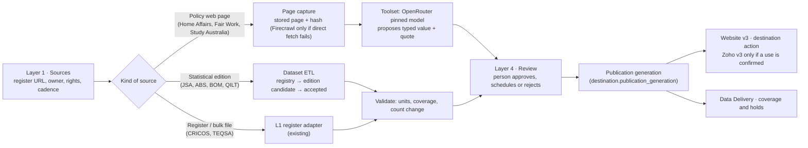

# RM1 Australia destination page — traceability, mechanism and v3 page contract

**Version 1.0 · 13 November 2026 AEDT · Proposed design · RM1 (with RM0C–RM0F)**
**Requested by:** Platform Admin, 13 Nov 2026 16:40 ("check the Australia worksheet and update the roadmap register: design, required fields, UI module, what exists, extra columns or toolset, which layer extracts it, mockups, v3 API for Wix").
**Builds on:** [Destination data design v1.2](DESTINATION-DATA-DESIGN.md) (RM delivery plan and S1-RM-Design sections) and [V3 quick wins and module briefs](V3-QUICK-WINS-MODULES.md). This page does not change those designs. It traces every row of the Study Square Australia page brief to the item that delivers it.
**Source brief:** Study Square destination data sources workbook, Australia sheet (10 Nov 2026). The workbook is confidential to Study Square and is **not** stored in this public repo; it is held in the Platform Admin's private project. This page records only our design, the topics, and public official sources.
**Mockups:** [`mockups/australia-destination-mockups.html`](mockups/australia-destination-mockups.html) (open the file in a browser; six views: overview, study rule review, cities and costs, source register, mechanism, Website v3 and page). Also published privately as the claude.ai artifact "Australia Destination Mockups".
**Next chat:** [`RM1-AUSTRALIA-NEXT-CHAT.md`](RM1-AUSTRALIA-NEXT-CHAT.md).


## Summary and findings (13 Nov 2026)

**Summary.** The Australia page brief has nine page sections. Four are already served by StudySearch from live catalogue data (Institutions, Courses, Universities, Scholarships), with coverage, permission and edition gaps. Five are not built on this platform (Visa & money, Cost & work, Work after study, Careers, Cities & weather). The brief marks most of those as loaded, but that refers to Study Square's separate prototype database, not this platform. All five arrive through the planned destination core (RM0C), study rules core (RM0D), the new Destination data Admin module (RM0F) and the `destination` action on Website v3 (RM0E).

**Findings, checked against production on 13 Nov 2026:**

| # | Finding | Effect | Roadmap |
|---|---|---|---|
| F1 | No destination, policy, city, climate, living-cost, labour or accreditation tables exist; `pipeline.city_regions` has 0 AU rows | Five page sections have no data path yet | RM0C, RM0D, RM0F, RM1B–RM1I |
| F2 | Rankings hold QS 2026 and 2027 and THE 2026; THE 2027 (released 30 Sep 2026) is not loaded | Universities section shows last year's THE | **RM1J (new)** |
| F3 | QILT outcomes are live (3,164 rows) but republishing needs QILT permission (Study Square, 13 Nov) | Live data cannot be shown on the website until permission is recorded | RM1D (gate) |
| F4 | 20 AU search items have no delivery mode; study load is not held | Page rule "on-campus, full-time only" cannot be applied fully | RM1G |
| F5 | CELPIP held on 80 courses, OET on 0 (letter grades not read) | Test requirements row partly met | AER / O14 |
| F6 | TEQSA category (45 / 8 / 137), CRICOS recognition and scholarships (1,202 published) are live | Institutions and Scholarships sections can launch on catalogue data | Delivered |
| F7 | Study Square rulings (13 Nov): admission tests as a general note; skip the 485 English item; processing time as "about 3–4 weeks"; climate as 30-year normals; Hobart costs from Study Tasmania; accreditations wanted globally | Narrows RM1H and RM1I scope; confirms RM1F | RM1H, RM1I, RM1F |
| F8 | Website v3 is live but has no release gate; no v3 handover document is issued | Destination fields can be added now and documented once at v3 release | RM0E, RM0B |
| F9 | The brief's licence and "updated" columns have no home today | Three new source columns: rights mode, cadence, page section | RM0C |

## 1. What the brief's columns mean in StudySearch

Each column of the brief becomes a field or a control in the platform. This is the mechanism every row follows.

| Brief column | Becomes in StudySearch | Where it lives | Who sets it |
|---|---|---|---|
| Page section | Destination **module** and page-section key (`institutions`, `courses`, `universities`, `scholarships`, `visa_money`, `cost_work`, `work_after_study`, `careers`, `cities`) | `destination.policy_rule.topic` / observation type; v3 `destination.module` + `section` | Design (fixed list) |
| Information | **Rule topic** (study rules) or **metric** (observations), e.g. `visa_charge`, `work_hours_in_session`, `climate_normal`, `living_cost` | `policy_rule.topic` + `rule_key`; `city_observation.metric`; `labour_observation.metric` | Design, per row in §3 |
| Official source | Registered **source** with owner, URL, cadence and rights | `pipeline.sources` (existing), approved in Layer 1 › Sources | Operator registers; Platform Admin approves |
| Second link | Additional source on the same version | `policy_version.source_ids[]` / `evidence_ids[]` | Operator |
| Figure / value | **Typed value**: amount + currency + period, hours + period, duration + unit, count, or condition JSON — never display text | `policy_version.value` (typed JSON) / observation `value`, `unit` | Capture proposes; a person approves |
| Licence | **Rights mode**: `open_attrib`, `link_and_credit`, `permission_required`, `check_terms` → controls capture, storage and whether the v3 feed may publish the value or only the link | `pipeline.sources.rights_mode` (new column, RM0C) | Platform Admin |
| Updated | **Cadence and freshness**: check frequency, review-due date, `stale` threshold | `pipeline.sources.cadence`; `policy_version.review_due_on`; edition `release_date` | Operator; job enforces |
| Supabase table | Our **canonical table** (the brief's table names are from the separate Study Square prototype database, not this platform) | See §3 "Our table" | Design |
| Status (Loaded / To load / To add) | **Coverage state**: `available`, `not_available`, `under_review`, `stale`, `not_applicable` per page section | Data Delivery stream per module; v3 `status` | Computed |
| Notes | Review note and decision trail on the version | `policy_version.review_note`; Layer 4 item | Reviewer |

New columns this adds to existing tables (RM0C): `pipeline.sources.rights_mode`, `pipeline.sources.cadence`, `pipeline.sources.page_section` (nullable, the brief's section). Everything else is in the proposed `destination` schema already in the design.

## 2. How a row moves through the layers



| Layer | Used for | Toolset | Cost control |
|---|---|---|---|
| L1 register (existing adapters) | Institutions, courses, TEQSA category, CRICOS recognition | Direct download; no AI | None needed |
| Dataset ETL (existing QILT/PRISMS path, generalised in RM0C) | QILT, rankings editions, JSA careers, ABS population, BOM climate | Direct file/API download; parser per publisher | Edition hash; replay without duplicates |
| Page capture (existing evidence path) | Visa, work, dependants, wage, post-study work, application route, living-cost pages | Direct fetch first; **Firecrawl** only on failure (metered in Toolsets); **OpenRouter** pinned model proposes the typed value and the supporting quote | Toolsets budget; unchanged page hash skips the AI step |
| L2/L3 enrichment (existing, S2 lanes) | Course study mode/load, English and admission tests, intakes, fees | Existing university adapters and readers | Existing lanes and budgets |
| L4 review | Every policy version before it is current; ambiguous campus–city matches; rights holds | Admin, person decision with reason | — |

A passing extraction never activates a rule by itself. Activation is a separate approve-and-schedule step (standing rule: no silent auto-activation).

## 3. Australia brief — row-by-row traceability (as at 13 Nov 2026)

"Live today" is checked against the production database on 13 Nov 2026. "Our table" is this platform's table, existing or proposed in the design.

| # | Page section · information | Live today | Gap | Our table (new fields in bold) | Layer · toolset | Admin screen | Website v3 | RM item |
|---|---|---|---|---|---|---|---|---|
| 1 | Institutions · registered institutions and courses for overseas students | Yes: CRICOS providers and courses (25,380 active AU courses) | — | `catalogue.providers`, `courses`, `course_registrations` | L1 register | Courses, Providers | `providers`, `course` (recognition live, RM1A-1) | RM1A |
| 2 | Courses · fees, English, entry, intakes | Yes, partial coverage | Coverage (S2 lanes) | existing catalogue | L2/L3 adapters | Courses, Entry requirements | `course`, `search` | S2 lanes |
| 3 | Courses · on-campus full-time only | Partly: delivery mode held; 20 AU search items have none; study load not held | Study load field; 20 missing modes | **`study_load`** on course/offering (S2-CF decides grain) | L2/L3 course reader | Courses › Catalogue columns | `course.study_load`, search filter | RM1G |
| 4 | Courses · test requirements (English, admission tests) | English tests incl. CELPIP (80 courses); OET 0 | OET letter grades; admission tests = general note (Study Square, 13 Nov) | existing `ref.english_tests`; country note as a study rule `admission_tests_note` | L2/L3; page capture for the note | Entry requirements; Destination data › Study rules | `course.english_requirements`; `destination study_rules` | AER; RM1H |
| 5 | Institutions · TEQSA provider category | Yes: `institution_type` from TEQSA register (45 / 8 / 137) | — | existing | L1 register | Providers › Institution type rules | `providers.institution_type` | Delivered |
| 6 | Universities · student satisfaction (QILT SES) | Yes: 3,164 outcome rows | **Republishing needs QILT permission** (REQ-68) | `catalogue.provider_outcomes` | Dataset ETL | Rankings & statistics | `provider.outcomes` | RM1D (rights) |
| 7 | Universities · graduate outcomes (QILT GOS) | Yes | Same permission | same | Dataset ETL | Rankings & statistics | `provider.outcomes` | RM1D (rights) |
| 8 | Universities · rankings (QS, THE) | QS 2026 and 2027, THE 2026 | **THE 2027 edition (released 30 Sep 2026) not loaded** | `ranking.editions`, `observations` | Dataset ETL (ranking import) | Rankings & statistics › Datasets | `provider.ranking_summary`, `rankings` | **RM1J (new)** |
| 9–11 | Universities · AACSB, EQUIS, AMBA | No | Whole item; global scope confirmed by Study Square 13 Nov | **`catalogue.provider_accreditations`** (provider, school/programme scope, accreditor, grant type, valid_from/to, source, evidence) | Page capture or accreditor list | Provider detail | `provider.accreditations[]` | RM1F (D-3) |
| 12 | Scholarships · university and government scholarships | Yes: 1,202 published | Coverage | `scholarship.*` | L2/L3 scholarship lane | Scholarships | `scholarships`, `scholarship` | S2-Scholarship |
| 13 | Visa & money · application process (portal, deadlines, offer dates) | Partly: provider application windows in `important_dates` | Route facts | `destination.policy_rule` topic `application_route`; dates stay in `pipeline.important_dates` | Page capture + review | Destination data › Study rules; Key dates | `destination study_rules`; `course.application_route` (optional) | RM1C |
| 14 | Visa & money · offer acceptance document (CoE) | No | Rule | topic `acceptance_document` | Page capture + review | Study rules | `destination study_rules` | RM1C |
| 15 | Visa & money · Student visa (500) requirements, funds, conditions | No | Rules | topics `visa_requirements`, `financial_capacity` (amount, currency, per year, family size) | Page capture + review | Study rules | `destination study_rules` | RM1H |
| 16 | Cost & work · work hours while studying | No | Rule | topic `work_hours` (hours, per fortnight, in session/break, course-level exceptions) | Page capture + review | Study rules | `destination study_rules` | RM1H |
| 17 | Cost & work · minimum wage | No | Rule | topic `minimum_wage` (amount, AUD, per hour, effective from) | Page capture + review | Study rules | `destination study_rules` | RM1H |
| 18 | Visa & money · processing priority and times | No | Snapshot with expiry (Study Square 13 Nov: show "about 3–4 weeks, varies") | topic `processing_time` (percentile, window, snapshot date, **expires_on**) plus editorial note | Page capture + review; monthly refresh | Study rules | `destination study_rules` | RM1H |
| 19–20 | Visa & money · dependants and Oct 2026 rule changes | No | Rules with effective dates | topics `dependants`, `onshore_application` (effective-dated, conditions JSON) | Page capture + review | Study rules | `destination study_rules` | RM1H |
| 21 | Visa & money · English scores for Student and 485 visas | No | Rule; Study Square 13 Nov: skip the 485 English item | topic `visa_english` (Student visa only) | Page capture + review | Study rules | `destination study_rules` | RM1H |
| 22 | Visa & money · financial capacity (living costs) | No | Rule (a visa fact, not a city cost) | topic `financial_capacity` | Page capture + review | Study rules | `destination study_rules` | RM1H |
| 23, 33 | Visa & money · visa application charge, concessions | No | Rule with nationality condition | topic `visa_charge` (amount, AUD, once-off, conditions: nationality group) | Page capture + review | Study rules | `destination study_rules` | RM1H |
| 24–26 | Work after study · 485 length by qualification; India ECTA; regional extension | No | Rules with qualification, nationality and location conditions | topic `post_study_work` (duration by qualification level, nationality, regional `locality` link) | Page capture + review | Study rules | `destination study_rules` | RM1H (O27) |
| 27–32 | Careers · OSCA, shortage list, projections, NERO, state trends, occupation profiles | No | One licensed JSA edition first | `destination.stat_dimension_member`, `stat_crosswalk`, `labour_observation`, `dataset_edition` | Dataset ETL | Destination data › Careers | `destination careers` | RM1D |
| 34–41 | Cities & weather · climate averages (8 capitals) | No | 30-year published normals per city (Study Square 13 Nov: 1991–2020 or 1986–2020; summer and winter average and annual rainfall) | `destination.city_observation` type `climate` (station ID, baseline period, season, metric, unit) | Dataset ETL (BOM) | Destination data › Cities and costs | `destination cities` | RM1I |
| 42–49 | Cities & weather · living costs (8 capitals) | No | Scoped institutional or official student budgets; Hobart source replaced (Study Tasmania) | `city_observation` type `cost` (basket, low/high, AUD, per week/year, publisher scope) | Page capture + review | Cities and costs | `destination cities` | RM1I |
| — | Cities · population (REQ-67) | No | ABS edition | `city_observation` type `population`, `locality`, `campus_locality` | Dataset ETL (ABS) | Cities and costs | `destination cities` | RM1B |
| — | Institutions · primary campus (REQ-75) | No | Decision D-4 | primary-campus assertion | Rule job + override | Provider detail | `provider.campuses[].is_primary` | RM1E |

**What exists vs what is new, in one line:** rows 1–2, 5–8 and 12 are live (with coverage, permission and edition gaps). Everything under Visa & money, Cost & work, Work after study, Careers and Cities is new and depends on RM0C (destination core), RM0D (study rules core) and RM0F (Destination data module).

## 4. Admin module (RM0F) — what the operator sees

One new module, **Destination data**, under Catalogue, with a country picker and three tabs. Existing screens are extended, not copied.

| Screen | Purpose | Key controls | Exists? |
|---|---|---|---|
| Destination data › Overview | One row per page section for the chosen country: status, last checked, next review, items held | Section status chips; "open section" | **New** |
| Destination data › Study rules | List of rule topics; each opens a version timeline (current, scheduled, superseded) | Add version from captured page; edit typed value; attach evidence; approve and schedule; withdraw with reason | **New** |
| Destination data › Cities and costs | Localities, campus-to-city mappings, observations by edition | Pick edition; confirm ambiguous mapping (to Layer 4); view source | **New** |
| Destination data › Careers | Editions and coverage by occupation/geography | Pick edition; coverage counts | **New** |
| Layer 1 › Sources | Register source with owner, rights mode, cadence, page section | New columns from §1 | Existing, extended |
| Rankings & statistics › Datasets | Edition cards for QILT, rankings, JSA, ABS, BOM | Import and accept edition | Existing, extended |
| Layer 4 › Inbox | Rule versions awaiting approval; ambiguous mappings; rights holds | Approve, reject, ask | Existing |
| Data Delivery | Coverage and holds per destination module | — | Existing, new streams |
| Toolsets and limits | Firecrawl and OpenRouter spend for page capture | — | Existing |

## 5. Website v3 page contract (for Wix)

The website builds one destination page from the existing catalogue actions plus one new action. Field names follow the design's option A; values are filled only from approved, publishable versions.

| Page section | v3 call | Fields the page reads |
|---|---|---|
| Institutions | `providers` (country AU) | `name`, `institution_type`, `campuses[]`, `ranking_summary`, `university_groups`, `accreditations[]` (RM1F) |
| Courses | `search`, `course` | `study_level`, `delivery_modes`, `study_load` (RM1G), `english_requirements`, `entry`, `intakes[].start_date_status`, `tuition` |
| Universities | `provider`, `rankings` | `outcomes` (after QILT permission), `rankings` |
| Scholarships | `scholarships`, `scholarship` | as today |
| Visa & money, Cost & work, Work after study | `destination` `module=study_rules` | per item: `topic`, `title`, `value` (typed), `unit`, `currency`, `period`, `conditions`, `effective_from`, `effective_to`, `status`, `source{publisher,url,attribution}`, `last_checked`, `review_due` |
| Careers | `destination` `module=careers` | `metric`, `occupation{scheme,code,label}`, `geography`, `period`, `value`, `unit`, `edition`, `source` |
| Cities & weather | `destination` `module=cities` | `locality{name,code}`, `population`, `climate{season,metric,value,unit,baseline}`, `living_cost{basket,low,high,currency,period,publisher}`, `source` |

```json
{"action":"destination","country_code":"AU","module":"study_rules","section":"cost_work","page_size":50}
→ {"module":"study_rules","country_code":"AU","generation":4,"as_of":"…",
   "items":[{"rule_key":"au.student500.work_hours","topic":"work_hours","section":"cost_work",
             "title":"Work while studying",
             "value":{"hours":48,"per":"fortnight","applies":"in_session"},
             "conditions":{"any":[{"study_level":"research_masters","hours":"unlimited"},{"study_level":"phd","hours":"unlimited"}]},
             "effective_from":"…","effective_to":null,"status":"available",
             "source":{"publisher":"Australian Government","url":"https://www.studyaustralia.gov.au/…","attribution":"…"},
             "last_checked":"…","review_due":"…"}],
   "next_cursor":null,"api_version":"website-v3"}
```

Values are illustrative until a version is approved. `status` follows the design (`available`, `not_available`, `under_review`, `stale`, `not_applicable`). A rule whose source rights are `link_and_credit` returns the link and title with `value: null`. Website first; Zoho only when a use is confirmed. v2 stays frozen.

## 6. Roadmap changes recorded with this page

| RM | Change | Why |
|---|---|---|
| RM1H | Scope note: includes processing-time snapshots with expiry, the admission-tests general note, and excludes the 485 English item (Study Square, 13 Nov) | Rows 4, 18, 21 |
| RM1D | Scope note: QILT republishing permission (REQ-68) is a release gate for rows 6–7 even though the data is live | Rows 6–7 |
| **RM1J (new)** | Ranking edition refresh: load THE 2027 (and any later QS/THE edition) through the existing ranking import | Row 8 gap found live 13 Nov |
| **RM1K (new)** | Australia page acceptance: one golden fixture per brief row (this page §3) checked on Admin and Website v3 before the AU page is called complete | Gives RM1 a measurable finish line |

Indicative effort: RM1J 4–8 engineering hours (existing import path); RM1K 6–10 hours (fixtures and read-back), both inside the RM1 allowance in the destination design.
