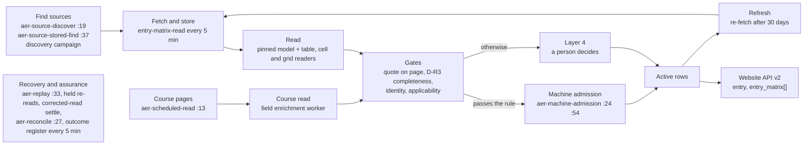

# Academic entry requirements (AER) admission mechanism: how it works, controls and status

12 Nov 2026 · prepared by Claude (Integration Controller) for the Platform Admin

> Figures were read from the live system (Supabase `fxcwkweaxjtknorudmwp`) on 12 Nov 2026 between 16:00 and 16:30 AEDT, read only. Change control: CF-CHG-20260915-247, items F-AER.01 to F-AER.10 and SS-017. The design behind it is `AER-TECHNICAL-DESIGN.md` (v1.2); the proposed next design is `AER-DESIGN-V2-PROPOSAL.md`.

## Summary

The platform admits academic entry requirements by country of prior education in two forms:

- a **provider entry matrix**: a table on the provider's own site giving the minimum for each country or qualification, by study level;
- **course entry requirements**: what a course page itself says.

A requirement is admitted only when a rule or a person has proof from the provider's own page. Once admitted, it reaches the website and Zoho through the existing consumer fields (`entry`, `entry_matrix[]`).

- **Position (12 Nov, 16:20 AEDT).**
  - Eligible providers: 1,476 (AU 1,279, NZ 197).
  - 127 providers have an entry source; 16 have an active matrix (1,289 rows).
  - 780 of 29,533 eligible active courses (2.6%) have active course rows (2,478 rows).
  - Qualification rows (IB, A Levels and similar): 8 active, 672 proposed.
- **Runs unattended.** Eight scheduled jobs run the flow. Two machine-admission rules admit what passes and send the rest to Layer 4 with a reason.
  - Course reads: 300 admitted since switch-on on 11 Nov. That reached the 300-a-day maximum in about 8 hours; nothing has been admitted since 21:24 that evening. The cap counts a rolling 24 hours, so room comes back as earlier admissions age (a rolled-back run at 16:30 would have admitted 15 of 22 checked). 500 course items are pending, 61 never checked.
  - Country tables and qualification rows: 16 admitted at 3 providers since it was switched on yesterday.
- **Still needs people:** 568 Layer 4 AER items are waiting. 301 are classified "awaiting human review"; 267 have no readiness class.
- **Main limits:**
  1. Most providers publish requirements only on course pages. Of the 679 providers the discovery campaign has asked, 513 have course pages only.
  2. Incomplete reads: the D-R3 gate is the largest decline reason for machine admission.
  3. The course machine-admission daily maximum (300), reached in about 8 hours on its first day.
  4. A large hand-built rule surface, reviewed in the v2 proposal.

## The flow

Each stage is a scheduled job. A stage takes only work the stage before it has finished.

| Stage | Job (schedule, AEDT) | What it does |
| --- | --- | --- |
| Find sources | `aer-source-discover` (hourly :19) | Asks the central-page search for providers with no entry source; runs the discovery campaign (60 providers a run, 10,000-credit ceiling) |
| Find sources from stored links | `aer-source-stored-find` (hourly :37) | Finds entry pages among links already stored for each provider, without new Firecrawl spend |
| Fetch and read country tables | `entry-matrix-read` (every 5 min) | Fetches each source (direct, rendered or Firecrawl), stores the copy, and reads it with the pinned model. PDFs go to the PDF table, cell or grid reader. Proposes rows to Layer 4 |
| Read course pages | `aer-scheduled-read` (hourly :13) | Picks course pages (20 a run, 200 a day, 5 per provider), asks corrected reads for held ones (100 a day), and stops new reads while Layer 4 holds 600 AER items. Settles corrected reads the reader skipped |
| Machine admission | `aer-machine-admission` (:24 and :54) | Rule `aer-machine-v1` for complete course reads (300 a day); rule `aer-matrix-machine-v1` for first reads of country tables and qualification rows (40 a day, 20 a run). 5% audit sample to a person |
| Recover | `aer-replay` (hourly :33) | Recovers held reads from stored records (200 a day) |
| Assure | `aer-reconcile` (hourly :27), `aer-outcome-register` (every 5 min) | Coverage findings, regression alerts, the course outcome register |

**The admission rules** are the only machine gates into the catalogue. Both apply through the same function a person uses. Each decision is recorded as one Layer 4 decision by the system actor, marked `machine`, and can be withdrawn.

`aer-matrix-machine-v1` admits a country-table first read only when all of these hold:

- it is the provider's own official host;
- the stored copy was fetched from it (an uploaded copy is never admitted);
- there is no lock and no rejection of the same source;
- the read passes D-R3 and the completeness guard;
- every row has its applicability resolved, its level mapped, enough confidence, and its published minimum printed in its own quote;
- there is no conflicting active row.

Changes to an admitted table always go to a person.

## Toolset usage

| Tool | What AER uses it for | Limits that apply (live 12 Nov) | Use |
| --- | --- | --- | --- |
| Firecrawl | Site maps and targeted search to find entry pages (`central_map`, `central_entry_search`); fetching pages that refuse a direct read; rendered reads for 4 listed hosts | Central share 1,000 credits a day, out of a 4,000 day total. Campaign ceiling 10,000. Up to 1,000 spare credits a day from verified unused capacity, never touching the vendor floor (1,500) or other groups' projected need. Not-due rule: no repeat search within 30 days | Last 7 days: 3,132 site-map and 1,158 entry-search credits. Campaign: 2,688 credits, 1,603 of them spare, 1,000 today |
| OpenRouter (AI) | Reading country tables (lane `entry_matrix`, pinned `openai/gpt-4.1-mini`); reading course pages (lane `enrich_fields`, pinned `openai/gpt-4.1-mini` from the central AI setting) | Daily guard for entry matrices US$2. Course reads share the field-enrichment guard (US$25) with every other enriched field. Platform credit floor US$5 | `entry_matrix` US$1.28 over 7 days. Course entry reads are not separated from other field enrichment in the ledger (see Data gaps) |
| Supabase | 8 jobs, 161 AER database functions, the `coverage-sweep` worker (entry, PDF, cell and grid readers), storage of every fetched copy (bucket `evidence`) | Batch sizes per run (Settings) | — |

- **One pinned model per lane, no routing.** Every recorded answer traces to the model that gave it.
- **Stored copies first.** A page is read from its stored copy where one exists. A source is fetched again only after 30 days or when asked, and is read again only when its content hash changes or a person asks.

## How the platform sustains itself

1. **Every stage is scheduled and bounded.** A backlog slows the flow but never stops it. The course reader also stops itself while Layer 4 holds 600 AER items, so people are not flooded.
2. **Work is leased.** Fetch and read runs have claim and lease timers. A failed run returns to the queue, up to 3 tries. A Firecrawl budget refusal doesn't use up a try.
3. **Machine admission does the routine.** Both rules run every 30 minutes. They are switched on only after a recorded validation against human decisions and shadow results; validation 6 of the matrix rule passed with 0 disagreements. A pass never switches anything on by itself.
4. **Recovery without a person.**
   - Held reads are read again from stored records (replay).
   - Corrected reads are asked for held course reads, up to 2 tries, 14 days apart.
   - A corrected read the reader skipped before reading is closed hourly, so its item isn't blocked.
   - When the reader improves, pages left beside a waiting item are read again through the governed re-read, which supersedes the source's own item first, so there are no duplicate items.
5. **Discovery runs to completion.** The campaign asks every eligible provider without a source, records one outcome each, and retries budget refusals after 3 hours. Its spare-capacity rule shrinks automatically when other work needs the credits.
6. **Assurance.** `aer-reconcile` raises Platform health issues on regressions. The Data Delivery panel shows the campaign, both admission rules, corrected reads, the last 24 hours' gains and the failures.

**What is still switched off:** E13 recovery (`aer.e13_recover_on`), fair university turns (`wc.aer_fair_on`), global-qualification pages (`reading.entry_global_pages_on`), D1 admission of grid reads (`aer.grid_machine_admission_on`), Canada (`aer.schedule_countries_off`: "no AER configuration"), the stronger-model attempt before a person (`har.ai_escalate_on`, with no model pinned), the Layer 4 arrival guard and automatic settling (`layer4.arrival_guard_on`, `layer4.reconcile_supersede_on`), and the Monday AER e-mail.

## Settings that influence AER, and where they live

Every value is a row in `pipeline.platform_toolset_settings`, changed on screen with a reason and recorded in `admin_control_events`.

- **Count:** 195 AER settings. 38 of them are lists of words, patterns, aliases or provider ids.
- **Pipeline settings:** Settings › Settings, Platform Admin, by section.
- **Firecrawl and AI limits:** Models & services › Services & limits and AI & OpenRouter.

### Models & services

| Panel | Setting | Value | Effect on AER |
| --- | --- | --- | --- |
| Services & limits › Firecrawl › Daily budget | Credits a day (billed); Share: central pages; Share: reading pages Firecrawl must read | 4,000; 1,000; 1,200 | Discovery and fetches spend from central and reads. The campaign may take spare credits beyond the central share only from unused capacity |
| Services & limits › Firecrawl › Daily budget | Credits kept back from course page search | 1,500 | The vendor floor the campaign's spare room never touches |
| AI & OpenRouter › Daily guards | Daily guard: entry matrices with AI; Enrich fields with AI; Credit floor | US$2; US$25 (shared with all field enrichment); US$5 | Country-table reads stop for the day at US$2. Course reads compete with other fields for US$25 |

### Settings › Settings, section "Entry requirements" (Platform Admin)

| Group | Settings that matter most | Live values |
| --- | --- | --- |
| Switches | Entry matrices reader on; read PDF tables; changes to a person; whole-read completeness gate; keep international qualifications; cell reader; grid reader | all on |
| Machine admission, course reads | `aer.machine_mode`, `aer.machine_daily_max`, `aer.machine_min_confidence`, `aer.machine_min_quote_chars`, `aer.machine_audit_pct`, `aer.machine_suspended` | admitting (2); 300 a day; 0.8; 8 characters; 5%; not suspended |
| Machine admission, country tables and qualification rows | `aer.matrix_machine_mode`, `aer.matrix_machine_daily_max`, `aer.matrix_machine_min_confidence`, `aer.matrix_machine_audit_pct`, `aer.matrix_machine_min_shadow`, `aer.grid_machine_admission_on` | admitting (2); 40 a day; 0.9; 5%; 20; grid reads off |
| Discovery | `aer.source_discover_on`, `aer.source_discover_credits_per_day`, `aer.source_discover_recheck_days`, `aer.entry_search_on`, `aer.source_stored_find_on` | on; 200 credits; 30 days; on; on |
| Discovery campaign | `aer.discovery_campaign_on`, `_credit_cap`, `_batch`, `_retry_hours`; `aer.discovery_spare_daily_max`, `_margin_pct`, `_window_hours` | on; 10,000; 60; 3 h; 1,000 a day; 50%; 3 h |
| Scheduled course reading | `aer.schedule_countries`, `aer.schedule_daily_max`, `batch.aer_schedule_courses`, `aer.schedule_per_provider`, `aer.schedule_layer4_max`, `aer.schedule_correction_daily_max`, `aer.schedule_held_max_tries`, `aer.schedule_held_retry_days`, `aer.schedule_retry_days` | AU, NZ; 200 a day; 20 a run; 5; 600; 100; 2; 14 days; 30 days |
| Reader (country tables) | `entry.matrix_model`, `entry.matrix_min_confidence`, `entry.matrix_slice_chars`, `entry.matrix_max_tokens`, `entry.matrix_attempts`, `entry.matrix_refresh_days`, `entry.pdf_max_bytes`, `entry.pdf_max_pages`, `entry.render_hosts` | gpt-4.1-mini; 0.85; 8,000; 16,000; 3; 30 days; 20 MB; 40; 4 hosts |
| Reader vocabularies (lists) | country aliases, global-scope words, global qualifications, grid headings (25 mappings), band label words, rank and score words, domestic-route words, non-requirement patterns (16), award abbreviations, level equivalents, qualification frameworks | maintained by hand; see the v2 proposal |
| Course reads | `entry.min_confidence`, `entry.max_rows_per_course`, `entry.max_rows_by_provider` (10 providers), `entry.course_page_chars`, `entry.gate_hold_reasons`, `entry.shared_page_hold`, `entry.variant_check` | 0.8; 6; per-provider overrides; 205,000; 3 reasons; on; on |
| Recovery | `aer.replay_on`, `aer.replay_daily_max`, `aer.e13_recover_on` (pilot list of 10 universities), `aer.reread_recheck_hours` | on; 200; off; 24 h |
| Assurance | `aer.eligible_countries`, `aer.baseline_eligible`, `aer.stale_source_days`, `aer.regression_alert_providers`, `aer.alerts_enabled`, `aer.weekly_email_enabled` | AU, NZ; 1,279 and 197; 90 days; 1; on; off |
| Provider lists (stale) | `entry.providers` (33 providers), `entry.course_read_providers` (41) | No longer limit the matrix reader while scheduled reading is on (eligibility rules replace them). Candidates for retirement |

Other sections that act on AER:

- **Job sizes:** `batch.aer_matrix_machine` 20, `batch.aer_reconcile` 5,000, `batch.aer_source_stored_find` 200.
- **Work continuity:** `wc.aer_*`; fair turns are off.
- **Human-assisted recovery:** `har.aer_*`, one automated attempt for most causes before a person; `har.open_max_per_lane` 150.
- **Layer 4 and Layer 4 readiness:** `layer4.*`.
- **Platform upkeep:** outcome register every 60 minutes.

### Controls that AER and scholarships share

AER and scholarships compete for these. A change for one affects the other.

| Control | Where | How it links them |
| --- | --- | --- |
| Firecrawl day total (4,000) and the other shares | Models & services › Services & limits | The AER campaign's spare room is what is left after every other group's projected need, scholarships' 800 included. Raising the scholarship share lowers AER's spare room on busy days |
| Credits kept back from course page search (1,500) | same | A floor for both: neither may spend below it |
| Open interventions per lane (`har.open_max_per_lane`, 150) | Settings › Human-assisted recovery | One cap for every Layer 4 recovery lane, AER and scholarships alike; both scholarship lanes are full |
| Stronger-model attempt (`har.ai_escalate_on`, escalation model) | same | One switch for both; off, no model pinned |
| OpenRouter credit floor and platform ceiling | AI & OpenRouter | Stop both when reached; course entry reads share the US$25 field-enrichment guard |
| Layer 4 readiness and auto-settling (`layer4.*`) | Settings › Layer 4 | Same Inbox and settling rules for both |

## Data fields

| Record | Key fields | What it tells you |
| --- | --- | --- |
| `pipeline.entry_matrix_sources` | provider, url, status (found, reading, read, failed, robots_disallowed, pdf_step_b, inactive), found_via, content_hash, evidence_id, attempts, read_at | The one registry of entry sources and their fetch state |
| `pipeline.aer_source_attachments` | source, how (url, pdf_upload), classes, ownership, reused, completed_at | Sources a person attached, with classification (D3) |
| `pipeline.entry_matrix_runs` | source, content_hash, state, result (rows, dropped, gate), previous_results, review_item_id, cost_usd | Every read of every stored copy, with earlier results kept |
| `catalogue.provider_entry_matrix` | provider, country_code, qualification_name, level_label, min_grade, grade_scale, benchmark_band, quote, confidence, status | Country-table rows (proposed, active, superseded) |
| `catalogue.provider_qualification_requirements` | provider, qualification code, applicability, level, minimum, quote, status | Qualification-first rows (IB, A Levels and similar); **not in the consumer API** |
| `catalogue.course_entry_requirements` | course, kind, country, qualification, minimum, basis, audience, provenance, status | Course-page rows |
| `ref.aer_qualifications` | code, family, awarding body, level, scope, country, grading scheme, aliases | 37 canonical qualifications (13 international, 24 national) |
| `pipeline.aer_machine_admissions`, `pipeline.aer_matrix_machine_admissions` (+ validations) | mode (shadow, admit), outcome, rule, reason, withdrawn_at | Every machine decision, shadow or live, and its validation |
| `pipeline.aer_discovery_campaigns`, `aer_source_discover_requests`, `aer_discovery_spare_spends` | outcome per provider, credits | The campaign, one outcome per provider, and every spare credit taken |
| `pipeline.aer_read_supersessions` | old item, state (requested, superseded, refused), outcome | Corrected course reads and what became of each |
| `pipeline.layer4_review_items`, `layer4_decisions` | field_code (entry_matrix_first_run, entry_matrix_change, course entry kinds), status, actor | What waits for a person and every decision, human or machine |
| Consumer API (frozen, G3) | `entry` with `resolution` and `min_scores[]` on a course; `entry_matrix[]` with `scale_stated` on a provider; `edu_country` | What the website and Zoho receive (developer guide §7.9) |

## Data gaps

| Gap | Size (12 Nov) | What moves it |
| --- | --- | --- |
| Courses with no admitted academic entry | 28,753 of 29,533 eligible (97.4%) | Scheduled course reading: 200 a day, bounded by the Layer 4 hold at 600 |
| Providers with no entry source | 1,349 of 1,476 | Campaign: 679 asked; 60 searching. 513 publish on course pages only, so they need course reading, not a table |
| Providers with a source but no active table | 111 of 127 | Matrix machine admission (first reads), then Layer 4 |
| Qualification rows proposed, not active | 672 | Machine admission when every condition holds; otherwise a person |
| Layer 4 AER items waiting | 568 (267 with no readiness class) | People; the readiness classifier |
| Sources that cannot be fetched | 6 (4 blocked PDFs: Macquarie ×3, CIT; 2 robots) | Upload on Sources, reads and holds |
| Reads held as unreadable | 12 | Reader improvements, then the governed re-read |

Other gaps found while writing this document:

- **Coverage misreports academic entry.** Coverage & completeness records `academic_entry` as `no_reader` for all 35,689 courses, including the 780 with active rows. The gap view therefore can't steer work.
- **The standing gap queue does not ask for academic entry.** Only the AER scheduler does.
- **Course entry AI spend isn't separable.** It is logged under `enrich_fields` with every other field, so the cost per admitted course requirement can't be reported.
- **Data Delivery is slow.** `security.data_delivery_v1` takes 7–17 seconds against the 8-second limit for signed-in users; the AER part alone is 5.8 seconds.
- **Two provider allowlists remain as settings** although eligibility rules replaced them.
- **Hand-maintained vocabularies.** 38 list settings and 25 grid-heading mappings are maintained by hand, and three layout-specific readers (cells, grid, PDF grid) have been added in the last week. Each new layout or country has needed code or a list edit (see the v2 proposal).

## Development requests: committed and pending

### Website developer requests (Website API v2)

| Request | Status |
| --- | --- |
| R12 Academic entry (academic part) | Answered by R19 |
| R19 Academic entry by country of previous study | Returned since developer guide issue 5 (29 Oct): `entry` with `resolution` on a course, `entry_matrix[]` on a provider, `edu_country`. Coverage grows as rows are admitted |
| R26 Academic entry (same request) | Existing API (R19); coverage reported separately |
| O9 Printed grade with no stated scale | Done 30 Oct: `scale_stated` |
| O10 Several entry scores per course | Done 31 Oct: `entry.min_scores[]` |
| Qualification rows (IB, A Levels and similar) in the API | **Not requested by the developer yet and not built.** Exposing them changes the frozen consumer API and needs the Platform Admin's approval (Decision 266) |

### Committed (merged, deployed and checked against the live system)

| Change | What it delivered |
| --- | --- |
| Pilot #1014, #1016, #1019, #1025 | Self-healing corrections; course machine admission validated and switched on |
| Pilot #1028, #1030, #1032 | Discovery campaign; qualification-first storage and European applicant countries; first qualification re-reads |
| Pilot #1035, #1038, #1043 | Matrix machine admission (shadow), quote proof, audited activation (validation 6 passed) |
| Pilot #1036 | Campaign on verified spare capacity; credit-count fix (stopped spend time-outs); metrics |
| Pilot #1038 | Source management on Sources, reads and holds; PDF upload (`aer-source-upload`); uploaded copies never machine-admitted |
| Pilot #1039, #1044 | Stuck corrected reads closed; 14 qualification re-reads without duplicate items |
| Pilot #1041 | Data Delivery AER stage 4 "Discovery and admission" |
| Pilot #1034, #1046, #1048, #1050, #1052–#1055, #1058 (other sessions, 11–12 Nov) | PDF cell reader (WSU), aligned PDF grid reader and course links (worker v0.73.0–v0.74.1), reusable reader fixes, re-reads of held tables (UNSW, Sydney, UQ and others), faster course links |
| Admin #429 | Decisions D1–D3 recorded; AER design v1.2 §14 |

### Pending

| Request | Owner | Status |
| --- | --- | --- |
| Qualification rows in the consumer API | Platform Admin (Decision 266 approval), then developer guide | Awaiting a decision |
| Coverage `academic_entry` state reflects admitted rows; gap queue asks for academic entry | Engineering | Open (found here) |
| Separate AI lane for course entry reads | Engineering | Open |
| Data Delivery read under the 8-second limit | Engineering | Open |
| Classify the 267 unclassified Layer 4 AER items | Engineering | Open |
| Retire `entry.providers` and `entry.course_read_providers` | Engineering (housekeeping) | Open |
| Canada AER configuration | Platform Admin (scope) | Off: no configuration |
| Stronger-model attempt before a person | Platform Admin, then qualification of a model | Off |
| Upload the 4 blocked PDFs | Platform (D3 upload) | Open |
| Course machine admission saturates its daily maximum (`aer.machine_daily_max` 300; reached in about 8 hours on 11 Nov) | Platform Admin (throughput decision) | 500 course items waiting; raising the cap admits more of what already passes the rule, with the 5% audit unchanged |
| AER design v2 (prompt-led reader and verifier) | Platform Admin decision | Proposed: `AER-DESIGN-V2-PROPOSAL.md` |
