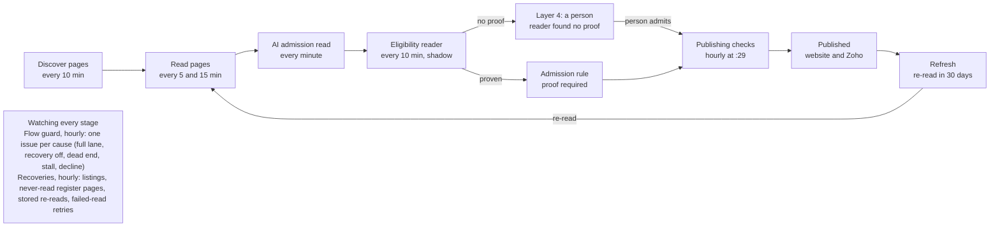

# Scholarship admission mechanism: how it works, controls and status

Nov 12, 2026 · Mandeep Singh

> Committed copy of the Claude Doc of the same name, exported 12 Nov 2026 16:00 AEDT. The figures are as read from the live system (Supabase `fxcwkweaxjtknorudmwp`) on that day.

## Summary

Scholarships are admitted by an automated pipeline. It finds each provider's scholarship pages, reads them, and admits a scholarship only when a rule or a person has proof it is the provider's own, currently offered, and open to international students. It then publishes what passes the publishing checks.

- **Today's position (12 Nov 2026, 15:40 AEDT):** 1,199 scholarships published at 65 providers. 1,537 providers are now eligible for scholarship search, up from 151 this morning.
- **Runs unattended:** 23 scheduled scholarship jobs run the flow; the hourly flow guard raises an issue when anything stalls.
- **Still needs people:** the policy calls listed under Development requests, and Layer 4 decisions the rules cannot make.
- **Main limit on throughput:** budget. Scholarships get 800 Firecrawl credits a day, and that share was used up by 12:30 today.
- **Eligibility reader:** in shadow. Live processing waits on a validation review, scheduled for 16:44 AEDT today.

Change control: CF-CHG-20260915-247, item F-SCH.01 (Pilot #1051, #1056, #1057).

## The flow

Each stage is a scheduled job. A stage only takes work the stage before it has finished, so the flow runs without anyone starting it.

A scholarship is admitted only on proof; a person sees only what the rule cannot decide.

The admission rule (`scholarship_admit_from_provider_page_v1`) is the only gate into the catalogue. It admits a page only when all of these hold: the page is on the provider's own site, it names a scholarship, it is a single-scholarship page, it is currently offered, and a sentence on it proves international students may apply.

| Stage | Job (schedule, AEDT) | What it does |
| --- | --- | --- |
| Line up providers | `scholarship-discover-refill` (hourly :23), `scholarship-discovery-settle` (hourly :16) | Keeps providers waiting for discovery; returns refused providers once the reason clears |
| Discover | `scholarship-discover` (every 10 min) | Maps a provider's site and keeps likely scholarship pages as candidates |
| Read | `scholarship-read` (every 5 min), `scholarship-listing` (every 15 min), `scholarship-listing-accept` (hourly :33) | Reads candidate and listing pages through Firecrawl; listing items become candidates |
| AI read | `scholarship-ai-extract` (every minute), `scholarship-ai-backfill` (nightly) | Pinned model reads each page; every fact must be quoted from the page |
| Eligibility | `scholarship-eligibility` (every 10 min), `scholarship-recheck` (every 2 min) | Re-reads pages refused only for unstated eligibility; re-checks held pages |
| Recover | `scholarship-coverage-recover` (hourly :31), `scholarship-transient-recover` (hourly :37) | Listings, register pages, stored re-reads, failed-read retries; each case once |
| Classify | `scholarship-coverage-classify` (hourly :29) | Puts every case in one of 15 coverage states, with an owner |
| Layer 4 | `layer4-interventions` (:14 and :44) | Raises a case for a person only when no machine step can settle it |
| Publish | `scholarship-auto-publish` (hourly :29) | Publishes what passes every publishing check |
| Enrich | `scholarship-audience` (:41), `scholarship-nationality` (every 10 min), `scholarship-course-attribute` (every 15 min, nightly full), `scholarship-fee-alignment` (:47), `scholarship-savings` (nightly) | Audience, nationalities, course links and savings for published records |
| Refresh | `scholarship-reread-cadence` (daily), `scholarship-publication-review` (nightly) | Re-reads published pages within 30 days; withdraws records that no longer qualify |
| Watch | `scholarship-flow-guard` (hourly :43) | One integration issue per cause that stops admission |

## Toolset usage

Three tools do the work. Each has its own spending limit, and every limit is a setting rather than a value written into code.

| Tool | What the scholarship flow uses it for | Limits that apply (live 12 Nov) | Use so far |
| --- | --- | --- | --- |
| Firecrawl | Site maps to find scholarship pages (up to 5,000 links a site); search (5–6 results); page and listing reads (waits 1.5 s for a page and 5 s for a catalogue to render) | 800 credits a day for scholarships (resets at midnight Sydney time); 150 credits per university per 30 days; the all-time cap is off | Not visible in the call log today (see Data gaps) |
| OpenRouter (AI) | Reads each page and quotes every fact; re-checks held pages; the eligibility reader asks one question: who may apply | US$20 a day guard for scholarship AI; answers capped at 3,000 tokens (page) and 800 (re-check) | US$0.78 today, US$1.26 over 7 days; the eligibility reader has spent US$0.13 of the US$0.50 authorised |
| Supabase | 23 scheduled jobs, the `coverage-sweep` worker (v0.76.0), the admission rule, the coverage and Layer 4 records | Batch sizes per run (see Settings) | n/a |

**One pinned model.** Scholarship AI reads use a single qualified model, `qwen/qwen3-30b-a3b-instruct-2507`. Two others (`openai/gpt-4.1-mini`, `openai/gpt-4.1`) are listed as candidates and receive no traffic. There is no automatic routing between models, so every recorded answer can be traced to the model that gave it.

**Stored copies first.** The eligibility reader reads the copy of a page the platform already holds before it pays for a fresh read. It follows at most one linked eligibility page per scholarship.

## How the platform sustains itself

No one needs to start, nudge or restart the flow. Five properties keep it running.

1. **Every stage is scheduled.** The 23 jobs run on fixed schedules. Each takes a bounded batch, so a large backlog slows the flow down but never stops it.
2. **Work is leased, not locked.** A worker takes a case for a fixed time. If the worker fails, the lease runs out and the case returns to the queue. Failed reads are tried again after 6 hours, up to the set number of tries, and are then recorded as failed.
3. **Recoveries run once per case.** The hourly recovery jobs read listings and never-read register pages, re-read refused pages from their stored copy, and retry reads that stopped on a time-out or a credit refusal. Each runs once per case, so a case that cannot be recovered moves on instead of looping.
4. **The flow guard reports what stops admission.** Each hour it checks five causes: a full Layer 4 lane, a recovery switched off, providers stuck at a dead end, admission stalled for 24 hours, and admission falling below half its 7-day daily average. It raises one integration issue per cause and updates it, rather than opening a new one each hour. Four are open now: IQ-00381 and IQ-00382 (both Layer 4 lanes full), IQ-00388 (52 providers at a scope dead end) and IQ-00389 (2,423 cases older than 7 days).
5. **Published records are kept current.** Published pages are re-read within 30 days, and a nightly review withdraws records that no longer qualify.

**What is still switched off.** The eligibility reader runs in shadow: it records what it would do but admits nothing. Since it started this morning it has found 4 pages that prove international students may apply, 9 that prove a scholarship is for domestic students only, and about 1,100 that say nothing either way. Another 883 cases are queued or being read. A separate check runs at 16:44 AEDT. If no proven case is a false positive, live processing (`sch_elig.apply_on`) is switched on through a migration. From then on, proven cases are admitted through the existing admission rule without a manual step.

## Settings that influence scholarships, and where they live

All of these settings are stored in `pipeline.platform_toolset_settings`. The admin UI shows them on two pages, and every change made there is recorded with a reason. The values below were read live on 12 Nov.

### Toolsets & limits

| Panel | Setting | Value | Effect |
| --- | --- | --- | --- |
| Firecrawl › Daily budget | Share: scholarships | 800 credits | The daily ceiling on scholarship reads, and the main limit on throughput |
| Firecrawl › Daily budget | Scholarship credits per university (30 days) | 150 | Stops one large site using up the share |
| Firecrawl › Daily budget | Scholarships only for providers with at least / discovery order | 30 courses | Now sets only the discovery order; admission uses the legitimacy check below |
| Firecrawl › Find pages | Site map links; search results | 5,000; 5 and 6 | How widely discovery searches each site |
| OpenRouter › Daily guards | Daily guard: read scholarship pages with AI | US$20 a day | AI reads stop for the day once this is reached |

### Settings › Pipeline settings

| Section | Settings that matter most | Live values |
| --- | --- | --- |
| Scholarships | Pilot providers only; non-university admission and types; legitimacy checks and minimum courses; directory-site gate; listing fan-out; umbrella pages; priority countries | pilot only **off**; non-university **on**; legitimacy **on**, at least 1 course; AU first |
| Scholarship eligibility reader | Read who may apply; act on proven sentences; a silent page is not for international students; follow a linked page; batch sizes | reader **on**; act **off** (shadow); silent **off**; 40 pages a call, 300 queued a run |
| Scholarship flow guard | On; stall after; overdue after; decline below, over a window, from a minimum | on; 24 h; 7 days; 50% of a 7-day average, from 5 a day |
| Scholarship coverage recovery | Classify every case; the three recoveries; actions per run and per provider; legal-name identity; policy disposition; apply reviewer award values | all recoveries **on**; 10 a run, 3 per provider; legal name **off**; policy disposition **off** |
| Scholarship discovery | Retry transient failures; park time; retry cycles; re-read an unchanged catalogue | on; 48 h; 1 cycle; 30 days |
| Human-assisted recovery | Raise scholarship interventions; ask for missing award values; open interventions per lane; per provider a run; stronger-model attempt | on; on; 150 a lane; 2; stronger model **off** |
| Job sizes | Universities per discovery run; candidates; pages read; listings | 6; 60; 40; 20 |
| Re-read and retry | Re-read a page, listing or AI read after; retry blocked or failed pages after | 90 / 7 / 90 days; 2 days / 6 h |
| Coverage reconciliation | Share of a listing the catalogue must hold; facts whose absence is a gap | 50%; funding type, value, application dates, study level |
| AI answer limits | Answer length for a page and for a re-check | 3,000 and 800 tokens |
| Platform upkeep | Rebuild cached publishability every | 10 min |
| Onboarding | Close the scholarship stage after | 7 days |
| Layer 4 | Days an item may wait | 7 days |

### A separate table

`pipeline.scholarship_layer_settings` holds nine older Layer 2 and Layer 4 values: discovery limit 6, read limit 40, listing limit 6, Firecrawl reserve 800, Firecrawl cap 60,000, auto-publish on. I have not confirmed which UI page shows this table (see Development requests).

## Data fields

The records below hold the flow's state. All of them are in the `pipeline` schema except the consumer view.

| Record | Key fields | What it tells you |
| --- | --- | --- |
| `scholarship_page_candidates`, `scholarship_pages` | address, provider, read state, stored copy, next try | Which pages have been found and read, and when each is due again |
| `scholarship_ai_queue`, `scholarship_ai_extractions` | state, model, quoted facts | What the AI read and the quotes behind each fact |
| `scholarship_eligibility_reads` | `state`, `outcome` (proven, domestic, silent), `result` (the proving sentence), `applied` (shadow or live action), `cost_usd`, `tries` | The eligibility reader's answer for each held page, and what it did or would have done |
| `scholarship_admission_log` | decision, reason | Every admission and refusal by the admission rule |
| `scholarship_coverage_items` | `state`, `reason`, `evidence`, `recovery`, `owner`, `next_recovery_at`, `escalation` | Every case for every provider, in one of the coverage states, with who or what moves it next |
| `scholarship_coverage_recoveries`, `scholarship_read_retry_cycles` | action, outcome | Each recovery attempt, so none is repeated |
| `scholarship_flow_checks` | `findings`, `raised` | Hourly flow guard results and the integration issue raised for each cause |
| `human_assisted_interventions` | lane (`sch_coverage`, `sch_value`), status, evidence | Layer 4 cases for scholarships |
| `ai_spend_ledger` | `lane`, `cost_usd`, `calls` | AI spend by lane, written automatically for every AI call |
| `admin_control_events` | setting, old and new value, reason | The audit trail for every setting change |
| `public.scholarship_catalogue_v2` | the published record | What the website and Zoho receive; the consumer API is frozen (G3) |

The facts a published scholarship must carry are set by `coverage.sch_gap_fields`: funding type, value, application dates and study level. A provider counts as having a gap when fewer than half (`coverage.sch_field_min_pct`) of its scholarships carry one of these facts.

## Data gaps

Coverage covers 2,561 providers. On 12 Nov, 1,187 cases were published and verified, and 16,069 were settled correctly as out of scope, domestic only, searched with nothing found, or rejected. The table lists the cases still open.

| Coverage state | Cases | Older than 7 days | What moves it |
| --- | --- | --- | --- |
| `international_unresolved` | 2,234 | 1,613 | Eligibility reader (shadow until live processing is switched on); otherwise Layer 4 |
| `traversal_incomplete` | 490 | 309 | Listing recovery, within the Firecrawl share |
| `admitted_not_published` | 342 | 208 | Mostly a missing award value; Layer 4 `sch_value` lane, which is full |
| `source_found_unread` | 288 | 167 | Page reads and register-page recovery |
| `expired` | 256 | — | Re-read at the next round |
| `awaiting_layer4` | 125 | 54 | A person, in the Layer 4 Inbox |
| `source_not_discovered` | 34 | 34 | Discovery; then Layer 4 |
| `rejected_incorrectly` | 31 | 19 | Stored-copy re-read |
| `ownership_conflict` | 22 | 19 | Platform Admin (provider identity) |

Other gaps found while writing this document:

- **Both Layer 4 lanes are full.** Each holds 150 open cases (the cap). Another 2,140 coverage cases and 118 value cases are waiting to be raised. This is why cases park: the cap is reached, so new cases wait rather than reaching a person.
- **Firecrawl scholarship reads are missing from the call log.** `pipeline.firecrawl_calls` shows only 15 credits today, all from the adapter builder. Scholarship reads are counted against the 800-credit share somewhere else. Where that is has not been confirmed, so the actual credits used are not reported here.
- **The 30-course floor is still read in one place.** `security.fc_sch_eligible_v1` applies the legitimacy check, but `security.scholarship_scan_work_v1` still reads `scholarship_min_courses` (30) without it. Whether this holds back any provider has not been checked.
- **Labels are out of date.** Four Scholarships settings are still labelled “PROPOSED” even though they are on.
- **AI read failures are high.** The AI queue shows 22,335 failed reads against 35,852 completed. Many of these are likely reads that waited for credits and were closed, but the breakdown has not been analysed.

## Development requests: committed and pending

### Committed (merged, deployed and checked against the live system on 12 Nov)

| Change | What it delivered |
| --- | --- |
| Pilot #1051, Admin #437 | Coverage classification and the scholarship flow review |
| Migration `20261113030000` | The eligibility reader (shadow and live modes), its queue and records, the flow guard, and two hourly jobs. Layer 4 raises an eligibility case only after the reader finds no proof |
| Migration `20261113040000` | Reader on in shadow; the four recoveries on; pilot-only scope off; the admission-decline check added. Each change is recorded as a control event |
| Migration `20261113050000`, worker v0.76.0 | Tighter proof: “international” must describe who may apply, not name a course. 2 of 5 earlier proofs failed this test and were re-queued |
| Specs F-SCH-01 to F-SCH-03 | Contract tests for the reader, the activation and the proof; the test register regenerated |

### Pending

| Request | Owner | Status |
| --- | --- | --- |
| Switch on live processing (`sch_elig.apply_on`) | Platform, under the existing authorisation | Check scheduled for 16:44 AEDT today; goes ahead only if no proven case is a false positive |
| Raise the Firecrawl scholarship share above 800 credits a day | Platform Admin (cost decision) | Awaiting a decision; this is the main limit on throughput |
| Policy for pages that stay silent (`sch_elig.silent_resolves`) | Platform Admin (policy) | Off; about 1,100 silent pages so far |
| Award-value lane: 150 open cases plus 118 waiting | Platform Admin | Awaiting a decision on how to clear it |
| Legal-name identity rule for providers with joined trading names, e.g. Torrens (`sch_cov.legal_name_identity_on`) | Platform Admin | Off; awaiting a decision |
| Report the 52 scope-refused providers as blocked by policy (`sch_cov.policy_disposition_on`) | Platform Admin | Off; tracked as IQ-00388 |
| Find where Firecrawl scholarship reads are logged, and log them in `firecrawl_calls` if they are not | Engineering | Open |
| Remove the 30-course floor from `scholarship_scan_work_v1` if it still holds providers back | Engineering | To check |
| Remove the “PROPOSED” labels from settings that are on | Engineering | Open |
| Confirm which UI page shows `scholarship_layer_settings`, or move those values into Pipeline settings | Engineering | Open |
| Stronger-model attempt before Layer 4 (`har.ai_escalate_on`; no model pinned yet) | Platform Admin, then qualification | Off; a model must be qualified and pinned first |
| Report actual before-and-after admissions and publications | Platform | Admissions have not increased yet; this will be reported only once live processing has run |
