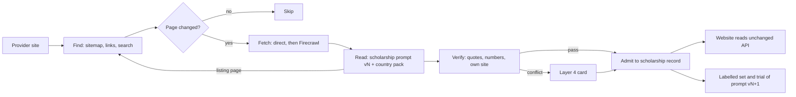

# Scholarship engine v2: a lean, prompt-led engine (proposal)

| | |
|---|---|
| Status | **Proposed (v0.1).** Nothing in this document is built or switched on. |
| Date | 12 November 2026 |
| Owner | Platform Admin |
| Companion documents | `2026-11-12-scholarship-admission-mechanism.md` (how it works today), `AER-DESIGN-V2-PROPOSAL.md` (the same pattern for entry requirements), `2026-11-12-aer-admission-mechanism.md` |
| Pattern it copies | F-PDESC / course descriptions: one versioned prompt in Settings, a small strict verifier, automatic admission, re-read only when needed |

## 1. Summary

Course and provider descriptions improved sharply once hand-written readers and lists were replaced by **one prompt kept in Settings, a small verifier that checks the AI against the page, and automatic admission**. Scholarships are now where descriptions were before that change: a large, rule-heavy engine that is costly to keep and does not travel well to new countries.

This proposal replaces the scholarship engine with the same shape:

1. **Find** candidate pages cheaply (sitemap and site links first, Firecrawl only when needed).
2. **Read** each page once with **one versioned prompt** that returns the whole scholarship record, with a quote for every fact.
3. **Verify** with a short, country-neutral check: every quote is on the page, every number appears in its quote, the page is on the provider's own site.
4. **Admit** automatically when the verifier passes; send only genuine conflicts to Layer 4.
5. **Re-read** only when the page's content changes.
6. **Improve** by testing a new prompt version against a labelled set in shadow; the Platform Admin switches it on.

Country differences (currency, how "international" is said, award names) move out of code into **country packs**: small reference rows the prompt is given as variables.

## 2. Where scholarships are today

Live figures, 12 Nov 2026.

| Measure | Today |
|---|---|
| Database functions in the scholarship area | 201 (about 562,000 characters) |
| Scheduled jobs | 23 |
| Settings | 69 |
| Firecrawl, last 7 days | 1,409 scrapes, 104 maps; the daily share of 800 was used up by about 12:30 today |
| AI read | One pinned model (`qwen/qwen3-30b-a3b-instruct-2507`); prompt `pipeline.scholarship_ai_prompts` v2 (11 Oct 2026). This prompt classifies the page, but it does not decide admission. |
| Admission | A hard rule, written in code: own site, names a scholarship, one scholarship per page, currently offered, and a sentence saying international students can apply |
| Unresolved | 2,234 rows marked `international_unresolved` |
| Layer 4 | Lanes full at the cap of 150; the value lane has 261 waiting |
| Readers in shadow | The eligibility reader runs in shadow only |
| Leftover rules | The 30-course floor is still read in `scholarship_scan_work_v1` |

What this tells us:

- **Admission is decided by rules, not by the AI.** The prompt is already versioned, but its answer is checked against a fixed English test ("a sentence saying international"). Pages that say "overseas", "non-domestic" or "students from outside the EU" fail. Pages in other languages fail. This one test is most of the 2,234 unresolved rows.
- **Too many moving parts.** 23 jobs and 201 functions need a person to keep them running. Each new country has brought new lists and special cases.
- **Firecrawl is the bottleneck.** Every read goes through Firecrawl, even for pages a direct fetch would return. Some pages are read again even when nothing on them has changed.
- **Layer 4 is a holding pen.** Lane caps stop new work arriving, but nothing settles the questions a policy could answer (for example, a value written in words, or eligibility that the page does not mention).

## 3. Principles

1. **The prompt decides; the verifier checks.** Business judgement (is this a scholarship, is it open to international students, what is it worth) lives in the prompt, which the Platform Admin can edit in Settings. The code only checks that the answer is supported by the page.
2. **Nothing without a quote.** Every fact the website shows has a quote from the page behind it.
3. **Country-neutral code.** No country, currency or wording is written into code. These live in country packs.
4. **Read once, re-read on change.** A page is read again only if its content hash changes, or if a new prompt version is switched on (once per version, as in F-PDESC self-heal).
5. **Cheap fetch first.** Direct fetch first; Firecrawl only for pages that refuse it or need JavaScript.
6. **People settle conflicts, not volume.** Layer 4 receives only cases where the verifier and the prompt disagree, or where two sources give different facts.
7. **Improvements are trialled, then switched on by a person.** A passing trial never switches anything on by itself.
8. **Consumer API unchanged (G3).** The new engine writes to the existing scholarship tables that the website reads. It does not change their shape.

## 4. Design



### 4.1 Find

- Candidates come from the provider's sitemap, site links whose text or path suggests scholarships (worked out by the prompt, not a list), and the existing Firecrawl search when a site gives nothing.
- A **listing page** (one that names several scholarships) is not rejected. The prompt returns its child links, and these join the queue. This replaces the "single-scholarship page" rule.
- Candidate ranking: the AI scores titles and links in a single cheap call per site, as proposed for AER v2.

### 4.2 Fetch

- Direct fetch first, under the existing time-out (a technical safety value, marked `-- fixed:`).
- Firecrawl only on refusal, a JavaScript-only page, or a block. This should cut Firecrawl use substantially. The saving is measured in rollout step 1, not assumed.
- A hash of the main text is stored. If the hash is unchanged, there is no AI call.

### 4.3 Read: one prompt, one record

The prompt lives in Settings (Models & services › AI & OpenRouter › prompt cards), versioned in `pipeline.scholarship_ai_prompts`, and edited only by the Platform Admin with a reason. It returns strict JSON:

```json
{
  "page_kind": "single | listing | not_scholarship",
  "children": [{"url": "", "title": ""}],
  "scholarship": {
    "name": {"value": "", "quote": ""},
    "provider_own": true,
    "offered_now": {"value": "open | closed_round | ended", "quote": ""},
    "international": {"value": "yes | no | not_stated", "quote": ""},
    "value": {"amount": null, "currency": "", "period": "", "in_words": "", "quote": ""},
    "levels": [{"value": "", "quote": ""}],
    "fields": [{"value": "", "quote": ""}],
    "eligibility": [{"value": "", "quote": ""}],
    "deadline": {"value": "", "quote": ""},
    "apply_url": ""
  },
  "language": "en"
}
```

The prompt receives the **country pack** for the provider's country as variables: currency codes and symbols, the local words for "international" and "domestic", the common award names and the academic year pattern. Pages in other languages are read in their own language; quotes stay in the original language.

### 4.4 Verify

The verifier is small, deterministic and the same for every country.

| Check | Rule | Fail goes to |
|---|---|---|
| Quote present | Every quote appears in the page text (after whitespace normalisation) | Rejected, logged as a prompt miss |
| Numbers in quote | Every number in `value.amount` and `deadline` appears in its quote | Rejected |
| Own site | The page host belongs to the provider (existing host rules) | Rejected |
| Currency known | The currency is in the country pack, or is stated in the quote | Layer 4 |
| International | `yes` admits; `no` is stored as not open to international; `not_stated` is admitted with eligibility left as null (null means not held) | — |
| Conflict | A second source gives a different value or deadline | Layer 4 |

### 4.5 Admit

When the verifier passes, the record is written to the existing scholarship tables with its quotes as evidence. There is no lane cap. Admissions are counted in a rolling daily limit in Settings (`scholarship.admit_daily_max`, set by the Platform Admin) as a safety brake.

Policy auto-settle replaces the waiting lanes:

- **Value in words** ("full tuition", "50% fee waiver") is admitted as stated in `in_words`, with `amount` left null.
- **Eligibility the page does not mention** is null, which is not a Layer 4 question.
- **A closed round of a recurring scholarship** is admitted as offered, which matches prompt v2.

### 4.6 Layer 4

Layer 4 cards show the quote, the page link and the conflicting value, and offer three actions: accept, reject, or "teach". Teach adds the case to the labelled set (§4.7). There are no lane caps; the queue is ordered by provider priority and by how much each card would add to coverage.

### 4.7 Self-improvement

- Each human decision on Layer 4, and a weekly random sample of automatic admissions, goes into a **labelled set**: `pipeline.scholarship_labelled_set` (new table, written beside the consumer tables).
- A new prompt version runs in **shadow** on the labelled set and on a sample of live pages. The trial reports: agreement with the labels, verifier pass rate, quotes missing, and cost per admitted record.
- The Platform Admin switches the new version on in Settings. When it is switched on, pages are re-read once (self-heal, as in F-PDESC).
- A weekly line in the Monday report shows admitted records, verifier rejects by reason, Layer 4 cards in and out, cost, and Firecrawl share used.

### 4.8 Country packs

`pipeline.country_packs` (new reference table, edited on Settings with a reason) holds one row per country:

| Field | Example (Australia) |
|---|---|
| currency | AUD, `$`, `A$` |
| international_terms | international, overseas, offshore |
| domestic_terms | domestic, Australian citizen, permanent resident |
| award_terms | scholarship, bursary, grant, fee waiver |
| academic_year | Feb–Nov |
| languages | en |

A new country needs a new row, not new code. The prompt can propose a draft row for a new country from its first pages. The Platform Admin approves the row.

## 5. What is retired

Retired only after the new engine has run in shadow and been validated, and switched off in the same change that switches the new engine on (Decision 260).

| Retire | Replaced by |
|---|---|
| Hard admission rule (international sentence, single-scholarship page) | Prompt plus verifier (§4.3, §4.4) |
| 30-course floor in `scholarship_scan_work_v1` | Removed; coverage is by provider |
| Layer 4 lane caps and the separate value lane | Policy auto-settle and priority ordering (§4.5, §4.6) |
| Eligibility reader in shadow | Eligibility field in the prompt |
| Hand-kept wording and host lists used only by scholarships | Country packs and the prompt |
| About 17 of the 23 jobs | About 6 jobs: find, fetch-and-read, verify-and-admit, re-check changed pages, trial, report |

Each retired item is marked `retiring` in `pipeline.component_register` with `replaced_by` and `retire_after`. Drops go to the Platform Admin as a paste file after 14 days unused.

## 6. Settings (target)

All are in `pipeline.platform_toolset_settings` with a label, range, unit and `used_by` line, shown on Settings (G2).

| Setting | Purpose |
|---|---|
| `scholarship.prompt_version` | Active prompt version (Platform Admin) |
| `scholarship.admit_daily_max` | Safety brake on automatic admissions |
| `scholarship.read_daily_max` | AI reads per day |
| `scholarship.firecrawl_share` | Share of the existing Firecrawl daily budget (no increase to the overall budget) |
| `scholarship.recheck_days` | How often unchanged pages are checked for a new hash |
| `scholarship.trial_sample` | Live pages sampled in a shadow trial |
| `scholarship.labelled_weekly_sample` | Automatic admissions sampled into the labelled set each week |

The 69 current settings reduce to about 10–15. The rest are retired together with the components that read them.

## 7. Rollout

| Step | What | Gate |
|---|---|---|
| 0 | Build the labelled set from existing human decisions; write country packs for current countries | Platform Admin reviews the set |
| 1 | Direct-fetch-first and content hash, on the current engine | Firecrawl use measured before and after |
| 2 | Prompt v3 (full record) plus verifier, in **shadow** beside the current rule | Trial report: agreement, verifier pass rate, cost |
| 3 | Platform Admin switches v3 on for one country | Switch-on is a separate, deliberate step |
| 4 | Policy auto-settle replaces lane caps; the 2,234 unresolved rows are re-read once | Layer 4 inflow measured |
| 5 | Remaining countries; retire old components (§5) | 14 days unused, then paste file |

## 8. Risks

| Risk | Mitigation |
|---|---|
| The AI admits something that is not a scholarship | The quote must be on the page; weekly sample into the labelled set; daily admit brake |
| The prompt drifts after an edit | Versioned; every version is trialled in shadow; switching on is a person's decision |
| Direct fetch gets blocked | Automatic fall-back to Firecrawl inside the existing budget |
| Non-English pages | Quotes are kept in the original language; the verifier matches text, not meaning |
| Consumer API | Writes go to existing tables in their existing shape; `s57` and the website API v2 contract stay green |

## 9. Decisions needed from the Platform Admin

1. Agree the principle: **the prompt decides and the verifier checks**, replacing the hard admission rule once validated.
2. Agree that `international: not_stated` is admitted with eligibility left null, rather than held.
3. Agree direct fetch first, with Firecrawl as fall-back (step 1 can start straight away).
4. Agree country packs as the only place country-specific wording lives.
5. Agree the order: step 0 and step 1 first, with a shadow trial before any switch-on.
