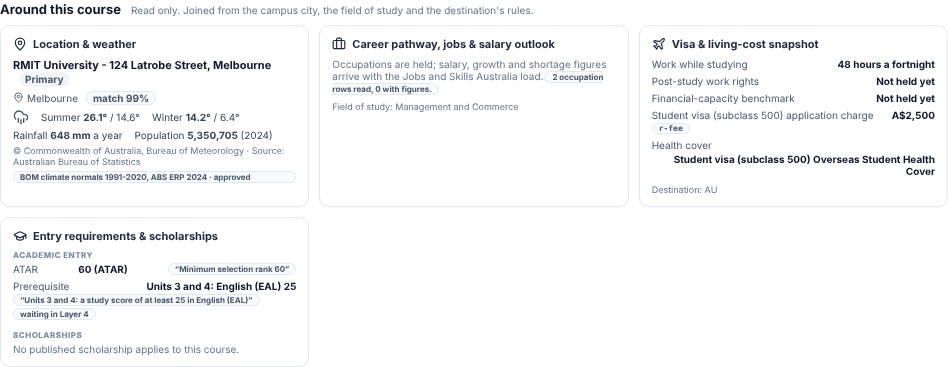
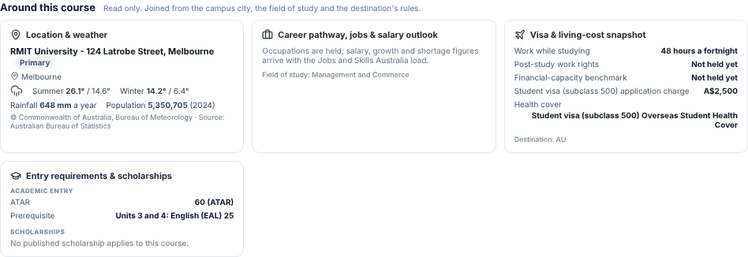
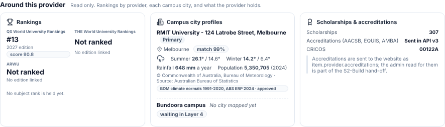
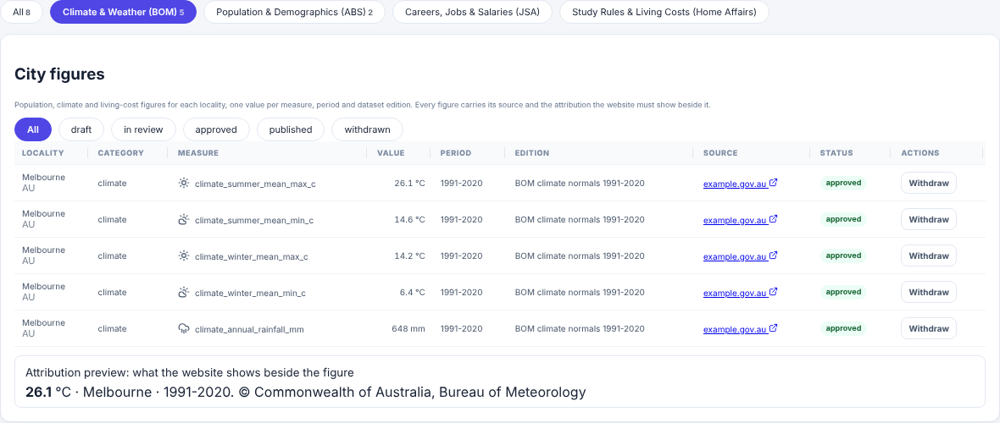
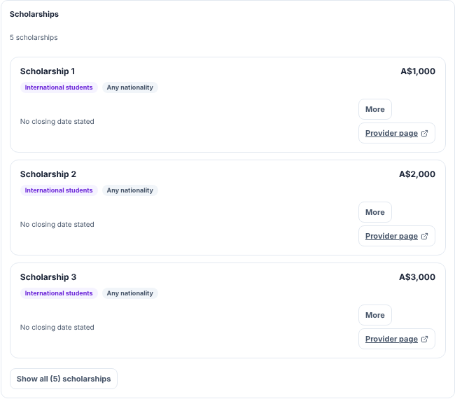
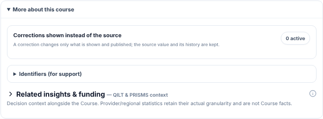

# Correlated detail blades, metric type pills and role-based field visibility — UI mockup and specification

Version 1.2 · 19 Nov 2026 · S1-RM-Design · Platform Admin directives 18 Nov 2026 21:23, 23:02 and 23:51 · PIM Admin v2.16.44 to v2.16.46 (Pilot specs s694 to s698)

The interactive mockup is the live screen itself: it ships in PIM Admin v2.16.44 as read-only blocks in the Course and Provider detail, the pills on Destination data › City metrics & costs and the "Preview as" switcher. Column and field tables in sections 3 to 6 are generated from the code (`src/lib/correlation-adapters.js` CARD_SPEC, `src/lib/destination-metric-types.js`, `src/lib/field-visibility.js`), so this document and the screen cannot drift; s694 to s696 hold the screen to them.

## 1. What this covers

| Item | Where | Spec |
|---|---|---|
| Correlated read-only sections in the Course detail (Location & weather; Career pathway, jobs & salary outlook; Visa & living-cost snapshot; Entry requirements & scholarships) | Courses › a course › Around this course | s694 |
| Correlated read-only sections in the Provider detail (Rankings; Campus city profiles; Scholarships & accreditations) | Providers › a provider › Around this provider | s694 |
| Metric type filter pills | Destination data › City metrics & costs | s695 |
| Role-based field visibility matrix and "Preview as: Admin \| Counsellor \| Viewer" | Course and Provider detail header and body | s696 |
| Fixes after live inspection: Preview as pills, Archive course and Read with AI, the entry pipeline, scholarship Show all | Course and Provider detail | s697 |
| Course detail declutter: Description pipeline and task buttons hidden for Counsellor and Viewer, pipeline and Related insights & funding folded, one scholarship list | Course detail | s698 |

Zero schema: no migration, no new function, no grant. Every card is a join in the browser over reads the admin already has: `admin_provider_destination_read` and `admin_course_destination_read` (any StudySearch role), `admin_destination_review` (Curator and above), `admin_entry_requirements`, `admin_read` `provider_ranking_history`, and the course detail's own scholarships. G3 untouched (75 functions, 48 tables).

## 2. Layout summary

Course detail (top to bottom): summary pills and fact cards › course values (cards with Change) › **Around this course** (four cards in a grid that reflows from one to three columns with the drawer width) › scholarships › More.

```
┌ Course detail header ─────────────── [Compare] [Evidence] [×] ┐
│ Associate Degree in Business                                   │
│ 👁 Preview as  (Admin) (Counsellor) (Viewer)   ← Editor and up   │
├────────────────────────────────────────────────────────────────┤
│ pills · fact cards (tuition, CRICOS cost, intakes, English …)    │
│ course values (cards with Change; tags hidden for students)      │
│ Around this course — read only                                  │
│ ┌ Location & weather ┐ ┌ Career pathway ┐ ┌ Visa & living cost ┐ │
│ │ campus · city      │ │ occupation │    │ │ work limit         │ │
│ │ ☁ summer max/min   │ │ growth     │    │ │ post-study work    │ │
│ │   winter max/min   │ │ median AUD │    │ │ financial capacity │ │
│ │   rainfall, pop.   │ │ shortage   │    │ │ visa charges       │ │
│ │ attribution        │ │ (or empty  │    │ │ health cover       │ │
│ └────────────────────┘ │  state)    ┘    └────────────────────┘ │
│ ┌ Entry requirements & scholarships ┐                           │
│ │ academic entry (3)  │ scholarships (3) │                       │
│ └───────────────────────────────────┘                           │
└────────────────────────────────────────────────────────────────┘
```

Provider detail: summary › **Around this provider** (Rankings · Campus city profiles · Scholarships & accreditations) › fill actions › provider values › rankings history › More.

Empty and gap states (every card has one, so a card never disappears):

| Card | Empty state | Read-gap note (Viewer, Counsellor) |
|---|---|---|
| Location & weather | "No campus is held for this course yet." / "No climate or population figure is held for <city> yet." | "City figures, careers and visa figures show for Curators and above until the student-facing read is added (S2-Build)." |
| Career pathway | not_loaded: "Career outcomes are not loaded for this country yet." · figures_loading: "Occupations are held; salary, growth and shortage figures arrive with the Jobs and Skills Australia load." · no_field_link: "No occupation is linked to this field of study yet." | as above |
| Visa & living cost | "No visa or living-cost rule is proven for this course's destination yet."; a rule without a figure reads "Not held yet" | "Figures for each rule show for Curators and above …" |
| Entry & scholarships | "No approved entry requirements published for this course yet." (also the only entry line a Counsellor or Viewer sees when none is approved) / "No published scholarship applies to this course."; more than three scholarships: Show all (N) scholarships | — |
| Rankings | "Not ranked" per system; "No subject rank is held yet." | — |
| Scholarships & accreditations | "Sent in API v3" | "Accreditations are sent to the website as item.provider.accreditations; the admin read for them is part of the S2-Build hand-off." |

Screenshots (mocked data, Playwright, 1500 px wide unless stated; the signed-in browser was not reachable from this session):

| View | Image |
|---|---|
| Detail header with Preview as |  |
| Around this course (Platform Admin view) |  |
| Around this course (Preview as Counsellor) |  |
| Around this provider |  |
| City metrics & costs, Climate & Weather (BOM) pill |  |
| v2.16.45: Preview as pills at a 720 px pane |  |
| v2.16.45: Preview as Counsellor, approved entry requirements only |  |
| v2.16.45: scholarships, three then Show all (5) scholarships |  |
| v2.16.46: Description pipeline folded (Editor and Platform Admin) |  |
| v2.16.46: More about this course, Related insights & funding folded |  |

## 3. Course detail: Around this course

### Location & weather (`course.location`)

Join: course › campus › postcode › locality (security.destination_locality_for_postcode_v1, approved localities only).

| Field | Shown as | Column read | API v3 path | Audience |
|---|---|---|---|---|
| `campus` | Campus and city | catalogue.campuses.name, city | `item.campuses[].name` | Student-facing |
| `locality` | Locality (city) | destination.localities.name | `item.campuses[].locality.name` | Student-facing |
| `summer_max` | Summer mean max (°C) | locality_metrics.numeric_value · metric_key climate_summer_mean_max_c | `localities[].metrics[] key climate_summer_mean_max_c` | Student-facing |
| `summer_min` | Summer mean min (°C) | locality_metrics · climate_summer_mean_min_c | `localities[].metrics[] key climate_summer_mean_min_c` | Student-facing |
| `winter_max` | Winter mean max (°C) | locality_metrics · climate_winter_mean_max_c | `localities[].metrics[] key climate_winter_mean_max_c` | Student-facing |
| `winter_min` | Winter mean min (°C) | locality_metrics · climate_winter_mean_min_c | `localities[].metrics[] key climate_winter_mean_min_c` | Student-facing |
| `rainfall` | Annual rainfall (mm) with climate icon | locality_metrics · climate_annual_rainfall_mm | `localities[].metrics[] key climate_annual_rainfall_mm` | Student-facing |
| `population` | City population (ABS) | locality_metrics · metric_category population (erp_persons) | `localities[].metrics[] category population` | Student-facing |
| `attribution` | Attribution and period | locality_metrics.attribution_text, reference_period | `localities[].metrics[].attribution` | Student-facing |
| `match_share` | Postcode match share | locality_postcodes.containment_share | — | Internal (Editor and Platform Admin) |
| `dataset_edition` | Dataset edition and status | locality_metrics.dataset_edition, status | — | Internal (Editor and Platform Admin) |

### Career pathway, jobs & salary outlook (`course.careers`)

Join: course field of study › career_outcomes.study_area_code (country of the course).

| Field | Shown as | Column read | API v3 path | Audience |
|---|---|---|---|---|
| `occupation` | Occupation and code | career_outcomes.occupation_title, occupation_scheme, occupation_code | `career_outcomes[].occupation_code` | Student-facing |
| `growth` | Projected growth / outlook | career_outcomes.job_outlook_rating, outlook_horizon_years | `career_outcomes[].outlook` | Student-facing |
| `median_salary` | Median salary (AUD a year) | career_outcomes.median_salary, salary_currency, salary_period | `career_outcomes[].median_salary` | Student-facing |
| `shortage` | Skills shortage status | career_outcomes.skill_shortage_status | `career_outcomes[].shortage` | Student-facing |
| `attribution` | Attribution and period | career_outcomes.attribution_text, reference_period | `career_outcomes[].attribution` | Student-facing |
| `dataset_edition` | Dataset edition and status | career_outcomes.dataset_edition, status | — | Internal (Editor and Platform Admin) |

### Visa & living-cost snapshot (`course.visa`)

Join: course › provider › country › study_rules (proven rule_applicability).

| Field | Shown as | Column read | API v3 path | Audience |
|---|---|---|---|---|
| `work_hours` | Work limit while studying (hours a fortnight) | study_rules.work_hours_fortnight · work_rights | `study_rules[] rule_category work_rights` | Student-facing |
| `post_study_work` | Post-study work rights (years) | study_rules.post_study_work_years_min, _max | `study_rules[] rule_category post_study_work` | Student-facing |
| `financial_capacity` | Financial-capacity benchmark (a year) | study_rules.financial_capacity_annual, currency_code | `study_rules[] rule_category financial_capacity` | Student-facing |
| `visa_fees` | Visa application charges | study_rules.application_fee_amount · visa_fee | `study_rules[] rule_category visa_fee` | Student-facing |
| `health_cover` | Health cover rule | study_rules.title · health_insurance | `study_rules[] rule_category health_insurance` | Student-facing |
| `rule_id` | Rule id | study_rules.id | — | Internal (Editor and Platform Admin) |
| `approval_status` | Approval and edition status | study_rules.approval_status, editions.status | — | Internal (Editor and Platform Admin) |

### Entry requirements & scholarships (`course.entry`)

Join: course › entry requirement rows and published scholarships.

| Field | Shown as | Column read | API v3 path | Audience |
|---|---|---|---|---|
| `entry_rows` | Academic entry requirements (kind, requirement, score and basis) | admin_entry_requirements course rows | `item.entry_requirements.summary` | Student-facing |
| `scholarships` | Published scholarships (name, value, closing date) | course_scholarships.items | `item.scholarships[].name` | Student-facing |
| `raw_quote` | Quote read from the page | entry requirement quote | — | Internal (Editor and Platform Admin) |
| `layer4_queue_state` | Waiting in Layer 4 | entry requirement status proposed | — | Internal (Editor and Platform Admin) |

## 4. Provider detail: Around this provider

### Rankings (`provider.rankings`)

Join: provider_id › ranking observations (provider_ranking_history).

| Field | Shown as | Column read | API v3 path | Audience |
|---|---|---|---|---|
| `qs` | QS World University Rankings (latest edition and rank) | system_code qs_wur · edition_year, rank_display | `rankings[] system qs_wur` | Student-facing |
| `the` | THE World University Rankings | system_code the_wur | `rankings[] system the_wur` | Student-facing |
| `arwu` | ARWU (Academic Ranking of World Universities) | system_code arwu | `rankings[] system arwu` | Student-facing |
| `subject` | Subject ranks | any other system_code (subject tables) | `rankings[] subject` | Student-facing |
| `overall_score` | Overall score | overall_score | — | Internal (Editor and Platform Admin) |

### Campus city profiles (`provider.campus_cities`)

Join: provider › campuses › locality › city figures.

| Field | Shown as | Column read | API v3 path | Audience |
|---|---|---|---|---|
| `campus` | Campus (primary first) | catalogue.campuses.name, is_primary | `item.campuses[].is_primary` | Student-facing |
| `weather` | Summer and winter means, rainfall, climate icon | locality_metrics climate_* | `localities[].metrics[] category climate` | Student-facing |
| `population` | City population | locality_metrics population | `localities[].metrics[] category population` | Student-facing |
| `match_share` | Postcode match share and Layer 4 state | locality_postcodes.containment_share, in_layer4 | — | Internal (Editor and Platform Admin) |

### Scholarships & accreditations (`provider.scholarships_accreditations`)

Join: provider › scholarships and accreditation bodies.

| Field | Shown as | Column read | API v3 path | Audience |
|---|---|---|---|---|
| `scholarships` | Scholarships held for the provider | provider_detail.scholarship_count | `item.scholarships[]` | Student-facing |
| `accreditations` | Accreditations (AACSB, EQUIS, AMBA) | catalogue.provider_accreditations.body_code (API v3 only today) | `item.provider.accreditations[].body_code` | Student-facing |
| `registrations` | Provider registrations (CRICOS and others) | provider registrations | `item.provider.registrations[]` | Student-facing |

## 5. Metric type pills (s695)

Destination data › City metrics & costs. One row of pills above the panel; the choice can be opened directly with `#destination-data?tab=metrics&type=<key>`.

| Pill | Key | Source | What it shows |
|---|---|---|---|
| All | `all` | — | Every city figure (count beside the pill) |
| Climate & Weather (BOM) | `climate` | Bureau of Meteorology | City figures with metric_category `climate`, `weather` |
| Population & Demographics (ABS) | `population` | Australian Bureau of Statistics | City figures with metric_category `population`, `demographics`, `demographic` |
| Careers, Jobs & Salaries (JSA) | `careers` | Jobs and Skills Australia | The Careers & outcomes list in place |
| Study Rules & Living Costs (Home Affairs) | `rules` | Department of Home Affairs | The Study rules list, then living-cost city figures (`cost_of_living`, `living_cost`, `living_costs`, `rent`) |

## 6. Role-based field visibility (s696)

| Role | Ranks | Audience |
|---|---|---|
| Viewer | 1 | Student-facing only |
| Counsellor | 2 | Student-facing only |
| Editor (Curator, Pipeline Operator and PIM Operator) | 3, 4, 5 | Student-facing and internal |
| Platform Admin | 6 | Student-facing and internal |

| Field | Viewer | Counsellor | Editor | Platform Admin | Marker on screen |
|---|---|---|---|---|---|
| Automated or entered-by-hand tag (`change_tag`) | Hidden | Hidden | Shown | Shown | `.re-auto, .re-lock-wrap` |
| Change and Remove buttons (`edit_actions`) | Hidden | Hidden | Shown | Shown | `.re-actions` |
| Study rule id (`rule_id`) | Hidden | Hidden | Shown | Shown | `[data-vis="rule_id"]` |
| Match confidence and locality match share (`confidence`) | Hidden | Hidden | Shown | Shown | `[data-vis="confidence"]` |
| Layer 4 hook detail (`hook_detail`) | Hidden | Hidden | Shown | Shown | `[data-vis="hook_detail"]` |
| AI prompt version and read cost (`prompt_version`) | Hidden | Hidden | Shown | Shown | `[data-vis="prompt_version"], [data-course-entry-reads]` |
| Layer 4 queue state and corrections (`layer4_queue_state`) | Hidden | Hidden | Shown | Shown | `.cf-layer4-override, [data-vis="layer4_queue_state"]` |
| Raw quote diagnostics (`raw_quote`) | Hidden | Hidden | Shown | Shown | `[data-vis="raw_quote"]` |
| Approval and edition status (`approval_status`) | Hidden | Hidden | Shown | Shown | `[data-vis="approval_status"]` |
| Dataset edition (`dataset_edition`) | Hidden | Hidden | Shown | Shown | `[data-vis="dataset_edition"]` |
| Record id and stable key (`identifiers`) | Hidden | Hidden | Shown | Shown | `[data-identifiers]` |
| Fill, extract and re-read actions (`fill_actions`) | Hidden | Hidden | Shown | Shown | `[data-fill-fields-card], [data-vis="fill_actions"]` |
| Course status with Archive course and Restore course (`archive_actions`) | Hidden | Hidden | Shown | Shown | `.re-manage, [data-vis="archive_actions"]` |
| Read with AI trigger bar (`read_with_ai`) | Hidden | Hidden | Shown | Shown | `[data-course-read-ai]` |
| Read / refresh entry requirements now and the entry pipeline (sources, AI candidates, reviewer packet, Layer 4, links) (`entry_pipeline`) | Hidden | Hidden | Shown | Shown | `[data-course-entry], [data-aer-read-now], [data-vis="entry_pipeline"]` |
| Description pipeline (stored page, AI reading, checks, decision, source, next retry, run, Fill / refresh, Check the feeds, Fill or Recheck only) and Tasks that held this course (`description_pipeline`) | Hidden | Hidden | Shown | Shown | `[data-cdod-block], .cdod-tasks-fold` |
| Scraper and task triggers (Check scholarships for this course and other task buttons) (`task_triggers`) | Hidden | Hidden | Shown | Shown | `[data-scholarship-actions], [data-job-button], [data-vis="task_triggers"]` |
| Entry requirement rows not yet approved (`unapproved_entry`) | Hidden | Hidden | Shown | Shown | `[data-vis="unapproved_entry"]` |
| The value itself (fee, intake, figure, rank) (`value`) | Shown | Shown | Shown | Shown | — |
| Source page link (`source_link`) | Shown | Shown | Shown | Shown | — |
| Attribution the licence requires beside a figure (`attribution_text`) | Shown | Shown | Shown | Shown | — |
| Period the figure covers (`reference_period`) | Shown | Shown | Shown | Shown | — |
| Climate icon (long-term average) (`climate_icon`) | Shown | Shown | Shown | Shown | — |
| Approved entry requirements (or one empty-state line) (`approved_entry`) | Shown | Shown | Shown | Shown | — |

Preview as: Admin | Counsellor | Viewer, in the Course and Provider detail header, shown to Editors and Platform Admins only. A preview only lowers what is shown (an Editor previewing as Admin still sees the Editor view; a Viewer can never raise theirs).

## 6A. Fixes after live inspection (v2.16.45, s697; Platform Admin 18 Nov 2026 23:02)

| # | Found on Master of Teaching (Secondary) | Fix | Check in s697 |
|---|---|---|---|
| 1 | Preview as pills clipped ("out of bounds") | The drawer header styled every button as a 32 px icon square; the Preview as pills now override it (inline-flex, wrap, no-wrap labels, pill padding) | Full label, no clipping and inside the pane at 1500, 720 and 390 px; the check fails without the fix |
| 2 | Archive course and the Read with AI bar shown to Counsellor and Viewer | `archive_actions` (`.re-manage`) and `read_with_ai` (`[data-course-read-ai]`) are internal | Hidden in Preview as Counsellor and Viewer and for a Counsellor; shown again for Admin |
| 3 | Read / refresh entry requirements now and its pipeline (Source found, AI parsed candidates, Complete reviewer packet, Awaiting a person in Layer 4, Approved and active, Visible to the website, Open in Entry requirements, Inspect resolution) shown to Counsellor and Viewer | `entry_pipeline` (`[data-course-entry]`, `[data-aer-read-now]`) is internal; Counsellor and Viewer see a student-only block with approved (`active`) requirements, or "No approved entry requirements published for this course yet." Rows not yet approved are internal in the Around this course card too | Pipeline hidden, one approved row shown, the proposed row not shown; a Counsellor with none approved sees the one line |
| 4 | Cramped scholarship list | Course scholarships, the Around this course card and the scholarship insight panel (Course and Provider detail) show three, then Show all (N) scholarships / Show less; no inner scroll box | Three, then all, then three again; no overflow or max-height on the list |

## 6B. Course detail declutter (v2.16.46, s698; Platform Admin 18 Nov 2026 23:51)

Found on Diploma of Information Technology (Higher Education), on a phone, in Preview as Viewer.

| # | Found | Fix | Check in s698 |
|---|---|---|---|
| 1 | Description pipeline (stored page, AI reading, checks, decision, source examined, next retry, run, Fill / refresh course description now, Check the feeds, Fill or Recheck only) and Tasks that held this course shown to a Viewer, and open by default for everyone | `description_pipeline` (`[data-cdod-block]`, `.cdod-tasks-fold`) is internal; the pipeline sits in a fold, closed until an Editor or Platform Admin opens it | Hidden in Preview as Counsellor and Viewer and for a Viewer; closed by default for the Platform Admin and opens on click |
| 2 | Check scholarships for this course shown to a Viewer | `task_triggers` (`[data-scholarship-actions]`, `[data-job-button]`) is internal, so every task button in the drawer is hidden for Counsellor and Viewer | Hidden in Preview as Counsellor and Viewer and for a Viewer |
| 3 | Related insights & funding (QILT, PRISMS: six stat cards) open every time | The panel is its own fold, "Related insights & funding — QILT & PRISMS context", closed by default for every role | Closed for the Platform Admin and a Counsellor; opens on click |
| 4 | A second Scholarships & funding card below the insights | On a course the insights add no scholarship card; the course's Scholarships section (three, then Show all (N) scholarships) is the one list. The Provider detail keeps its scholarship card, which is its only list | No `.ci-scholarships` on the Course detail; one Scholarships section |

## 7. Live data behind the cards (read 18 Nov 2026, project fxcwkweaxjtknorudmwp)

| Source | Held | What the cards show today |
|---|---|---|
| BOM climate (destination.locality_metrics, category climate) | 40 figures across 8 capital-city localities (Adelaide, Brisbane, Canberra - Queanbeyan, Darwin, Hobart, Melbourne, Perth, Sydney), five keys each | Summer and winter means, annual rainfall and the climate icon for a campus in those cities |
| ABS population (category population, erp_persons) | 102 figures, one per locality | City population and period |
| JSA careers (destination.career_outcomes) | 1,577 OSCA occupations, national, approved; none with median salary, outlook, shortage status or study area yet | The figures_loading empty state |
| Home Affairs study rules (destination.study_rules) | 4 approved: subclass 500 application charge (AUD 2,500), Overseas Student Health Cover, work limit 48 hours a fortnight, subclass 485 application charge (AUD 5,750) | Work limit, visa charges, health cover; post-study work years and the financial-capacity benchmark read "Not held yet" |
| Accreditations (catalogue.provider_accreditations) | 13 AMBA | Sent in API v3; not readable in the admin yet |
| Rankings | QS and THE history by provider (provider_ranking_history) | Latest and previous edition per system; ARWU and subject ranks show "Not ranked" / "No subject rank is held yet" until loaded |

## 8. Decisions taken and open items

| # | Item | Decision or owner |
|---|---|---|
| 1 | Viewers and Counsellors cannot read city figures, careers or full rule figures: `admin_destination_review` is Curator and above, and this lane adds no schema | The cards show a read-gap note. Hand-off to S2-Build after Thu 03:30 AEDT: one read-only `admin_correlated_read_v1(entity_type, entity_id)` open to any StudySearch role, returning only student-facing fields (approved and published rows). The screen then swaps its reads; the card layout does not change. |
| 2 | Accreditations have no admin read | Same S2-Build hand-off (add `accreditations` to the provider detail or the correlated read). |
| 3 | Field visibility is a screen rule | The server's role checks remain the access control. Internal markers carry `data-vis="<field>"`; a student-facing drawer hides them with one generated style. |
| 4 | Preview as | Editors and Platform Admins only; it never raises a role. The preview uses the person's own reads, so it shows the intended student view with data, including the cards a Viewer or Counsellor will see once item 1 is live. |
| 5 | Career figures | JSA salary, outlook and shortage figures and the field-of-study link (study_area_code) are a destination load task; the empty state stays until they arrive. |
| 6 | Post-study work rights and the financial-capacity benchmark | Not yet captured as Home Affairs rules; the snapshot reads "Not held yet" until a rule with those figures is approved. |

## 9. Change record

| Version | Date | Change |
|---|---|---|
| 1.0 | 18 Nov 2026 | First issue with PIM Admin v2.16.44 (Platform Admin 18 Nov 2026 21:23). |
| 1.1 | 18 Nov 2026 | Section 6A and the four new matrix rows: v2.16.45 fixes after live inspection (Platform Admin 18 Nov 2026 23:02, Pilot #1323, s697). |
| 1.2 | 19 Nov 2026 | Section 6B and two new matrix rows: v2.16.46 Course detail declutter (Platform Admin 18 Nov 2026 23:51, Pilot #1324, s698). |
