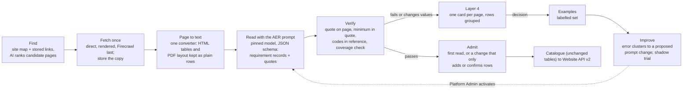

# AER design v2: a prompt-led reader with a strict verifier (proposal)

**Version:** 0.3, approved with amendments (Decision 276, 12 Nov 2026 17:20), steps 0–1 in progress (0.3 adds §9 amendments; 0.2 added country packs §3.9, the lean job set and Fill on demand §3.10, success measures §3.11, lessons from descriptions §1.1) · **Change control:** CF-247 (SS-017 follow-on) · **Status:** approved with amendments (Decision 276); steps 0–1 in progress; activation by the precision gate in §9
**Reads with:** `2026-11-12-aer-admission-mechanism.md` (how it works today, with live figures), `AER-TECHNICAL-DESIGN.md` v1.2 (design of record), `DATA-PIPELINE-OPERATING-MODEL.md` §3.3.1 (AI-written text), `PROVIDER-DESCRIPTIONS-RUNBOOK.md` (the pattern this follows)

## 1. Why change

AER works, but it has grown by adding a rule or reader each time a page broke the last one, and coverage has not kept pace.

| Measure (live, 12 Nov 2026) | Value |
| --- | --- |
| Eligible courses with admitted academic entry | 780 of 29,533 (2.6%) |
| Eligible providers with an active country table | 16 of 1,476 |
| AER database functions | 161 (about 600,000 characters of SQL) |
| AER settings | 195, of which 38 are hand-kept lists (country aliases, 25 grid-heading mappings, 16 "not a requirement" patterns, rank, score and band words, domestic-route words, award abbreviations) |
| Readers in the worker | general table reader plus three layout readers added this week (PDF cells, PDF grid, aligned grid), about 1,700 lines |
| Providers asked by the discovery campaign that publish on course pages only | 513 of 679 |
| Largest decline reason for machine admission | D-R3: the read cannot be shown complete (32 of 42 declines on 11 Nov) |
| Layer 4 AER items waiting | 568 |

Provider and course descriptions had the same shape: many hand rules, a low pass rate, and copying. They improved sharply once the rules were replaced with a **prompt kept in Settings plus a strict, small verifier** (F-PDESC: from about a third of AI answers passing to 14 of 18 on the first prompt version, then 107 automatic admissions in three hours). AER is a better fit for that pattern than descriptions are, because its answers are short, structured and checkable against the page.

### 1.1 What descriptions taught us, applied to AER

| Descriptions (F-PDESC, course text) | AER v2 |
| --- | --- |
| Hand-written readers and lists scrapped, not patched | 38 list settings and three layout readers retired once v2 passes shadow (§4) |
| One prompt in Settings, edited by the Platform Admin with a reason | One AER prompt card on AI & OpenRouter, versioned |
| Small verifier: canonical quote on the page, numbers in quotes | Same verifier, plus reference codes and completeness (§3.4) |
| Automatic admission once the verifier passes | Same, with the 5% audit and the daily brake (§3.5) |
| Self-heal: a new prompt version re-reads once | Same (§3.7) |
| Fill description on demand | Fill entry requirements on demand (§3.10) |
| Started with a short prompt and improved by version (about a third passing, then 14 of 18 on the first version) | Start with a short prompt; each version is trialled on the labelled set |

## 2. Principles

1. **The model understands; code only verifies.** The model decides what a row means: country, qualification, level, route, minimum, scale and applicability. Code never interprets wording. It checks that each claim is printed on the stored page, that the codes exist in reference data, and that the answer is internally consistent.
2. **Reference data, not word lists.** Countries, qualifications (with aliases), study levels, grading schemes and national rank names live in reference tables with a screen. An unknown name becomes a proposed reference alias for a person to accept once; it is never a new list setting or code.
3. **One record shape for both sources.** A requirement from a provider table and one from a course page are the same kind of record, with a scope (provider, course, or a group of courses). Resolution picks the most specific record.
4. **The prompt is versioned in Settings.** The Platform Admin edits it with a reason. A new version re-reads held items once (as F-PDESC self-heal does) and is trialled in shadow before it admits.
5. **The platform learns from people.** Every Layer 4 decision becomes a labelled example. Clusters of edits and rejections become a proposed prompt change, trialled against those examples. A person switches it on: a passing trial never switches anything on by itself.
6. **Country-agnostic by data.** A country is switched on when its reference pack exists (qualification framework, levels, rank name, grading scheme). No code or list edit is needed.
7. **Same outputs, same consumer API.** v2 writes the same catalogue tables and statuses, so the website and Zoho see no change (G3). Qualification rows in the API remain a separate approval.

## 3. Proposed design

### 3.1 Find (discovery)

- **Rank candidates, don't search one by one.** Rank the site map and stored links of each provider with a cheap AI call ("which of these addresses hold entry requirements, admission criteria, country requirements or qualification tables?"). Fetch only the top few. This replaces per-provider entry searches, which are the costliest part of the campaign today (about 44 credits a usable source and rising).
- **Route by what the provider publishes.**
  - A provider whose ranked pages are course pages only goes straight to course reading; it is not a discovery failure.
  - A provider with a table page gets a country-table read.

  Today, 513 such providers are recorded as "course pages found" and wait for the scheduler.

### 3.2 Fetch and convert

- **Fetch once, store, read many.** Direct first, rendered for hosts that need it, Firecrawl only when refused. This is unchanged from today.
- **One converter.** It turns a stored page into plain text that keeps table structure, so every page reaches the model in one form:
  - HTML tables become rows with their headings;
  - PDFs become text with column positions kept as rows.

  The current layout readers (cells, grid, aligned grid) become converter options, not separate readers with their own rules. Their heading mappings move into reference data.

### 3.3 Read with the AER prompt

- **Prompt and model.** One prompt in Settings (versioned, Platform Admin), one pinned model per prompt version, and a JSON schema for the answer. Each record carries:
  - scope (provider, course or course group, with the course name as printed);
  - applicant country (ISO) or qualification (reference code), or "every country" only when the page says so;
  - study level and route (school leaver, transfer, postgraduate, foundation pathway);
  - minimum as printed, scale as printed or "not stated", band, and conditions;
  - one or more **verbatim quotes** for each value;
  - confidence.
- **Completeness in the answer.** The model also returns the list of requirement rows it saw on the page but couldn't map, with their quotes. The verifier uses this list instead of the D-R3 dropped-row heuristics.
- **Cost.** About US$0.005 a course page and under US$0.01 a country table on today's pinned model. A full pass over all 29,533 eligible courses is roughly US$150, which is affordable inside the existing daily guards over a few weeks.

### 3.4 Verify (small, strict, deterministic)

The verifier is the only gate. It does not interpret wording; it checks:

| Check | Replaces today |
| --- | --- |
| Every quote is on the stored page (one canonical form: spacing around tags, quote and dash shapes; words and numbers exact) | quote-on-page checks, quote-in-parts |
| The minimum (grade text or value) is printed in its own quote | the D1 quote proof, extended to course rows |
| Country and qualification codes exist in reference data, or are proposed as new aliases | country aliases, global-scope words, grid headings, qualification lists |
| Level and route map to reference levels | level equivalents, award abbreviations |
| Nothing the model listed as "seen but not mapped" is a requirement row with a minimum (completeness) | D-R3 gate, dropped-row reasons, gate cover lengths |
| Provider identity: own host, or a stored copy fetched from it | unchanged |
| Course identity for course-scoped records: the course name is printed and matches the catalogue course by the existing identity bases | unchanged, simplified |

### 3.5 Admit

- **First read:** admitted when the verifier passes and the audit sample doesn't pick it (one rule for tables and courses, same ledger shape).
- **Re-read:** admitted automatically when it only adds rows or reproduces existing values from a newer copy. A change to a value goes to a person with the before and after.
- **Unchanged:** the 5% audit, withdrawal, the system actor marked `machine`, and machine decisions not counting towards human trust thresholds.
- **Daily maximum** stays as a safety brake, not a throughput limit. Today's course rule reaches its cap in about 8 hours.

### 3.6 Layer 4: fewer, better cards

- One card per page or course, with rows grouped and each quote highlighted on the stored copy.
- Each card shows the verifier's reason in plain words ("minimum not printed in its quote", "country name not in reference: 'Kingdom of Eswatini', propose alias SZ?").
- An **accept alias** action updates reference data once for every future read.

### 3.7 Self-improvement loop

1. **Examples.** Every Layer 4 decision (approve, edit, reject with reason) and every audit-sample outcome is stored with the stored copy and the model's answer. This builds the labelled set automatically.
2. **Weekly clusters.** A weekly job groups edits and rejections by verifier reason and by the field a person changed, and drafts a proposed prompt change for the largest clusters.
3. **Shadow trial.** The proposed prompt reads the labelled set from stored copies (no Firecrawl). Passing means at least as many correct and no new false admissions. The result shows on the AI & OpenRouter card.
4. **Activation.** The Platform Admin activates a new version with a reason, never automatically. Held items are read once more under it.

### 3.8 Coverage truth and reporting

- **Fix the gap view.** Coverage & completeness must compute `academic_entry` from admitted records (today every course shows `no_reader`), and the standing gap queue should ask for academic entry like any other field.
- **Own AI lane.** Give course entry reads their own AI lane and guard, so cost per admitted requirement is reported.
- **One live panel.** The Data Delivery AER panel and Entry requirements › Sources show the prompt version, admissions, holds by reason, examples collected, and the last trial.

### 3.9 Country packs: how v2 adapts across countries

A country pack is reference data, not code. It is held in the existing reference tables (countries, qualifications, levels, grading schemes) and edited on a reference screen with a reason. The prompt receives the pack for the applicant country and the provider country as variables.

| Pack field | Example (applicant country India) | Example (applicant country Germany) |
| --- | --- | --- |
| Qualifications and aliases | CBSE Class XII, ISC, state boards (HSC) | Abitur (Allgemeine Hochschulreife), Fachhochschulreife |
| Grading scheme and direction | percentage, higher is better | 1.0–4.0, lower is better |
| National rank or score name | none | none |
| Levels | Class XII, bachelor, master | Abitur, Bachelor, Master |
| Common route words | direct entry, foundation | direct entry, Studienkolleg |
| Languages pages are written in | en | de, en |

Rules:

- **Values stay as printed.** The model records the minimum and scale exactly as printed. It never converts a grade between countries. An equivalence (for example "IB 30 or ATAR 80") is recorded only when the page prints it.
- **Pages in other languages.** They are read in their own language; quotes stay in the original language, and the verifier matches the printed text.
- **A new country.** When reads meet a country with no pack, the model drafts one from the quotes it has seen (qualification names, scale, levels). The draft shows on the reference screen; the Platform Admin accepts it once. Until then, rows for that country are held, not guessed. No code change and no list setting is needed.
- **Provider country.** Pages differ by where the provider is (an Australian page states ATAR equivalents; a UK page states A-level offers). The provider-country pack tells the model which local terms to expect, for example ATAR, NCEA, UCAS tariff or a Canadian provincial average.

### 3.10 A lean, self-sustaining job set

Today there are eight AER jobs, each with its own rules and recovery path. v2 keeps five, all catalogued (G1), each reading its batch size from Settings (G2).

| v2 job | Does | Replaces today |
| --- | --- | --- |
| `aer-find` | Ranks candidate pages per provider; routes to table read or course read | `aer-source-discover`, `aer-source-stored-find` |
| `aer-read` | Reads pages that are new, have a changed content hash, or were read under an older prompt version | `aer-scheduled-read`, `entry-matrix-read`, `aer-replay` |
| `aer-admit` | Verifies and admits, or sends to Layer 4 | `aer-machine-admission`, `aer-reconcile` |
| `aer-improve` | Weekly: clusters Layer 4 edits and rejections, drafts a prompt change, runs the shadow trial | new |
| `aer-report` | Updates coverage `academic_entry`, the gap queue and the Monday line | `aer-outcome-register` |

What keeps it running without a person:

- **Re-read only on change.** A stored copy's content hash decides whether a page is read again; an unchanged page costs nothing.
- **Gap-driven.** The standing gap queue asks for academic entry for every eligible course without it, so new providers and courses are picked up without being switched on one by one.
- **Fill on demand.** A "Fill entry requirements" action on the Course detail blade and on a provider runs find, read and verify straight away, as Fill description does. The result goes through the same verifier and admission rule.
- **Budgets, not lists.** Spend is bounded by the AI lane guard and the existing Firecrawl share; there are no provider allowlists.

### 3.11 Success measures

Shown on the Data Delivery AER panel and in the Monday line:

| Measure | Today (12 Nov) | Direction |
| --- | --- | --- |
| Eligible courses with admitted academic entry | 780 of 29,533 | rising every week |
| Providers with admitted requirements (any scope) | 16 tables | rising every week |
| Verifier pass rate (current prompt version) | — | at least 70% on course pages before activation |
| Layer 4 AER items waiting | 568 | falling; only changes to values and new aliases |
| Cost per admitted requirement | not reported | reported (own AI lane) |
| Hand-kept list settings | 38 | 0 after step 5 |
| AER jobs | 8 | 5 |

The 70% figure is a proposed gate for the Platform Admin to confirm, not a measured value.

## 4. What v2 removes (housekeeping, after validation)

| Retire | Why |
| --- | --- |
| 38 list settings (aliases, patterns, words, grid headings) | Reference data plus the prompt |
| Separate cell, grid and aligned-grid readers | Converter options |
| `entry.providers`, `entry.course_read_providers` | Already bypassed by eligibility rules |
| E13 recovery, replay, held-read picker, corrected-read supersession machinery | One rule: read again when the prompt version, the reader version or the stored copy changes; otherwise never |
| Most of the 161 functions | Target: one reader contract, one verifier, one admission rule, one recovery rule, reference screens; aiming at 30–40 functions and 25–30 settings |

Retired objects follow Decision 260: marked `retiring`, switched off in the change that replaces them, and dropped by a paste file after 14 days unused.

## 5. Settings in v2 (target set)

On a new "Academic entry" section, plus the AI & OpenRouter prompt card:

- reader on; prompt (versioned); pinned model per version;
- batch per run; daily read maximum; Layer 4 hold;
- admission mode; daily admission maximum (brake); audit share; minimum confidence;
- re-fetch interval; re-read on new prompt version (on/off, items a run);
- discovery on; candidate pages ranked a provider; Firecrawl when refused (on/off);
- countries on, derived from reference packs (shown, not edited as a list);
- spend: AI daily guard (own lane), Firecrawl share (central, as today) and campaign spare room (as today).

## 6. Rollout (each step gated; a pass never switches anything on)

| Step | What | Cost | Gate |
| --- | --- | --- | --- |
| 0 | Build the labelled set from existing Layer 4 decisions and audit outcomes; fix coverage `academic_entry`; own AI lane | small | — |
| 1 | Converter plus prompt v1 plus verifier in **shadow** on stored copies: every stored entry page and a 2,000-course sample | about US$10–20, no Firecrawl | Agreement with human decisions at least today's rules; no new false admissions; completeness at least today's |
| 2 | Course pages first (the 513 course-only providers and the 28,753 courses without entry): v2 proposes, v2 rule admits | within guards | Platform Admin activation (migration with validation, as #1025 and #1043) |
| 3 | Country tables and qualification rows on v2; reference-alias accept on Layer 4 | within guards | Activation as step 2 |
| 4 | Self-improvement loop on (weekly clusters, trial) | small | — |
| 5 | Retire v1 readers, lists and recoveries (§4) | none | 14 days unused, paste file |

## 7. Risks and guards

| Risk | Guard |
| --- | --- |
| The model invents a value | Every value must be in a verbatim quote on the stored page, and the minimum in its own quote; otherwise not admitted |
| The model maps a country or qualification wrongly | Codes must exist in reference data; a new mapping needs a person to accept the alias once; the 5% audit; withdrawal |
| Prompt drift breaks earlier good reads | Versioned prompts; shadow trial on the labelled set before activation; pinned model per version |
| Cost | Stored copies first; own AI lane and guard; a full course pass is about US$150 |
| Consumer impact | Same tables and statuses; G3 untouched |

## 8. Decisions requested

1. Approve the v2 direction and step 0–1 (shadow only, no admission change).
2. Raise the course machine-admission daily maximum now (`aer.machine_daily_max` 300) while v2 is built: it caps admissions of reads that already pass today's rule.
3. Approve country packs (§3.9) as the only place country-specific wording, grading schemes and qualification names live, with model-drafted packs accepted by the Platform Admin.
4. Approve the five-job set and Fill entry requirements on demand (§3.10).
5. Confirm the activation gate for course pages (proposed: verifier pass rate at least 70% and no new false admissions on the labelled set).
6. Later: qualification rows in the consumer API (Decision 266 approval).

## 9. Approved amendments (Decision 276, 12 Nov 2026 17:20)

These amend the sections above where they differ (review: `2026-11-12-aer-design-v2-review.md`).

1. **Proven structure is a record source** (amends §3.2): a table whose structure the converter proves (aligned grid: every value in exactly one column, fail closed) yields records directly, through the same verifier; the model does not re-extract it. The UNSW, Sydney and UQ rows (5,526 minimums) are kept with their evidence. AI is used only where interpretation is needed.
2. **Independent completeness for tables** (amends §3.3 and §3.4): measured from the converted source (rows and labels printed against records returned), not from the model's own "seen but not mapped" list. For course pages the model's list is sufficient.
3. **Precision gate** (amends §3.11 and decision 5): activation needs no new false admission on the labelled set; error no worse than the current reader, measured independently; no regression in course identity, qualification identity, score attribution or source evidence; Layer 4 and manual locks effective; failures held with a reason and retried by the job. The 70% pass rate is an operational target.
4. **Production safeguards kept** (amends §3.4): printed course in the row identity; per-course qualification minimums never admitted as the provider's; one catalogue course per course minimum (CRICOS, exact title and level, then a person; AI suggests only); a rank (ATAR) is a course fact, recorded in the provider-country pack; one large stored PDF per worker call; recording within the 8 s API statement limit; host checks.
5. **v1 frozen** (amends §6): essential correctness and security fixes only while v2 is built; v1 keeps reading and admitting under the approved rules.
6. **Throughput now** (decision 2): `aer.machine_daily_max` 1,000.
7. **Coverage measure** (amends §3.8 and §3.11): resolver-based (`entry_resolve_v1` returns `minimum_published`) over the leading applicant countries, beside "courses with any admitted requirement".

## 10. S1-AER on-demand source acquisition and stored-page AI identity (13 November 2026)

**Platform Admin scoped decisions, S1-AER (13 November 2026):** (1) **approve** the wider official-source discovery with a **maximum cumulative campaign estimate/authorisation of 20,000 Firecrawl credits including the existing ~10,000-credit on-demand request**, never as an additional 20,000; (2) **approve** AI-assisted candidate matching of stored official pages to catalogue courses as an AER v2 development item, **not** autonomous acceptance of ambiguous course identity. This amends discovery/identity implementation under existing F-AER and Decision 276; v1 remains frozen except correctness/security fixes. No new unbounded crawler, no blanket readmission and no bypass of manual locks or human decisions.

### 10.1 Active request must not be restarted

Pilot #1125 (worker v0.84.0) was reported merged/deployed and verified, enabling genuine on-demand course-page search via `svc_course_link_search_next` and `svc_fc_on_demand_covers_v1`. The S1-AER session **already opened** an on-demand request for **326 providers**, originally estimated **3,737 AER-eligible course searches**, **~10,000 Firecrawl credits and ~US$8 AI**, with pre-run reported balances **85,254 Firecrawl credits and US$57.95 OpenRouter**, account floor US$0.50. First reported three minutes: **119 searches dispatched; 17 replied (4 found / 13 none), 46 Firecrawl credits charged**; a small early sample, **not** an established yield. The request's session-reported expiry is **22:13 Sydney/AEDT**. These are dated S1-AER observations, **not** an independent fresh production measurement.

**Execution authority:** Keep the **existing request and its provider/purpose limits**. Do not reissue searches already attempted or divert other scheduled jobs into the request. On completion or expiry, reconcile in-flight leases, call `security.on_demand_close_v1` with its real ID and report actual Firecrawl and AI spend and balances; expiry is not proof of closure. New site maps/other eligible providers require a separate correctly scoped request (or an authorised amendment with the ledger retaining true scope) and a *cumulative* cost ledger. The additional discovery window has **up to 10,000 credits of headroom within the 20,000 total**, not an automatic daily share or guaranteed consumption. Vendor plan/reserve, OpenRouter floor, official-host/robots/directory policies, budgets/actual credits and G1–G4 remain mandatory. Avoid a site-wide crawl: official site maps → scoped, deduplicated URL filtering → direct fetch → Firecrawl only for blocked/PDF/rendering needs. Prioritise providers with known active courses/source gaps, reuse stored URLs/hashes and earlier search results, then map stale-before-1-Nov sites and remaining no-source providers only on evidence-backed expected yield; report stopped/zero-yield providers honestly. Stop expansion if cost per verified useful source materially deteriorates; never spend merely to exhaust the budget.

### 10.2 AER v2 AI-assisted matching from stored pages

**Reuse** the existing course-page candidates/`coverage_course_pages` and official-domain/E16 identity guard. F-AER.08 already has a hierarchical **catalogue course-link** design (Pilot migration `20261112213100_cf247_aer_course_links.sql`): exact CRICOS and provider, else unique exact normalised title + level, otherwise suggestions and human review. Extend the source-to-course *candidate matching* stage where stored official pages cannot be proved against a single course, **not** a second independent matching engine or a new v1 admission path.

- AI sees only the **bounded stored page/candidate set and the exact provider/course identities**. It returns a ranking/candidate ID, exact quote/span from page title/CRICOS/course-level identifying wording, source hash, confidence and reasons for ambiguity. A page URL, generic faculty description, similar title or unproved course level does not become binding evidence.
- Existing deterministic identity verifier must independently confirm the same official provider/approved subsidiary host, **one unambiguous catalogue course**, supported CRICOS or uniquely supported exact title/level and page identity; protect existing manual course bindings, cross-provider collisions, prior rejection memory, retired courses and E16. AI guesses, even high confidence, stay **unresolved with suggested candidates** and the existing human Layer 4 route, never automatically bound/admitted.
- Run a **200-case stratified production-shaped precision fixture** from stored pages: include exact code, exact title+level, close titles, duplicate programme names, wrong-provider and generic pages, PDFs, missing identifiers and previously rejected/held cases. Existing reviewer-labelled truths and negative cases provide independent gold labels. No Firecrawl for this fixture; report verified auto-identity precision, unsafe/false bindings (target **zero**), recall/recovery (not a reason to lower gates), cost and latency. A 200-case fixture is a bounded QA test, **not** another multi-week university pilot. Fix any wrong binding at the shared verifier, rerun affected targeted tests and mandatory governed exact-head CI. The authorised safe subset may roll out to the whole stored eligible queue once the independent verifier and full release conditions pass, without a separate per-provider permission loop; genuine new human policy still needs its own approval.
- Every confirmed association must retain page/candidate/source hash, qualifying quote, course ID, actor (`machine` only when fully verified), prompt/model version, decision time, manual lock and prior decision state. Only after identity is verified may the existing AER v2/source-grounded reader and normal admission path run; do not infer academic minimums, qualification scale/study level or waive Layer 4.
- Measure **5,500 approximately unresolved stored-course-page mappings** as *candidate opportunity* until independently remeasured. Acceptance: new verified exact-course page bindings, newly usable source-backed AER reads, retained active requirement rows, resolver `minimum_published` outcomes where relevant, Website/Zoho v3 parity and per-field missing/held reasons in existing Entry requirements/Course Catalogue/Data Delivery views, with cost per new usable source/verified mapping/admitted row.

**Ownership and reporting:** S1-AER/F-AER owns the AI matching and AER acquisition. The sole Integration Controller owns shared course-page binding functions, worker versions and migration sequencing with S2-CF/Intakes. Keep decisions/current data in the existing F-AER acceptance, AER design and Execution Register, and developer requirements R19/R26/REQ-21/REQ-36 where consumer fields change. This document records **decisions and authorised next engineering**, not proof that new AI matching has been built, deployed, switched on or that the 20,000 credits were spent.
