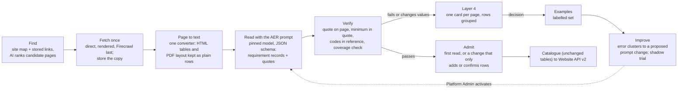

# AER design v2: a prompt-led reader with a strict verifier (proposal)

**Version:** 0.1, proposed, 12 Nov 2026 · **Change control:** CF-247 (SS-017 follow-on) · **Status:** for Platform Admin decision; nothing is built or switched on by this document
**Reads with:** `2026-11-12-aer-admission-mechanism.md` (how it works today, with live figures), `AER-TECHNICAL-DESIGN.md` v1.2 (design of record), `DATA-PIPELINE-OPERATING-MODEL.md` §3.3.1 (AI-written text), `PROVIDER-DESCRIPTIONS-RUNBOOK.md` (the pattern this follows)

## 1. Why change

AER works, but it has grown by adding a rule or reader each time a page broke the last one, and coverage has not kept pace.

| Measure (live, 12 Nov 2026) | Value |
| --- | --- |
| Eligible courses with admitted academic entry | 780 of 29,533 (2.6%) |
| Eligible providers with an active country table | 16 of 1,476 |
| AER database functions | 161 (about 600,000 characters of SQL) |
| AER settings | 195, of which 38 are hand-kept lists (country aliases, 25 grid-heading mappings, 16 "not a requirement" patterns, rank, score and band words, domestic-route words, award abbreviations) |
| Readers in the worker | general table reader plus three layout readers added this week (PDF cells, PDF grid, aligned grid), about 1,700 lines |
| Providers asked by the discovery campaign that publish on course pages only | 513 of 679 |
| Largest decline reason for machine admission | D-R3: the read cannot be shown complete (32 of 42 declines on 11 Nov) |
| Layer 4 AER items waiting | 568 |

Provider and course descriptions had the same shape: many hand rules, a low pass rate, and copying. They improved sharply once the rules were replaced with a **prompt kept in Settings plus a strict, small verifier** (F-PDESC: from about a third of AI answers passing to 14 of 18 on the first prompt version, then 107 automatic admissions in three hours). AER is a better fit for that pattern than descriptions are, because its answers are short, structured and checkable against the page.

## 2. Principles

1. **The model understands; code only verifies.** The model decides what a row means: country, qualification, level, route, minimum, scale and applicability. Code never interprets wording. It checks that each claim is printed on the stored page, that the codes exist in reference data, and that the answer is internally consistent.
2. **Reference data, not word lists.** Countries, qualifications (with aliases), study levels, grading schemes and national rank names live in reference tables with a screen. An unknown name becomes a proposed reference alias for a person to accept once; it is never a new list setting or code.
3. **One record shape for both sources.** A requirement from a provider table and one from a course page are the same kind of record, with a scope (provider, course, or a group of courses). Resolution picks the most specific record.
4. **The prompt is versioned in Settings.** The Platform Admin edits it with a reason. A new version re-reads held items once (as F-PDESC self-heal does) and is trialled in shadow before it admits.
5. **The platform learns from people.** Every Layer 4 decision becomes a labelled example. Clusters of edits and rejections become a proposed prompt change, trialled against those examples. A person switches it on: a passing trial never switches anything on by itself.
6. **Country-agnostic by data.** A country is switched on when its reference pack exists (qualification framework, levels, rank name, grading scheme). No code or list edit is needed.
7. **Same outputs, same consumer API.** v2 writes the same catalogue tables and statuses, so the website and Zoho see no change (G3). Qualification rows in the API remain a separate approval.

## 3. Proposed design

### 3.1 Find (discovery)

- **Rank candidates, don't search one by one.** Rank the site map and stored links of each provider with a cheap AI call ("which of these addresses hold entry requirements, admission criteria, country requirements or qualification tables?"). Fetch only the top few. This replaces per-provider entry searches, which are the costliest part of the campaign today (about 44 credits a usable source and rising).
- **Route by what the provider publishes.**
  - A provider whose ranked pages are course pages only goes straight to course reading; it is not a discovery failure.
  - A provider with a table page gets a country-table read.

  Today, 513 such providers are recorded as "course pages found" and wait for the scheduler.

### 3.2 Fetch and convert

- **Fetch once, store, read many.** Direct first, rendered for hosts that need it, Firecrawl only when refused. This is unchanged from today.
- **One converter.** It turns a stored page into plain text that keeps table structure, so every page reaches the model in one form:
  - HTML tables become rows with their headings;
  - PDFs become text with column positions kept as rows.

  The current layout readers (cells, grid, aligned grid) become converter options, not separate readers with their own rules. Their heading mappings move into reference data.

### 3.3 Read with the AER prompt

- **Prompt and model.** One prompt in Settings (versioned, Platform Admin), one pinned model per prompt version, and a JSON schema for the answer. Each record carries:
  - scope (provider, course or course group, with the course name as printed);
  - applicant country (ISO) or qualification (reference code), or "every country" only when the page says so;
  - study level and route (school leaver, transfer, postgraduate, foundation pathway);
  - minimum as printed, scale as printed or "not stated", band, and conditions;
  - one or more **verbatim quotes** for each value;
  - confidence.
- **Completeness in the answer.** The model also returns the list of requirement rows it saw on the page but couldn't map, with their quotes. The verifier uses this list instead of the D-R3 dropped-row heuristics.
- **Cost.** About US$0.005 a course page and under US$0.01 a country table on today's pinned model. A full pass over all 29,533 eligible courses is roughly US$150, which is affordable inside the existing daily guards over a few weeks.

### 3.4 Verify (small, strict, deterministic)

The verifier is the only gate. It does not interpret wording; it checks:

| Check | Replaces today |
| --- | --- |
| Every quote is on the stored page (one canonical form: spacing around tags, quote and dash shapes; words and numbers exact) | quote-on-page checks, quote-in-parts |
| The minimum (grade text or value) is printed in its own quote | the D1 quote proof, extended to course rows |
| Country and qualification codes exist in reference data, or are proposed as new aliases | country aliases, global-scope words, grid headings, qualification lists |
| Level and route map to reference levels | level equivalents, award abbreviations |
| Nothing the model listed as "seen but not mapped" is a requirement row with a minimum (completeness) | D-R3 gate, dropped-row reasons, gate cover lengths |
| Provider identity: own host, or a stored copy fetched from it | unchanged |
| Course identity for course-scoped records: the course name is printed and matches the catalogue course by the existing identity bases | unchanged, simplified |

### 3.5 Admit

- **First read:** admitted when the verifier passes and the audit sample doesn't pick it (one rule for tables and courses, same ledger shape).
- **Re-read:** admitted automatically when it only adds rows or reproduces existing values from a newer copy. A change to a value goes to a person with the before and after.
- **Unchanged:** the 5% audit, withdrawal, the system actor marked `machine`, and machine decisions not counting towards human trust thresholds.
- **Daily maximum** stays as a safety brake, not a throughput limit. Today's course rule reaches its cap in about 8 hours.

### 3.6 Layer 4: fewer, better cards

- One card per page or course, with rows grouped and each quote highlighted on the stored copy.
- Each card shows the verifier's reason in plain words ("minimum not printed in its quote", "country name not in reference: 'Kingdom of Eswatini', propose alias SZ?").
- An **accept alias** action updates reference data once for every future read.

### 3.7 Self-improvement loop

1. **Examples.** Every Layer 4 decision (approve, edit, reject with reason) and every audit-sample outcome is stored with the stored copy and the model's answer. This builds the labelled set automatically.
2. **Weekly clusters.** A weekly job groups edits and rejections by verifier reason and by the field a person changed, and drafts a proposed prompt change for the largest clusters.
3. **Shadow trial.** The proposed prompt reads the labelled set from stored copies (no Firecrawl). Passing means at least as many correct and no new false admissions. The result shows on the AI & OpenRouter card.
4. **Activation.** The Platform Admin activates a new version with a reason, never automatically. Held items are read once more under it.

### 3.8 Coverage truth and reporting

- **Fix the gap view.** Coverage & completeness must compute `academic_entry` from admitted records (today every course shows `no_reader`), and the standing gap queue should ask for academic entry like any other field.
- **Own AI lane.** Give course entry reads their own AI lane and guard, so cost per admitted requirement is reported.
- **One live panel.** The Data Delivery AER panel and Entry requirements › Sources show the prompt version, admissions, holds by reason, examples collected, and the last trial.

## 4. What v2 removes (housekeeping, after validation)

| Retire | Why |
| --- | --- |
| 38 list settings (aliases, patterns, words, grid headings) | Reference data plus the prompt |
| Separate cell, grid and aligned-grid readers | Converter options |
| `entry.providers`, `entry.course_read_providers` | Already bypassed by eligibility rules |
| E13 recovery, replay, held-read picker, corrected-read supersession machinery | One rule: read again when the prompt version, the reader version or the stored copy changes; otherwise never |
| Most of the 161 functions | Target: one reader contract, one verifier, one admission rule, one recovery rule, reference screens; aiming at 30–40 functions and 25–30 settings |

Retired objects follow Decision 260: marked `retiring`, switched off in the change that replaces them, and dropped by a paste file after 14 days unused.

## 5. Settings in v2 (target set)

On a new "Academic entry" section, plus the AI & OpenRouter prompt card:

- reader on; prompt (versioned); pinned model per version;
- batch per run; daily read maximum; Layer 4 hold;
- admission mode; daily admission maximum (brake); audit share; minimum confidence;
- re-fetch interval; re-read on new prompt version (on/off, items a run);
- discovery on; candidate pages ranked a provider; Firecrawl when refused (on/off);
- countries on, derived from reference packs (shown, not edited as a list);
- spend: AI daily guard (own lane), Firecrawl share (central, as today) and campaign spare room (as today).

## 6. Rollout (each step gated; a pass never switches anything on)

| Step | What | Cost | Gate |
| --- | --- | --- | --- |
| 0 | Build the labelled set from existing Layer 4 decisions and audit outcomes; fix coverage `academic_entry`; own AI lane | small | — |
| 1 | Converter plus prompt v1 plus verifier in **shadow** on stored copies: every stored entry page and a 2,000-course sample | about US$10–20, no Firecrawl | Agreement with human decisions at least today's rules; no new false admissions; completeness at least today's |
| 2 | Course pages first (the 513 course-only providers and the 28,753 courses without entry): v2 proposes, v2 rule admits | within guards | Platform Admin activation (migration with validation, as #1025 and #1043) |
| 3 | Country tables and qualification rows on v2; reference-alias accept on Layer 4 | within guards | Activation as step 2 |
| 4 | Self-improvement loop on (weekly clusters, trial) | small | — |
| 5 | Retire v1 readers, lists and recoveries (§4) | none | 14 days unused, paste file |

## 7. Risks and guards

| Risk | Guard |
| --- | --- |
| The model invents a value | Every value must be in a verbatim quote on the stored page, and the minimum in its own quote; otherwise not admitted |
| The model maps a country or qualification wrongly | Codes must exist in reference data; a new mapping needs a person to accept the alias once; the 5% audit; withdrawal |
| Prompt drift breaks earlier good reads | Versioned prompts; shadow trial on the labelled set before activation; pinned model per version |
| Cost | Stored copies first; own AI lane and guard; a full course pass is about US$150 |
| Consumer impact | Same tables and statuses; G3 untouched |

## 8. Decisions requested

1. Approve the v2 direction and step 0–1 (shadow only, no admission change).
2. Raise the course machine-admission daily maximum now (`aer.machine_daily_max` 300) while v2 is built: it caps admissions of reads that already pass today's rule.
3. Later: qualification rows in the consumer API (Decision 266 approval).
