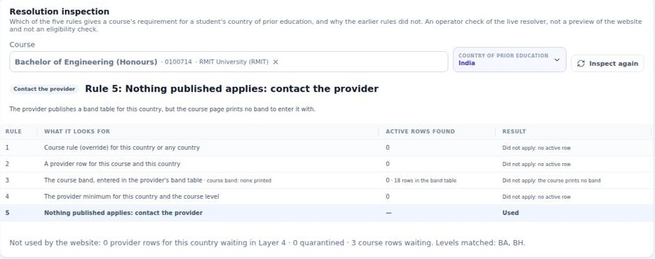
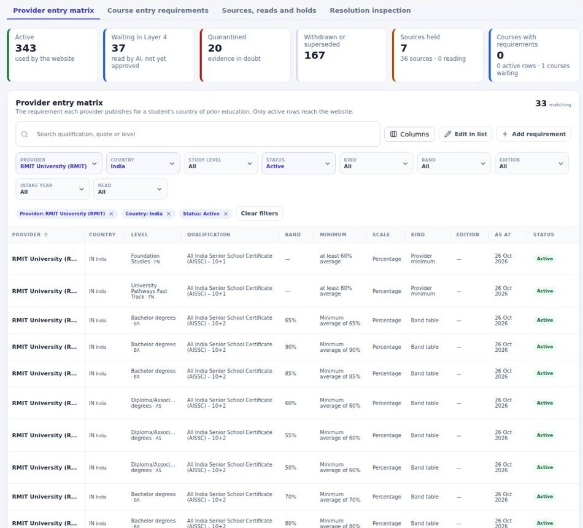
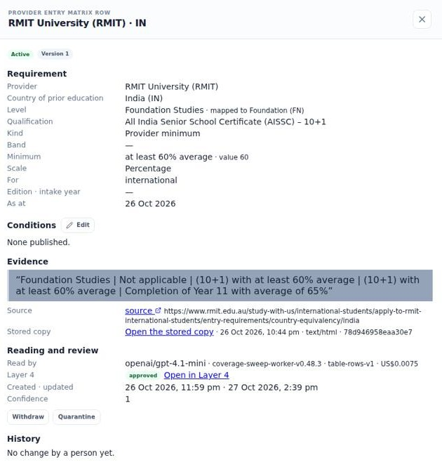
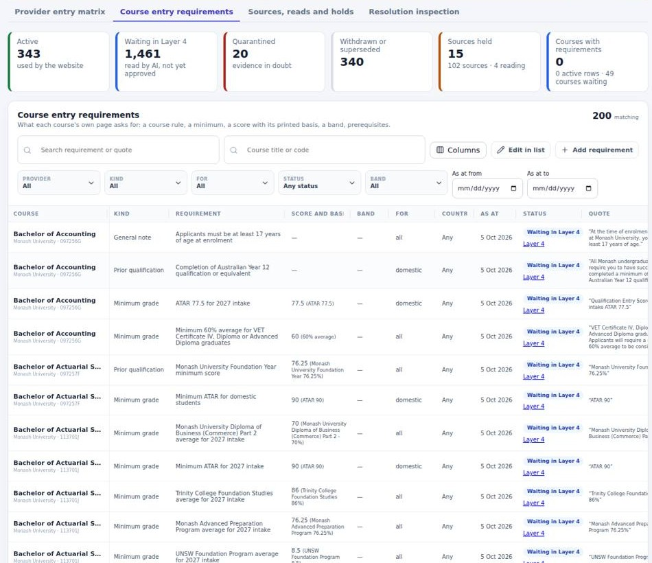
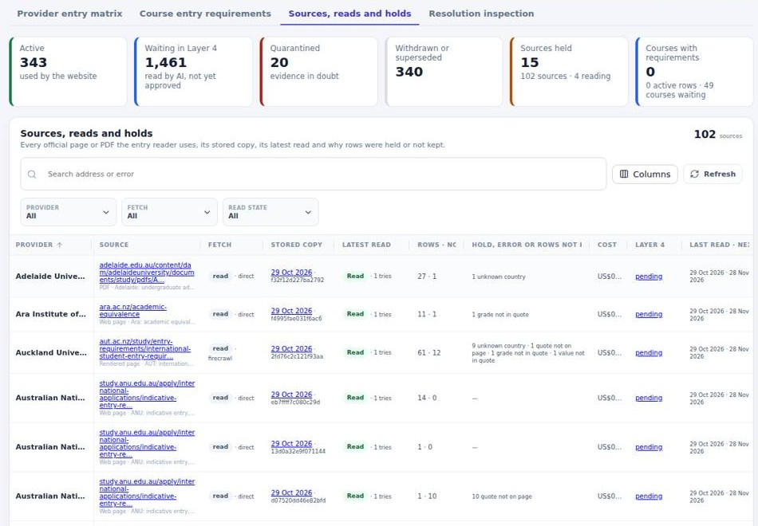

# StudySearch – Academic entry requirements (AER): technical design and status

**Version:** 1.0 (29 Oct 2026, platform release v2.15.368)
**Change control:** CF-247
**Status:** platform delivered on Pilot; coverage in review; course reading paused on AI credit
**Companion deck:** `StudySearch_Academic_Entry_Requirements_2026-10-29.pptx` (5 slides)

This page brings the AER decision records into one design: how requirements are stored, how they are cross-referenced for a student, what is built, what the live numbers are, and what comes next. Where it differs from a decision record, the decision record wins and this page is corrected.

| Source document | What it holds |
|---|---|
| `ENTRY-REQUIREMENTS.md` | The original proposal and its two diagrams (ER and toolset flow), kept current |
| `ENTRY-REQUIREMENTS-IMPLEMENTATION.md` | Part 1 research on 40 providers; Part 2 build plan (steps A–C); decisions 7–10 |
| `ENTRY-REQUIREMENTS-STEP-B-DECISION-2026-10-28.md` | Course-level reading, the five-rule resolver, admin views, consumer fields (RMIT BH126 slice) |
| `ENTRY-REQUIREMENTS-PROGRAMME-DECISION-2026-10-28.md` | Provider scope (P1–P10) and waves H, P and J |
| `AER-OPERATIONS-WORKSPACE-DECISION-2026-10-29.md` | Catalogue › Entry requirements workspace (W1–W26) |
| `ui-audit/2026-10-29-aer-programme-consolidated-report.md` | Delivery evidence and the human decisions waiting (Part B9) |

---

## 1. Purpose and scope

A student searching for a course needs to know: "with my school qualification from my country, what do I need for this course?" Universities publish this in three shapes:

1. **A university-wide table by country:** one minimum per qualification and study level. This is common in New Zealand.
2. **A band table:** the university converts its own benchmark bands (for example 65 %, ATAR 60, rank 70) into each country's qualifications. The course names its band (RMIT, Flinders, Wollongong, UWA, ANU).
3. **A minimum per course:** set on the course page or in a course × qualification PDF (UNSW, Sydney, UQ, Monash, Melbourne, Auckland).

The platform reads all three. It keeps every value with its verbatim quote and the stored copy of the page. A value reaches the website and Zoho only after a person approves it.

**In scope:**
- the 40 providers of Part 1 (AU top 20 and NZ top 20), plus Federation from the pilot;
- course pages of Australian courses, and New Zealand courses with a strong identity proof;
- country of prior education for international students.

**Out of scope:**
- English test requirements (a separate field);
- eligibility calculation (the platform never decides that a student "meets" a requirement);
- the website's own display (website team).

## 2. Current stage (live, 29 Oct 2026 about 16:30 AEDT)

| Area | State |
|---|---|
| Data model, readers, resolver, admin workspace, consumer fields | **Delivered** (releases up to v2.15.368) |
| Provider entry rows | 343 **active** (RMIT, 24 countries) · 2,186 **waiting in Layer 4** (26 providers: 13 AU, 13 NZ) · 20 quarantined · 765 superseded |
| Course entry rows | 695 **waiting in Layer 4** (184 courses); 0 active |
| Course reading | 252 of 4,977 eligible AU courses read (Monash 250, DP020, BH126); 421 NZ courses eligible, none read |
| Sources | 102 official pages or PDFs for 34 providers: 99 read (87 direct, 12 through Firecrawl), 3 refused (Macquarie PDFs) |
| AI spend | About US$1.70 on provider tables (112 runs); about US$0.008 per course page |
| What the website and Zoho receive | RMIT's 343 rows only. The consumer API shape is frozen as shipped (#720) |
| Blocked | Course reading paused at the OpenRouter US$5 floor (balance US$5.40); about 245 Layer 4 items wait for people |

**In plain words:** the machinery is built and proven on live data. Coverage is read but not yet approved, so the website sees only RMIT today.

## 3. Architecture

| Step | What happens | Where |
|---|---|---|
| 1. Find | Official entry pages and PDFs are seeded per provider (`found_via = manual`, count-guarded migrations) or found by central-page discovery. robots.txt is respected | `pipeline.entry_matrix_sources` |
| 2. Store | The page is fetched once and stored as evidence with its content hash. Firecrawl is used only where a direct read is refused or the page needs rendering (`entry.render_hosts`) | Evidence store |
| 3. Prepare | HTML tables become table lines (cells joined by " \| "). PDFs are rebuilt from text positions, and a table goes on only if every cell sits inside the header's columns (column-fidelity proof; otherwise held, fail closed). Long pages are cut into slices | Worker `coverage-sweep` v0.52.0 |
| 4. Read | A pinned model (`entry.matrix_model` = openai/gpt-4.1-mini) returns rows with a quote each | `pipeline.entry_matrix_runs` |
| 5. Admit | The database keeps a row only if its quote is on the stored page, any number has a scale, the country and level are known, and it does not repeat an English-test requirement. Every other row is counted with its reason | `svc_entry_matrix_record` |
| 6. Review | Each provider's first read, and each changed page, is one Layer 4 item. Nothing is approved in bulk or by SQL | Layer 4 Review (`entry_matrix_first_run`) |
| 7. Serve | Active rows only feed the resolver and the website and Zoho payloads | `security.entry_resolve_v1`, `website_v2_course`, `website_v2_provider` |

Jobs (G1, catalogued):
- `entry-matrix-read`, every 5 minutes: finds and reads sources;
- `companion-read`, hourly: companion pages such as course entry pages.

Course pages are read through the Enrich fields lane, in 50-course batches that a Platform Admin previews and starts.

## 4. Data model

### 4.1 `catalogue.provider_entry_matrix`: one row is one published minimum

| Column | Meaning |
|---|---|
| `provider_id`, `course_id` | The provider; `course_id` is set only for per-course tables |
| `matrix_kind` | `provider_minimum` · `band_ladder` · `course_minimum` · `rank_band` |
| `benchmark_band` | The university's band the row converts (for example "65%") |
| `study_level`, `level_label` | The university's own label kept, mapped to `ref.study_levels` where it maps |
| `country_code`, `qualification_name` | Country of prior education and the qualification as published |
| `min_grade`, `min_value`, `grade_scale` | As printed ("Minimum average of 65%"), the parsed number, and its scale. No number without a scale |
| `conditions` | Subject minimums ("60 % in English"), best-N rules, alternative routes |
| `edition`, `intake_year`, `as_at` | Edition of a yearly guide (for example Sydney "2026 admissions guide") |
| `quote`, `source_url`, `evidence_id`, `content_hash` | Proof: the verbatim quote and the stored copy |
| `status` | `active` · `proposed` (waiting in Layer 4) · `unverified` (quarantined) · `superseded` · `inactive` |
| `provenance` | Reader, model, run, versions |

### 4.2 `catalogue.course_entry_requirements`: what a course page asks for

| Column | Meaning |
|---|---|
| `kind` | `minimum_grade` · `prior_qualification` · `subject_prerequisite` · `portfolio_interview` · `work_experience` · `override` · `general_note` · `other` |
| `min_entry_score`, `min_entry_score_basis` | The score with its printed basis (for example 77.5, "2027 intake ATAR") |
| `benchmark_band` | Only when printed on the course page; this is what links the course to a band table |
| `audience` | `domestic`, `international` or `all`, from the quote only; never inferred |
| `quote`, evidence, `status`, `provenance` | As for the matrix |

### 4.3 Supporting objects

- **Sources and runs:** `pipeline.entry_matrix_sources` and `pipeline.entry_matrix_runs` (state, slices, rows kept and dropped, cost, Layer 4 item).
- **Level mapping:** `entry.level_equivalents` (for example BH=BA) and `entry_label_levels_v1`. A label that names several levels ("Diploma/Associate degrees") counts for each of them.

## 5. How requirements are cross-referenced

### 5.1 The resolver: `security.entry_resolve_v1(course, country)`

A pure lookup over **active** rows. It never calculates eligibility. The first rule that finds a row wins.

| Rule | Looks for | Typical provider |
|---|---|---|
| 1 | A course override row for the country (or any country) | A course with its own international rule |
| 2 | A per-course matrix row for the course and country | UNSW, Sydney, UQ, Auckland (PDF per course) |
| 3 | The course's printed band → the provider's band-table row for that band, country and level | RMIT, Flinders, Wollongong, UWA, ANU |
| 4 | The provider minimum for the country and the course's level (or its equivalent) | Waikato, Massey, Lincoln, Curtin, Western Sydney |
| 5 | Nothing published: "Requirements for your qualification aren't published — contact the provider" | QUT, Canterbury, held sources |

**Outcomes:**
- `minimum_published`: the rows carry a minimum.
- `case_by_case`: a published row without a minimum ("High school graduates", "assessment on application"). It is shown as "this qualification is considered case by case", never as "no data" and never as a pass (decision 10).
- `contact_provider`: rule 5.

Every result carries the rule used, the rows with their quotes and `as_at`, and a note that says why earlier rules did not apply.

### 5.2 Worked example from live data: RMIT, student from India

- RMIT publishes a band table for India. The **active** Bachelor rows for the **65 % band** are:
  - All India Senior School Certificate (AISSC, 10+2): minimum average of 65 %;
  - Indian School Certificate (ISC): minimum average of 65 %;
  - State Boards (HSC): minimum average of 70 %.

  Quote: "Bachelor degrees | 65% | Minimum average of 65% | Minimum average of 65% | Minimum average of 70%".
- **Bachelor of Engineering (Honours)** (BH126, course code 0100714) **today returns rule 5**: "The provider publishes a band table for this country, but the course page prints no band to enter it with."
  - Its three course rows are still waiting in Layer 4: the 2026 ATAR 73.00, which is excluded by decision, and two VCE prerequisites.
  - The 65 % band that the Platform Admin accepted on 28 Oct has not yet been stored. It needs one more read of the stored page, with the exact VCE quote.
- **Once that row is approved,** rule 3 returns the three India minimums above. The course's prerequisites travel with the result.

### 5.3 Rules that keep the cross-reference honest

- **Bands.** A band is never derived from an ATAR. Guaranteed ATAR 75 is not mapped to a 75 % band. A band is used only when the course page prints it.
- **Countries.** A quote never crosses into the next country's row.
- **Editions.** Edition and intake year are kept. A new edition supersedes the old one; a missing edition does not.
- **Changes.** A person's change creates a new version and a log entry. Withdrawn and superseded rows leave the website at once.

## 6. Readers by source route

| Route | Plan step | Providers | Result now |
|---|---|---|---|
| HTML table (page per country, one big table, page per qualification) | A | Flinders, UWA, Wollongong, Melbourne, ANU, UTS, Swinburne, Waikato, Massey, AUT, Otago, Lincoln, Unitec, MIT, Otago Polytechnic, Wintec, Ara, NMIT, SIT | Read; rows in Layer 4. Some held for named reasons (for example ANU pages disallowed by robots.txt) |
| PDF with column-fidelity proof | B | Adelaide, Curtin, Western Sydney, Victoria University, Federation; UNSW, Sydney, UQ, Auckland; Macquarie | 5 read; 4 held (cells cross a column edge, fail closed); Macquarie refuses direct reads |
| Rendered page (JavaScript) | C | Whitireia and WelTec, Newcastle, Griffith, Victoria University of Wellington; Swinburne via its India page | Whitireia 44 rows; Newcastle, Griffith and VUW have no table ("contact the provider", Layer 4 note) |
| Course page | B1 | Monash first (course pages only), then RMIT and the plan's other AU providers; NZ with a strong identity | 252 courses read; 695 rows waiting |
| No table published | — | QUT, Canterbury, EIT, NorthTec, UCOL, Toi Ohomai | "Contact the provider" |

## 7. Admin interface (live Pilot screenshots, 29 Oct 2026)

Screenshots are cropped from the read-only live tour of 29 Oct 2026, 11:22 AEDT (build v2.15.364). The full captures are in `ui-audit/assets/2026-10-29-aer-workspace-live/`.

**Catalogue › Entry requirements** has four tabs. The summary tiles count:
- active rows (used by the website);
- rows waiting in Layer 4;
- quarantined rows;
- withdrawn or superseded rows;
- sources held;
- courses with requirements.

1. **Provider entry matrix.** Filters by provider, country, level, status, kind, band, edition, intake year and read. Opening a row shows the requirement, its quote, source, stored copy, model and Layer 4 decision. Governed edits (Edit in list, Add requirement, Withdraw, Quarantine) are versioned and logged.

   

   

2. **Course entry requirements.** Each course row with its kind, score and printed basis, band, audience, quote and review state. **Course-level reading** previews and starts the next 50-course batch (Platform Admin), with the estimated cost.

   

3. **Sources, reads and holds.** Every official page or PDF, its stored copy and hash, the latest read, rows kept and not kept with their reasons, cost and Layer 4 link. **Read again** is Platform Admin only, one governed attempt.

   

4. **Resolution inspection.** For a course and a country, which rule applied and why the earlier rules did not (section 5.2).

**Also:**
- the same rows appear on the provider drawer (Catalogue › Providers) and on Course detail, which link into the workspace;
- Layer 4 Review holds every first read;
- every screen works at phone width.

## 8. Website and Zoho feed (consumer API)

These fields are additive. They were approved by the Platform Admin on 25 Oct (decision 7) and shipped in #720. The shape is now frozen (P9).

| Payload | Field | Content |
|---|---|---|
| `website_v2_course` | `entry` | `min_score`, `min_score_basis`, `benchmark_band`, `prerequisites[]`, `selection_tasks[]`, `requirements_note`, `resolution` (rule output for `edu_country`) |
| `website_v2_provider` | `entry_matrix[]` | `country`, `study_level`, `qualification`, `min_grade`, `scale`, `band`, `course_code?`, `conditions`, `as_at` (active rows only) |
| Both | `edu_country` | Optional ISO country. Fills `entry.resolution` on a course; narrows `entry_matrix` on a provider. An unknown code returns `INVALID_INPUT` |

**Live check:** RMIT's provider payload returns 343 rows, and 33 rows with `IN`. Providers whose rows are only waiting return none.

**Rendering rules for the website team** are in the developer pack:
- show the quote's minimum as published;
- "case by case" for a row without a minimum;
- "contact the provider" for rule 5;
- never "eligible".

## 9. Settings (G2) and controls

All are changed on Settings › Pipeline settings, with a reason.

| Setting | Value now | Purpose |
|---|---|---|
| `entry.matrix_enabled` · `entry.pdf_enabled` | 1 · 1 | Switch the provider-table reader and the PDF route on |
| `entry.providers` | 33 providers | Provider-table reading scope (RMIT is kept outside) |
| `entry.matrix_model` | openai/gpt-4.1-mini | Pinned, qualified model |
| `entry.matrix_min_confidence` · `entry.min_confidence` | 0.85 · 0.8 | Provider and course row confidence floors |
| `entry.matrix_first_run_review` | 1 | Every first read goes to a person (stays 1) |
| `batch.entry_matrix` · `entry.matrix_attempts` | 4 · 3 | Pages a run; tries per read |
| `entry.matrix_slice_chars` · `entry.matrix_slice_concurrency` · `entry.matrix_max_tokens` | 8,000 · 6 · 16,000 | Slice size, slices at once, answer length |
| `entry.matrix_refresh_days` | 30 | Re-read only if the page hash changed |
| `entry.pdf_max_pages` · `entry.pdf_max_bytes` | 40 · 20 MB | PDF limits |
| `entry.render_hosts` · `entry.render_wait_ms` | 4 hosts · 5,000 ms | Rendered-read route |
| `entry.course_read_countries` · `entry.course_batch_size` · `entry.course_page_chars` | AU, NZ · 50 · 100,000 | Course-level reading |
| `entry.max_rows_per_course` · `entry.course_read_cost_usd` | 6 · US$0.005 | Rows per course; estimate (the measured average replaces it) |
| `entry.level_equivalents` | BH=BA | Level equivalents for the resolver |

AI spend is held by the OpenRouter credit floor (US$5). Reading stops before it would cross the floor.

## 10. Quality, security and testing

- **Admission gates.** These are database-side and never weakened:
  - the quote is on the stored page;
  - every number has a scale;
  - the country and level are known;
  - no English-test row;
  - international applicability comes from the quote only.
- **People decide.** Every first read goes to Layer 4. There is no bulk or SQL approval, no automatic switch-on after a passing check, and Read again allows one governed attempt.
- **Security.** Reads need an assigned role. Edits are role-ranked; Read again and batch starts are Platform Admin only. Website functions are service-role only. robots.txt is respected.
- **Tests.**
  - Contract tests s111–s114: tables, reader admission, consumer keys, resolver.
  - s124–s143: reader structure, completeness, course reader, admin views, PDF column fidelity, rendered read.
  - Workspace and phone tests.
  - s167: deployed read-only acceptance, desktop and phone.
  - The latest full suite passed 1,183 tests, with 0 failed and 0 skipped (#742).
- **Evidence.** Each migration's history md5 is matched to its file, and live dry runs are rolled back. The worker is deployed byte-identical to `main`.

## 11. Plan

| Order | Work | Outcome | Depends on |
|---|---|---|---|
| 1 | Layer 4 review of about 245 items (57 provider tables, 185 course items) | Up to 26 more providers visible to the website | Platform Admin and reviewers |
| 2 | Top up OpenRouter (about US$20 covers about 2,250 courses) or approve a lower floor | Course reading resumes | Spend decision |
| 3 | Finish AU course reading (4,725 courses, about US$45), then NZ (421) | Course minimums, bands and prerequisites for every eligible course | Step 2 |
| 4 | Long course pages: raise the answer limit or read in slices | The 3 cut-off Monash pages read | Setting decision (G2) |
| 5 | One more read for ANU Croatian Matura, Melbourne India State Board and ANU `509c8f82` | Gaps closed | Re-read authority |
| 6 | Held PDFs (UNSW, Sydney, UQ, Auckland): accept "contact the provider", or approve a structure-driven reader correction | Clear outcome per provider | Platform Admin |
| 7 | Build the quarterly edition check (`entry-matrix-edition-check`, decision 8). It is not scheduled yet | Sydney 2027 and other yearly guides picked up | Build |
| 8 | Website display from the developer pack | Students see their requirement | Website team |
| 9 | Scholarship research links paste file (210 scholarships) | Wrong field-only links removed | Platform Admin |

## 12. Risks and limits

| Risk | Effect | Control |
|---|---|---|
| Review backlog | The website keeps showing RMIT only | Manifest grouped by class; row-by-row items named |
| AI credit | Course reading stops | Floor check before every batch; measured cost per batch |
| PDF layout | Rows could shift columns | Column-fidelity proof; misalignment holds the source |
| Bands not printed on course pages | Rule 5 for band-table providers | Honest "contact the provider" note; never derived from an ATAR |
| robots.txt and refusals (Sydney 2027, ANU pages, Macquarie) | Partial coverage | Respected; held with the reason; edition check (to build) |
| Legacy deployed tests (31 failing) | Weaker release signal | Decision pending: repair or retire |

## History

| Version | Date | Change |
|---|---|---|
| 1.0 | 29 Oct 2026 | First issue: design, cross-reference, live status, plan; with the 5-slide deck. |
