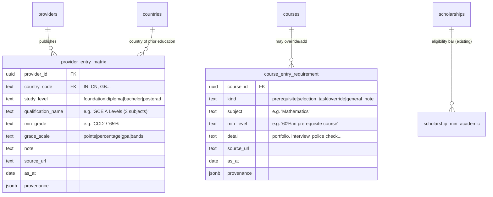
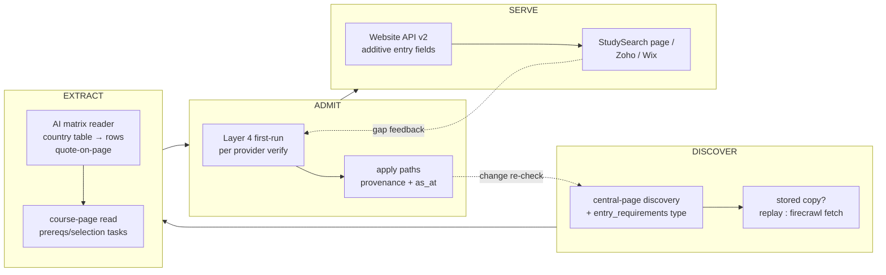

Academic entry requirements — research, canonical model, and website handoff
Draft 1.0 — 25 Oct 2026. Prepared by the Platform Admin's reviewer from provider
websites (RMIT, Unitec, Otago Polytechnic) + official registers. Part B's canonical
design is a PROPOSAL for the data-engineering agent to implement; Part C/D are the
handoff for the website team (StudySearch consumer + Zoho/Wix).

---

A. How universities define academic entry requirements (AU and NZ)

Same shape in both countries, three layers:

1. Provider-level country equivalency matrix — the dominant pattern. The provider
   expresses its academic entry standard in its DOMESTIC benchmark, then publishes a
   country-by-country conversion:
   - AU benchmark: Australian Year 12 / VCE-equivalent percentage (e.g. RMIT's "65%,
     70%, 75%…" bands). RMIT's UK table converts these to A-level points (CDD→BBB).
   - NZ benchmark: NCEA Level 3 + University Entrance (each university sets its own
     conversion; Unitec publishes a country × level table; Otago Polytechnic runs the
     same as a formal procedure document).
   - One page per country (RMIT: /entry-requirements/country-equivalency/),
     or one large table (Unitec). Rows: country → qualification name → minimum grade;
     sometimes separate columns per study level (Certificate/Diploma vs Bachelor).
2. Course-level requirements on each course page — "Entry requirements and
   admissions" section: minimum score band for THIS course, prerequisite subjects
   (e.g. Mathematics for engineering), selection tasks (portfolio, interview), and
   course-specific exclusions. RMIT states these live on the program page, not the
   equivalency page.
3. English requirements — separate axis (already modelled in the platform's
   English fields; visa-level English is INZ/Home Affairs, out of scope here).

Postgraduate: bachelor's assessed against the destination level (NZQCF/AQF level
match + grade average, e.g. "B+ overall" for a UK 2:1 equivalent). Rarely tabulated;
usually free text per course.

Differences AU vs NZ: none structural — both are equivalency matrices + course
prerequisites. Practical differences: AU bands are percentage-based (ATAR/VCE scale);
NZ uses NCEA credit/endorsement language domestically but international rows are the
same grade-averages. NZ PTEs/polytechnics publish the same tables as universities
(Unitec, Otago Polytechnic) — coverage is broader than the 8 universities.

Relationship to campuses: essentially none — entry requirements are provider- or
course-level, not campus-level (delivery location may affect English or foundation
pathways, rarely academic). Relationship to scholarships: scholarships carry
their own minimum-academic bars ("min 75% in Year 12", "GPA 3.0") — separate fields
already in the scholarship schema; a student's eligibility check crosses both, but
the data does not.

B. Canonical DB model (proposal — additive, consumer API additive)

Resolution order for display (per student, per course):
course override → provider matrix (student's country + course's study level) →
generic provider note. If no row: "Contact provider" (never invent).

Ingestion:
1. Extend central-page discovery with an `entry_requirements` page type (equivalency
   index + per-country pages) — stored copies first, Firecrawl only when silent.
2. AI reader per provider: extract the country table(s) into provider_entry_matrix
   rows, quote-on-page per row; the domestic-benchmark band becomes the study_level
   axis. 10–15 rows per provider-country pair at most.
3. Course pages: course_entry_requirement extraction rides the existing course read
   (kind=prerequisite|selection_task|override). General course score bands are the
   AU/NZ standard — store as course-level `min_entry_score` (benchmark scale) + note.
4. Verification: first-run per provider goes to Layer 4 (matrix is high-stakes);
   changes re-verify via the acceptance-report loop. Top 20 providers per country
   first (AU: 8 unis + 12 largest; NZ: 8 unis + top PTEs/polytechnics).

C. What the website/Zoho/Wix side receives and must program

Data (additive Website API v2 fields, frozen-API compliant):
- course payload += `entry: { min_score, min_score_basis, prerequisites: [...],
  selection_tasks: [...], requirements_note }`
- provider payload += `entry_matrix: [{country, study_level, qualification,
  min_grade, scale}]`
- scholarship payload += existing `min_academic` (B4 fills it).

They program:
1. A country selector (student's country of prior education) — store as session/
   profile field; pass as `?edu_country=` to course/provider calls.
2. Course page: render prerequisites + selection tasks; resolve the equivalency row
   from the matrix for the chosen country ("With an Indian HSC at 65% you meet this
   course's 65% band") — pure lookup, no logic beyond resolution order in Part B.
3. Fallback rendering when no row: "Requirements for your qualification aren't
   published — contact the provider" (link to provider contact).
4. Zoho Creator: same API via server-side call (no public key in browser, per the
   existing security boundary); Wix: identical consumption.

D. Toolset involvement diagram

Effort estimate: matrix reader 2 days (pattern is table-like, high AI yield);
course-level extraction rides the existing B1 entry-requirements build; Layer 4
verification queue for the first 40 providers (20 AU + 20 NZ).