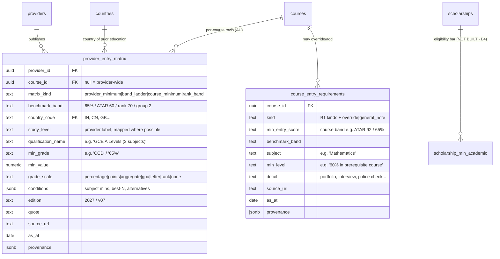
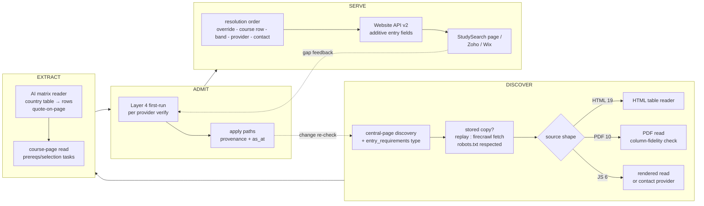

Academic entry requirements — research, canonical model, and website handoff
Draft 1.2 — 2 Nov 2026 (qualification-first, missing-country/provider coverage, postgraduate and Provider source-URL gap design; section F, not yet implemented).
Draft 1.1 — 25 Oct 2026 (corrected against 40 live providers; see ENTRY-REQUIREMENTS-IMPLEMENTATION.md Part 1 — reality wins).
Draft 1.0 — 25 Oct 2026. Prepared by the Platform Admin's reviewer from provider
websites (RMIT, Unitec, Otago Polytechnic) + official registers. Part B's canonical
design is a PROPOSAL for the data-engineering agent to implement; Part C/D are the
handoff for the website team (StudySearch consumer + Zoho/Wix).

---

A. How universities define academic entry requirements (AU and NZ)

Same shape in both countries, three layers. CORRECTED 1.1: the provider-level matrix dominates in NZ (12 of 13
readable NZ matrices) but NOT in the AU Group of Eight, where 5 of 8 publish per-course minimums (UNSW, Sydney, UQ,
Monash, Melbourne) and 2 use band ladders (ANU rank bands, UWA ATAR-equivalent); RMIT, Flinders and UOW also convert
benchmark BANDS, so a course names its band and the band row gives the country minimum. 10 of 40 publish PDF only,
6 only behind JavaScript selectors, 5 have no matrix / course-only / refused fetches.

1. Provider-level country equivalency matrix — the dominant pattern. The provider
   expresses its academic entry standard in its DOMESTIC benchmark, then publishes a
   country-by-country conversion:
   - AU benchmark: Australian Year 12 / VCE-equivalent percentage (e.g. RMIT's "65%,
     70%, 75%…" bands). RMIT's UK table converts these to A-level points (CDD→BBB).
   - NZ benchmark: NCEA Level 3 + University Entrance (each university sets its own
     conversion; Unitec publishes a country × level table; Otago Polytechnic runs the
     same as a formal procedure document).
   - One page per country (RMIT: /entry-requirements/country-equivalency/),
     or one large table (Unitec). Rows: country → qualification name → minimum grade;
     sometimes separate columns per study level (Certificate/Diploma vs Bachelor).
2. Course-level requirements on each course page — "Entry requirements and
   admissions" section: minimum score band for THIS course, prerequisite subjects
   (e.g. Mathematics for engineering), selection tasks (portfolio, interview), and
   course-specific exclusions. RMIT states these live on the program page, not the
   equivalency page.
3. English requirements — separate axis (already modelled in the platform's
   English fields; visa-level English is INZ/Home Affairs, out of scope here).

Postgraduate: bachelor's assessed against the destination level (NZQCF/AQF level
match + grade average, e.g. "B+ overall" for a UK 2:1 equivalent). Rarely tabulated;
usually free text per course.

Differences AU vs NZ: none structural — both are equivalency matrices + course
prerequisites. Practical differences: AU bands are percentage-based (ATAR/VCE scale);
NZ uses NCEA credit/endorsement language domestically but international rows are the
same grade-averages. NZ PTEs/polytechnics publish the same tables as universities
(Unitec, Otago Polytechnic) — coverage is broader than the 8 universities.

Relationship to campuses: essentially none — entry requirements are provider- or
course-level, not campus-level (delivery location may affect English or foundation
pathways, rarely academic). Relationship to scholarships: scholarships carry
their own minimum-academic bars ("min 75% in Year 12", "GPA 3.0") — CORRECTED 1.1: NOT yet a field in the
scholarship schema or the website payload (B4 must add it); a student's eligibility check crosses both, but
the data does not.

B. Canonical DB model (proposal — additive, consumer API additive)

Resolution order for display (per student, per course) — CORRECTED 1.1:
course override → per-course matrix row (course_id, student's country) → band ladder (course's benchmark_band →
provider row for that band + country) → provider minimum (country + study level) → "Contact provider" (never invent).

Ingestion:
1. Extend central-page discovery with an `entry_requirements` page type (equivalency
   index + per-country pages) — stored copies first, Firecrawl only when silent.
2. AI reader per provider: extract the country table(s) into provider_entry_matrix
   rows, quote-on-page per row; the domestic-benchmark band becomes the study_level
   axis. 10–15 rows per provider-country pair at most.
3. Course pages: course_entry_requirement extraction rides the existing course read
   (kind=prerequisite|selection_task|override). General course score bands are the
   AU/NZ standard — store as course-level `min_entry_score` (benchmark scale) + note.
4. Verification: first-run per provider goes to Layer 4 (matrix is high-stakes);
   changes re-verify via the acceptance-report loop. Top 20 providers per country
   first (AU: 8 unis + 12 largest; NZ: 8 unis + top PTEs/polytechnics).

C. What the website/Zoho/Wix side receives and must program

Data (additive Website API v2 fields, frozen-API compliant):
- course payload += `entry: { min_score, min_score_basis, prerequisites: [...],
  selection_tasks: [...], requirements_note }`
- provider payload += `entry_matrix: [{country, study_level, qualification,
  min_grade, scale}]`
- scholarship payload += existing `min_academic` (B4 fills it).

They program:
1. A country selector (student's country of prior education) — store as session/
   profile field; pass as `?edu_country=` to course/provider calls.
2. Course page: render prerequisites + selection tasks; resolve the equivalency row
   from the matrix for the chosen country ("With an Indian HSC at 65% you meet this
   course's 65% band") — pure lookup, no logic beyond resolution order in Part B.
3. Fallback rendering when no row: "Requirements for your qualification aren't
   published — contact the provider" (link to provider contact).
4. Zoho Creator: same API via server-side call (no public key in browser, per the
   existing security boundary); Wix: identical consumption.

D. Toolset involvement diagram

Effort estimate: matrix reader 2 days (pattern is table-like, high AI yield);
course-level extraction rides the existing B1 entry-requirements build; Layer 4
verification queue for the first 40 providers (20 AU + 20 NZ).
---

E. Merge note (25 Oct 2026)

This design EXTENDS, not replaces, the B1 spec in nz-enrichment-brief/2026-10-24-nz-field-admission.md section 5:
course-level rows use B1's table `catalogue.course_entry_requirements` (plural, B1's columns and validation rules),
gaining the kinds override/general_note, min_entry_score, benchmark_band and provenance; the provider matrix is new.
Implementation and build order: ENTRY-REQUIREMENTS-IMPLEMENTATION.md.
Website feed CONFIRMED (Platform Admin 25 Oct 2026 14:50): additive fields on the EXISTING course and provider payloads,
no separate function; the mandate is the explicit frozen-API approval. A matrix row with no minimum renders as "this
qualification is considered case by case" — never "no data", never an automatic pass.

---

## F. Draft 1.2 — 2 November 2026: qualification-first coverage extension (design, not deployed)

**Change authority:** Platform Admin's 2 November assessment/versioning instruction. **Gap register and evidence:** `docs/platform/nz-enrichment-brief/2026-11-02-aer-qualification-coverage-gap-assessment.md` (AER-GAP-01–10). **Status:** revised target design; existing Draft 1.1 and implementation/release decisions remain historical records. The rules in Part B/C above describe the earlier country-based model; this section modifies their proposed future interpretation, not the current deployed behaviour.

### F1. Corrected primary key and scope

Academic equivalency must be resolved against **provider + intended course + study level + qualification identity + applicable country/issuer restrictions + policy edition**, not country alone. An applicant's country of prior education and the curriculum/qualification awarded there are separate facts.

Qualification families:
- **Globally or transnationally used:** International Baccalaureate Diploma, Global Assessment Certificate and applicable GCE A Level pathways; remain selectable without inventing per-country clones, subject to provider-specific published conditions.
- **Country-specific:** Nepal HSC, Swiss Matura and equivalent national credentials, with country-specific provider matrices.
- **Foreign-curriculum credentials offered overseas:** American High School Diploma and A Level variants require issuer/curriculum, accreditation and examination conditions where published; global listing does not guarantee recognition.
- **Prior tertiary study:** Bachelor's, honours, diplomas or other qualifications used for postgraduate admissions, evaluated by course level, discipline, grades/GPA, experience and alternative routes.

A provider rule may be provider-wide, band-based, course-specific, study-level-specific, country-restricted or award-body-specific. The qualification catalogue establishes identity/aliases; **provider recognition and minima remain evidence-backed**, versioned and subject to Layer 4.

### F2. Data model evolution (additive after live schema review)

Retain `catalogue.provider_entry_matrix`, `catalogue.course_entry_requirements`, source/run/evidence provenance and the governed admission lifecycle. Add or reference a canonical qualification identity and aliases only after checking existing ref/catalogue objects. Represent qualification scope independently from ISO country keys; do not use synthetic `GLOBAL` country codes or duplicate the same IB rules under Nepal, Switzerland and every other country. Consider a provider recognition relation or constrained additive fields if needed, with course, study level, issuer, policy edition, source evidence, status and applicability restrictions. Avoid a parallel read/admission pipeline. Preserve existing national rows and their exact grade basis.

### F3. Source discovery, completeness and URL ownership

Extend source classification beyond 'country table' to global qualification pages, national equivalency, programme-specific undergraduate, master's coursework, postgraduate research and pathway sources; include rendered HTML/PDF only under approved source-reading and fidelity rules. **A read URL is not evidence that extraction, Layer 4 admission or consumer publication succeeded.** Reconcile discovered sections, published countries, qualification families, levels/courses, extracted minima, holds, admitted rows and consumer availability with recorded reasons.

For each provider, display **a canonical official AER landing URL plus additional linked first-party sources** in Provider details, reusing `pipeline.entry_matrix_sources` and other verified source objects as the source of truth. Include type, country/global scope, course/study level, evidence, status, edition, last read and hold reason. A provider-level primary URL may be a verified reference, not an independent duplicated source inventory. Expose missing/held sections to Admin instead of silently treating them as absent.

### F4. Resolver and presentation

Preserve the published resolution precedence: active course override → applicable per-course requirement → course-declared band joined to matching matrix → applicable provider minimum → case-by-case/contact-provider. Within each rule match **qualification identity** and any country/awarding-body/edition restrictions; never pick the lowest score from competing routes without evidence. Do not equate ATAR with percent or assess applicant eligibility.

**Counsellor UI:** choose provider, study level and course; then qualification (searchable grouped global/transnational and national), with **conditional country** selection for national rules. For a global qualification, applicant country can remain profile context but must not block a valid global rule. Country options for verified national rules are derived from the provider's **active** records, not all `ref.countries`. Separate master's coursework and research pathways from Year 12 band tables. Show the qualification equivalency table if approved even where a course-specific required band cannot yet be justified, with an explicit unresolved course-minimum note.

**Admin UI:** additionally show discovered countries, held/failed/unparsed sources, proposed rows and supported-versus-missing qualifications. Do not infer complete provider coverage from `source.status='read'`.

**Consumer API:** maintain existing `website_v2_course`/`website_v2_provider` and `edu_country` compatibility. New qualification filter arguments or payload keys are a separately governed, additive, paste-reviewed change, with regression/baseline and developer-guide handover. No design-only claim of deployed counsellor UI.

### F5. Coverage objective and governance

Target every **eligible international-enrolling AU/NZ catalogue provider**, not only the 40-provider design sample. First reconcile the eligible denominator and source outcomes; expand through approved waves, settings/budget limits, robots rules, stored-first reads and Layer 4 verification. The 28 October restricted provider plan (which excluded RMIT matrix expansion) and 30 October ingestion hold must be explicitly reconciled/superseded before conflicting production actions; this versioned document does not itself lift them.

### F6. Minimum acceptance and rollout gates

- Nepal + IB and Switzerland + IB resolve through one evidenced RMIT global IB policy if admitted; Nepal + HSC resolves through a Nepal-specific rule.
- Nepal + GCE A Levels and US-curriculum diploma expose issuer/assessment caveats; qualification offering in a country is **not** automatic RMIT acceptance.
- UK country read reconciles all 31 published minima or records precise held reasons; IB and GAC pages no longer fail solely for lacking a country heading.
- Master's coursework/research pathways surface course-specific prior degree, discipline, GPA and experience terms where supported; otherwise explicit fallback.
- No inactive/proposed/held data leaks to the consumer; per-provider source URLs and distinct discovery/extraction/admission/consumer completeness measures are available to Admin.
- All eligible AU/NZ providers receive source-discovery outcomes, including not-published/refused cases; no invented worldwide requirements.
- Tests cover global versus national pathways, old country-only API compatibility, Layer 4, editions, quote/scale verification and non-inference. Actual production work requires separate decisions and verification.

**Known implementation gap:** this section is a design target. Existing reader failures, RMIT missing GB/CH rows, predominantly proposed course-entry rows and provider-source UI omissions are not claimed fixed.
